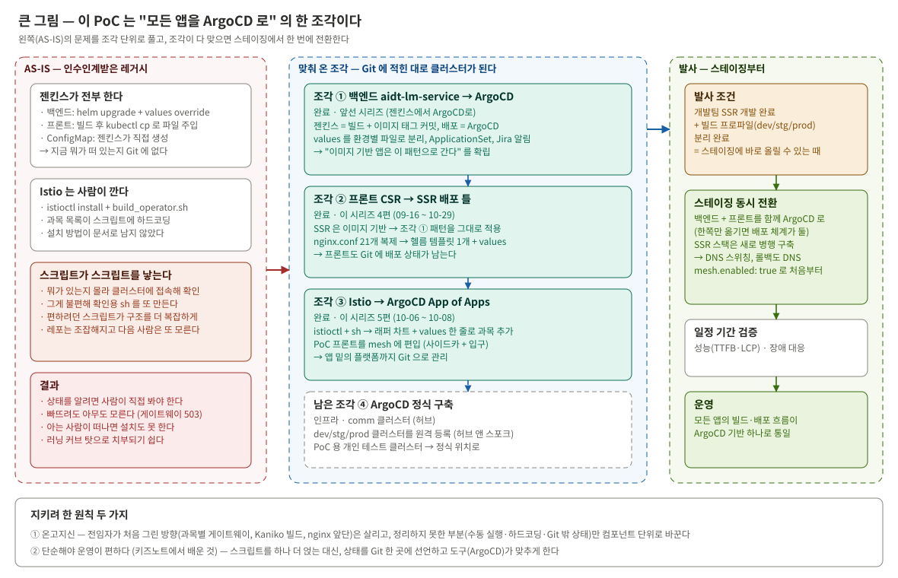
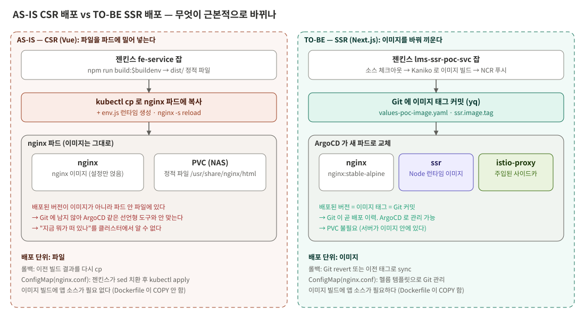
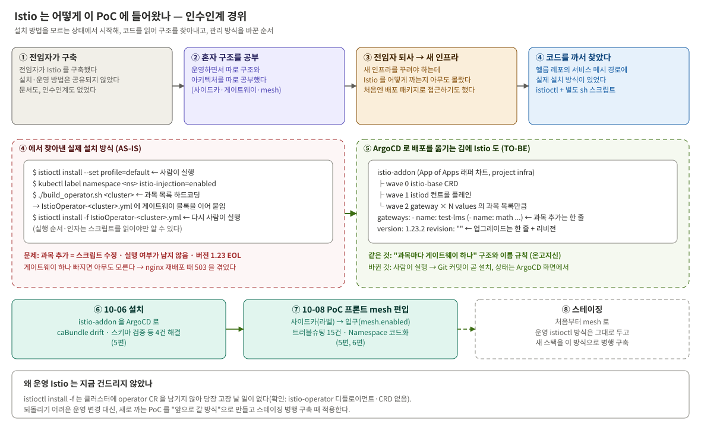
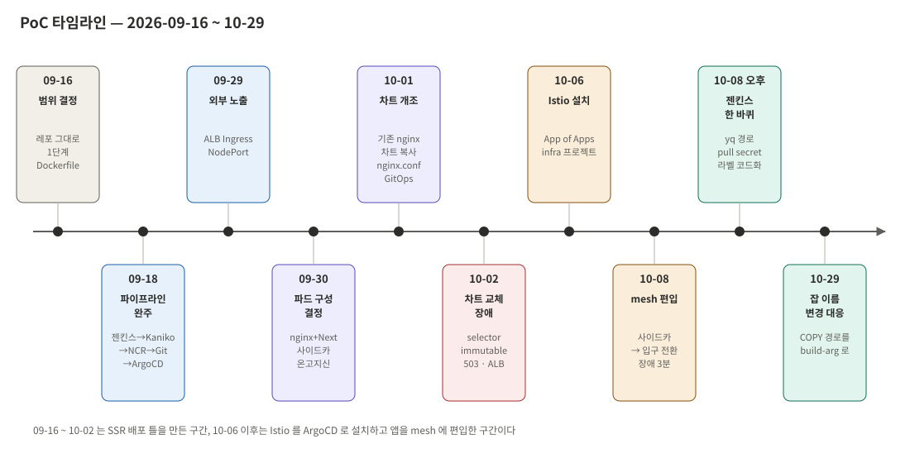
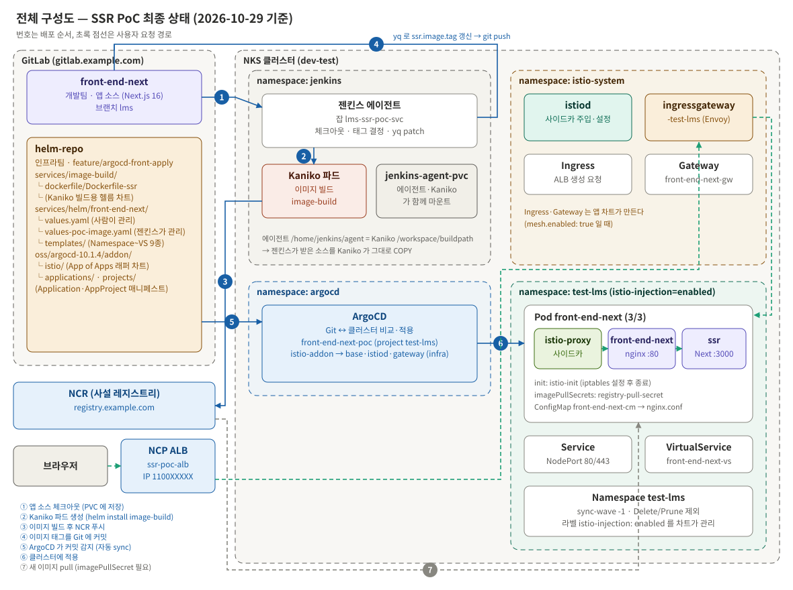



## 시리즈를 시작하며

앞선 시리즈 [배포 자동화 리팩토링, 젠킨스에서 ArgoCD로](/posts/argocd-migration-1/)에서는 백엔드 서비스 하나를
젠킨스 직배포에서 ArgoCD 기반 GitOps 로 옮긴 과정을 다뤘다. 그 시리즈 [마지막 편](/posts/argocd-migration-5/)에서 "프론트엔드는 아직이다"라고
적어 두었다. 프론트는 빌드·배포 방식 자체가 달라서 같은 구조를 그대로 가져다 쓸 수 없었기 때문이다. 그리고
"프론트엔드 전환이든 운영 확대든 의미 있는 진전이 생기면, 그때 다시 이어서 기록을 남기겠다"고 끝맺었다.

이번 시리즈는 그 숙제를 푼 기록이다. 마침 개발팀이 프론트를 CSR(Vue)에서 SSR(React/Next.js)로 바꾸기로 했고,
SSR 은 백엔드처럼 **이미지로 배포하는 앱**이라 앞선 시리즈의 패턴을 그대로 쓸 수 있게 됐다. 그 앱을 띄울
**빌드·배포 틀**을 PoC 로 만들었고, 같은 기간에 그 밑에 깔린 **Istio 설치까지 ArgoCD App of Apps 로 옮겨**
앱을 서비스 메시에 편입했다.

| 편 | 내용 |
|---|---|
| **(1) 왜 프론트와 Istio인가** (이 글) | 배경, 개발팀과 나눈 이야기, Istio 를 함께 옮긴 이유, 목표와 원칙 |
| [(2) 도입 전후 한눈에](/posts/ssr-istio-gitops-2/) | ArgoCD 도입 전과 후의 아키텍처·플로우·구성 비교 |
| [(3) 알고 가야 할 개념과 전제](/posts/ssr-istio-gitops-3/) | SSR·Kaniko·GitOps·헬름 문법·Istio 를 이번에 필요한 만큼, NKS 제약 |
| [(4) SSR 배포 틀 만들기](/posts/ssr-istio-gitops-4/) | Dockerfile, 젠킨스, ALB, 파드 구성, nginx.conf GitOps |
| [(5) Istio를 App of Apps로, 그리고 mesh 편입](/posts/ssr-istio-gitops-5/) | 래퍼 차트, 사이드카 → 입구 전환, 네임스페이스 코드화 |
| [(6) 트러블슈팅 30건에서 배운 것](/posts/ssr-istio-gitops-6/) | 원리를 알아야 하는 사례와 반복된 패턴 |
| [(7) 결과와 남은 과제](/posts/ssr-istio-gitops-7/) | 검증한 것과 못 한 것, 대가, 스테이징 계획, 회고 |

---

## 퍼즐의 한 조각

이 작업은 단독으로 보면 "프론트 배포 방식 하나 바꾼 것"이지만, 앞선 시리즈와 합치면 **모든 애플리케이션의
빌드·배포 흐름을 ArgoCD 기반 하나로 바꾸는 변화**의 한 조각이다.


_AS-IS 의 문제를 조각 단위로 풀고, 조각이 다 맞으면 스테이징에서 한 번에 전환한다_

| 조각 | 내용 | 상태 |
|---|---|---|
| ① 백엔드 → ArgoCD | 젠킨스는 빌드 + 이미지 태그 커밋, 배포는 ArgoCD | 완료 ([앞선 시리즈 1~5편](/posts/argocd-migration-1/)) |
| ② 프론트 CSR → SSR 배포 틀 | SSR 은 이미지 기반이라 ①의 패턴을 그대로 쓴다 | 완료 (이 시리즈 4편) |
| ③ Istio → ArgoCD App of Apps | 앱 밑의 플랫폼까지 Git 으로 | 완료 (이 시리즈 5편) |
| ④ ArgoCD 정식 구축 | 툴 클러스터에 허브로 구축, 각 환경을 원격 등록 | 남음 |

조각 ②와 ③이 맞춰지면서 남은 건 **발사 조건**뿐이다. 개발팀의 SSR 개발과 환경별 빌드 분리가 끝나 스테이징에
바로 올릴 수 있는 순간, 스테이징부터 백엔드와 프론트를 **동시에** ArgoCD 로 전환한다. 백엔드만 먼저 옮기지 않는
이유는 단순하다. 한쪽만 옮기면 젠킨스 직배포와 ArgoCD 배포가 공존해 배포 체계가 둘이 되고, ArgoCD 를 실질적으로
운영하는 사람이 한 명인 팀이 감당하기 어렵다.

---

## 출발점 — 인수인계받은 레거시

이 작업을 하고 싶었던 진짜 이유는 기술 목록보다 여기에 있다.

지금 인프라는 앞서 구축한 사람들의 것을 **무엇이 어떻게 되어 있는지 모르는 상태로** 이어받은 것이다. 문서는 거의
없었고, 구조는 코드와 클러스터를 직접 열어 봐야 알 수 있었다. 그러다 보니 이런 순환이 반복됐다.

```
무엇이 떠 있는지 모른다
   → 클러스터에 하나하나 접속해서 확인한다
   → 번거로우니 확인용 sh 스크립트를 만든다
   → 편하려고 만든 스크립트가 늘어나 구조가 더 복잡해진다
   → 레포는 조잡해지고, 다음 사람은 또 모른다
```

스크립트 하나하나는 그 순간엔 합리적이었다. 문제는 **스크립트가 상태를 들고 있지 않다는 것**이다. 실행 결과는
클러스터에만 남고, 무엇을 언제 실행했는지는 사람의 기억에만 남는다.

| 겪은 일 | 원인 |
|---|---|
| 지금 어떤 프론트 버전이 떠 있는지 Git 으로 알 수 없다 | 젠킨스가 빌드 결과 파일을 파드에 `kubectl cp` 로 넣는다 |
| 웹서버 재배포 때 503 | 과목별 Istio 게이트웨이가 생성되지 않았는데 아무도 몰랐다 |
| nginx.conf 가 21개로 불어났다 | 치환 스크립트가 한 단어만 바꿀 수 있어 파일을 통째로 복제했다 |
| Istio 를 새로 깔 수 없었다 | 설치 방법이 스크립트 안에만 있었고, 아는 사람이 떠났다 |

이걸 "팀 러닝 커브 탓"으로 치부할 수도 있었다. 그래도 그렇게 두고 싶지 않았다. 키즈노트에서 일할 때 배운 게 있다.
**복잡한 시스템은 단순하게 만들어야 운영이 편하다.** 문제가 생길 때마다 스크립트를 한 겹 더 얹으면 당장은
편하지만, 운영해야 할 대상이 늘어난다. 반대로 상태를 한 곳(Git)에 선언하고 도구(ArgoCD)가 그 상태를 맞추게
하면, "지금 뭐가 떠 있나"는 클러스터를 열지 않고 답할 수 있다.

그렇다고 **처음 방향을 버리고 싶지도 않았다.** 전임자가 그린 큰 방향 — 과목마다 게이트웨이를 두는 mesh 구조,
Kaniko 이미지 빌드, nginx 앞단 — 은 지금 봐도 타당했다. 아쉬운 건 그것이 정리되지 못하고 수동 실행·하드코딩·Git
밖 상태로 남은 부분이었다.

> **처음 그린 방향은 살리고, 정리되지 못한 부분을 제대로 정리한다.**

---

## 지금 프론트는 어떻게 배포되나

LMS 프론트는 Vue 로 만든 CSR 앱이다. 배포는 이렇게 이뤄진다.

```
젠킨스 프론트 잡
  ① npm run build:$buildenv          ← 결과물은 정적 파일(dist/)
  ② kubectl cp 로 nginx 파드에 복사   ← 이미지가 아니라 "파일"을 밀어 넣는다
  ③ env.js 를 런타임에 만들어 넣고 nginx -s reload
```


_CSR 은 파일을 파드에 주입하고, SSR 은 이미지를 배포한다_

| 문제 | 왜 문제인가 |
|---|---|
| 배포된 버전이 Git 에 없다 | "지금 뭐가 떠 있나"를 클러스터를 열지 않고는 확인할 방법이 없다 |
| ArgoCD 와 맞지 않는다 | ArgoCD 는 "Git 에 적힌 상태 = 클러스터 상태"를 맞추는 도구다. 파일을 파드에 직접 넣으면 Git 에 흔적이 남지 않는다 |
| nginx.conf 가 21개 | 네임스페이스 한 단어만 치환할 수 있어 버킷·CDN 같은 나머지 환경값 때문에 파일을 통째로 복제했다 |
| ConfigMap 이 ArgoCD 밖에 있다 | 젠킨스가 `kubectl create configmap --dry-run | kubectl apply` 로 직접 만든다 |

[앞선 시리즈 5편](/posts/argocd-migration-5/)에서 프론트를 보류한 이유가 이 표다. 그리고 CSR 배포를 고치는 데 투자하지 않은 이유는, 어차피
SSR 로 대체될 대상이었기 때문이다.

---

## 왜 SSR 인가 — 개발팀과 나눈 이야기

전환은 인프라가 아니라 **개발팀의 요구**에서 시작됐다. 인프라는 그 앱을 띄울 자리를 만드는 역할이다.

### 개발팀이 SSR 로 가려는 이유

| 항목 | 내용 |
|---|---|
| 기술 스택 | Vue → React 전환. SSR 도입은 그 일환이다 |
| 도입 목적 | ① 초기 로딩 성능 개선 ② 장래 독립 로그인 시 SEO 대비 ③ 프론트 기술 스택 재편 |
| 적용 순서 | 팝업 등 저사용 화면 → 메인 레이아웃 → 학습창 (문제가 생겨도 영향이 작은 곳부터) |
| 전환 방식 | 기존 Vue 앱을 React 앱으로 **교체**. 경로를 나눠 두 앱을 섞어 쓰는 구조가 아니다 |

개발팀이 직접 짚은 유의점도 있었다. **SSR 이 항상 빠르지는 않다.** SSR 서버가 API 를 부르는 단계가 하나 더
생기고 서버 부하가 늘면 오히려 느려질 수 있다. 그래서 성능은 실측(TTFB, FCP, LCP 등)으로 판단하기로 했다.

### 개발팀 레포를 그대로 쓴 이유

처음엔 "설계 → 리팩토링 → ArgoCD 설정 → PoC" 순서로 계획했다. 이러면 리팩토링을 다 끝낸 뒤에야 인프라를
검증하게 되어 위험이 크다. 그래서 PoC 를 앞으로 당겼고, 마침 개발팀이 이미 SSR 용 레포(Next.js 16 + pnpm)를
만들어 자체 PoC 를 하고 있어서 **그 레포를 그대로 쓰기로 했다.** 가짜 샘플 앱보다 실제로 갈 앱으로 검증해야
결과를 그대로 이어 쓸 수 있다.

레포는 아직 프로젝트 생성 초기 단계였다. 환경별 빌드 스크립트도, 환경별 `.env` 도, 컨테이너용 `standalone`
설정도 없었다. 이걸 기다리지 않고 **"지금 레포 그대로, 가장 단순하게 이미지화해 띄우는 것"으로 범위를 좁혔다.**
인프라 틀이 먼저 있어야 개발팀이 검증을 시작할 수 있기 때문이다.

### 외부 노출을 먼저 연 이유

남은 검증 중 "SSR 파드에서 백엔드로 가는 통신"은 로그인 흐름을 타야 확인되는데, **개발팀에는 클러스터 권한이
없다.** 그래서 "라우팅 전략 결정 → 외부 노출" 순서를 "노출 → 개발팀 검증 → 그 결과로 전략 논의"로 뒤집었다.
개발팀이 먼저 만져 봐야 판단할 재료가 생기기 때문이다.

실제로 접속해 본 개발팀의 피드백은 **"환경별 빌드가 없어 백엔드 연동까지는 제대로 된 검증이 어렵다"**였다.
API 주소가 빌드할 때 번들에 박히는 구조라 환경별 빌드가 없으면 실제 백엔드에 붙일 수 없다. 이때부터 개발팀의
빌드 분리 작업이 통합 검증의 선행 조건이 됐고, 인프라는 그동안 배포 틀 자체를 다듬었다.

### nginx 를 남긴 이유

파드 구성(nginx 를 남길지, Next.js 단독으로 갈지)이 개발팀 계획에 달려 있어 질문을 하나로 좁혀 물었다.

> "nginx.conf 가 하던 일들을 Next.js 쪽으로 가져갈 계획인지, 아니면 nginx 를 앞에 두는 걸 전제하고 있는지."

답은 두 가지였다. **"nginx 가 앞에 있는 방향이 좋을 것 같다"**, 그리고 **"백엔드 때문에 아직은 프록시가
필요하다"**. 브라우저에서 출발하는 요청은 여전히 nginx 의 API 프록시를 타야 한다. 이 답으로 nginx + Next.js 를
한 파드에 두는 구조로 정했다(4편).

---

## 왜 Istio 설치 방식도 함께 바꿨나

기존 운영 환경은 Istio 서비스 메시 안에서 돈다. SSR 도 운영에 들어가려면 같은 mesh 에 들어가야 하는데, PoC
환경에는 Istio 가 없었다. 깔아야 했고, 그러려면 먼저 **어떻게 깔려 있는지**를 알아야 했다. 이 부분은 경위가 길다.


_설치 방법을 모르는 상태에서 시작해, 코드를 읽어 구조를 찾아내고, 관리 방식을 바꾼 순서_

Istio 는 전임자가 구축했는데 설치·운영 방법이 문서로 남지 않았다. 운영하면서 사이드카가 어떻게 붙는지, 게이트웨이가
왜 과목마다 따로 있는지 같은 구조를 따로 공부해 두었지만, 전임자가 떠난 뒤 새 인프라를 꾸려야 할 때 **Istio 를
어떻게 설치하는지 아는 사람이 없었다.** 결국 코드를 직접 열어 헬름 레포의 서비스 메시 경로에서 실제 설치 방식을
찾아냈다. `istioctl` 로 설치하되 별도 sh 스크립트를 거쳐야 하는 구조였다.

```bash
istioctl install --set profile=default            # 사람이 직접 실행
kubectl label namespace <ns> istio-injection=enabled
./build_operator.sh <cluster>                      # 스크립트 안에 하드코딩된 클러스터별 과목 목록을 돌며
                                                   # IstioOperator yaml 에 게이트웨이 블록을 이어 붙인다
istioctl install -f IstioOperator-<cluster>.yml   # 다시 사람이 적용
```

| 문제 | 내용 |
|---|---|
| 방법이 스크립트 안에만 있다 | 순서와 인자를 알려면 스크립트를 읽어야 한다. 아는 사람이 떠나자 설치를 못 했다 |
| 과목 목록이 스크립트에 박혀 있다 | 클러스터 13개, 많은 곳은 과목 네임스페이스가 20개를 넘는다. 과목이 늘면 스크립트를 고쳐야 한다 |
| 사람이 실행한다 | 게이트웨이가 빠져도 아무도 모른다. 실제로 503 을 겪었다 |
| 버전이 EOL 이다 | 운영 Istio 1.23 은 2025년 3월에 지원이 끝났다. 올릴 때 설치 방식을 다시 정해야 한다 |
| GitOps 밖에 있다 | 앱은 ArgoCD 로 가는데 그 밑의 Istio 만 수동이면, 위의 순환이 Istio 에서 반복된다 |

그래서 **배포를 ArgoCD 로 관리하기로 한 김에 Istio 도 자동으로 관리하기로 했다.** "과목마다 게이트웨이 하나"라는
구조와 이름 규칙은 그대로 두고, 관리 방식만 Git 으로 옮겼다. 이렇게 깐 Istio 를 PoC 프론트에 실제로 연결해 mesh
편입까지 확인해야 틀이 완성됐다고 볼 수 있어서, SSR PoC 와 하나로 묶어 진행했다.

운영 Istio 는 지금 건드리지 않았다. `istioctl install -f` 는 파일을 입력으로만 쓰고 클러스터에 CR 을 남기지 않아,
Istio 가 deprecated 한 in-cluster operator 와 무관하다. 당장 고장 날 일이 없으니 되돌리기 어려운 운영 변경 대신
**새로 까는 PoC 쪽을 앞으로 갈 방식으로 만들고, 스테이징을 병행 구축할 때 적용한다.**

---

## 전환 방식 — 교체가 아니라 병행 후 스위칭

"점진적 전환"이라는 말이 두 가지 뜻으로 섞여 쓰였다. 층위를 나눠 두었다.

- **인프라(환경 단위)** — 운영 중인 CSR 은 그대로 두고, 별도 환경에서 SSR 스택을 먼저 검증한 뒤 스테이징 → 운영
  순으로 올린다. 스테이징에서는 새 스택을 나란히 구축하고 DNS 로 트래픽을 넘긴다
- **앱(기능 단위)** — 개발팀이 새 React 앱에 팝업 → 메인 레이아웃 → 학습창 순으로 기능을 붙여 가며 검증한다

**이번 PoC 의 목적은 앱 쪽 검증이 시작될 자리를 만드는 것이다.** "SSR 이 뜨는가"가 아니라 "**기존 인프라 방식으로
SSR 을 배포할 수 있는가**"를 확인한다.


_9월 16일부터 10월 29일까지_

---

## 목표와 원칙

| # | 목표 | 완료 기준 |
|---|---|---|
| 1 | SSR 앱을 이미지로 빌드해 K8s 에 띄운다 | 파드가 뜨고 브라우저에서 열린다 |
| 2 | 배포를 GitOps 로 한다 | 젠킨스는 이미지 빌드 + 태그 커밋까지, 배포는 ArgoCD |
| 3 | 기존 nginx 의 역할을 보존한다 | 검증된 nginx.conf 설정이 SSR 앞단에서 그대로 동작 |
| 4 | nginx.conf 를 Git 으로 가져온다 | ConfigMap 이 헬름 템플릿으로 렌더링되어 ArgoCD 가 관리 |
| 5 | Istio 를 ArgoCD 로 설치한다 | values 한 줄로 과목 추가·버전 변경 |
| 6 | 앱을 mesh 에 편입한다 | 사이드카 주입 + 외부 입구를 ingressgateway 로 |

판단할 때 지킨 원칙은 두 가지다.

> **온고지신** — 명확히 더 나은 대안이 없다면, 검증된 기존 시스템을 기반으로 바뀌어야 할 부분만 컴포넌트 단위로 바꾼다.

Kaniko 빌드는 기존 빌드 차트로, Ingress 는 기존 CSR 템플릿의 어노테이션 체계로, 헬름 차트는 기존 nginx 차트를
복사해 개조했다. 기준은 "기존 것이니까 둔다"가 아니라 **"바꿀 만한 이유가 있는가"**였다. 이유가 있는 것 — 파드에
파일을 넣는 방식, 젠킨스의 ConfigMap 생성, istioctl 수동 실행 — 은 바꿨다.

> **단순해야 운영이 편하다** — 문제가 생길 때마다 스크립트를 한 겹 더 얹지 않는다. 상태는 Git 한 곳에 선언하고, 맞추는 일은 도구에 맡긴다.


_최종 구성. 번호는 배포 순서, 초록 점선은 사용자 요청 경로_

---

## 이 시리즈를 읽을 때 알아둘 것

- **PoC 환경 기준이다.** 운영 CSR 과 분리된 개발 클러스터의 별도 네임스페이스에서 검증했다. 스테이징·운영은 아직이다
- **백엔드 연동은 검증하지 못했다.** 개발팀의 환경별 빌드가 끝나야 의미 있는 검증이 된다
- **성능은 아직 재지 않았다.** "SSR 로 바꾸면 좋아진다"는 이 시리즈가 증명하는 내용이 아니다
- **실수와 정정을 지우지 않았다.** 장애도 두 번 냈다. 판단 근거의 신뢰도는 거기서 나온다고 생각한다

다음 편에서는 본격적인 과정에 들어가기 전에, ArgoCD 도입 전과 후의 구조를 나란히 놓고 무엇이 어떻게 바뀌는지를
먼저 한눈에 본다.

---

다음: [(2) 도입 전후 한눈에](/posts/ssr-istio-gitops-2/)

*(회사·인프라 관련 실명, 클러스터 식별자, 내부 호스트 주소, 레포·시크릿 이름 등은 전부 임의로 재구성해 게시했다.)*


