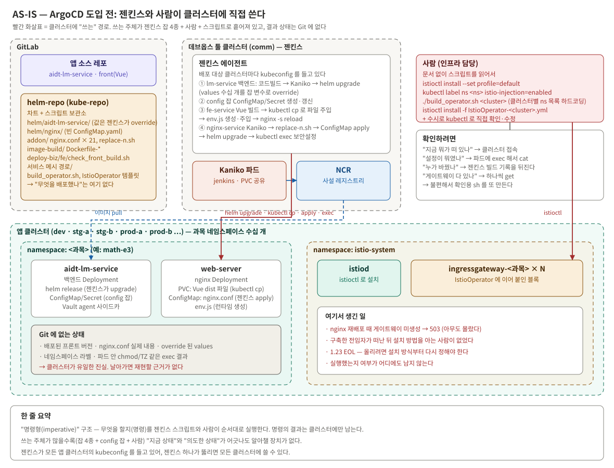
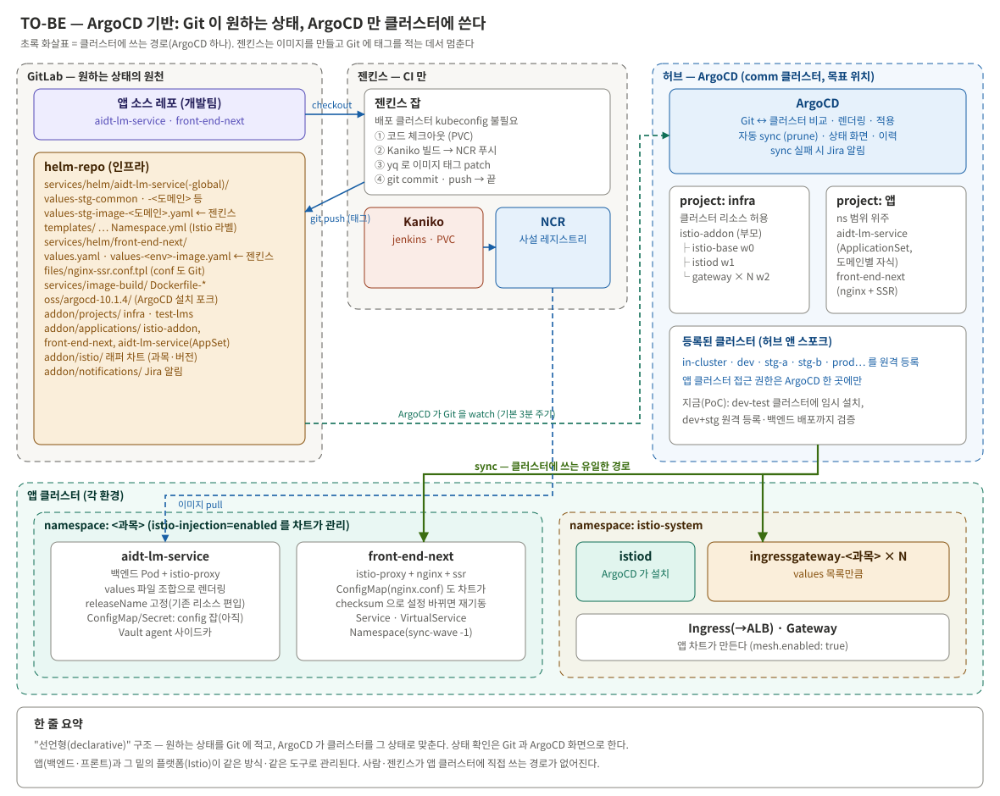
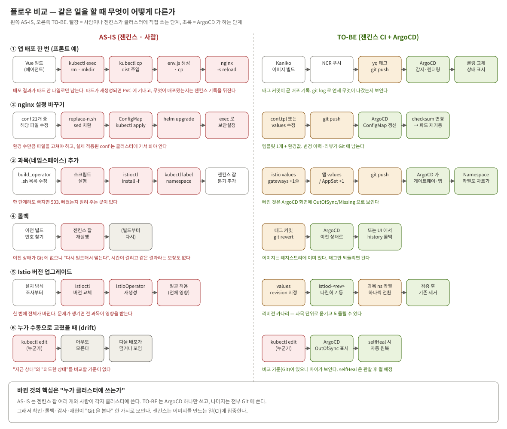



본격적인 과정에 들어가기 전에, **ArgoCD 를 도입하기 전의 빌드·배포 구조**와 **ArgoCD 기반으로 Istio 와 모든
애플리케이션이 빌드·배포되는 구조**를 나란히 놓고 본다. 백엔드는 [앞선 시리즈](/posts/argocd-migration-1/)에서,
프론트와 Istio 는 이 시리즈에서 옮겼다. 둘을 합친 그림이다.

TO-BE 는 **목표 구조**다. 그중 PoC 로 검증한 부분과 아직 목표인 부분은 이 글 끝에서 나눠 적었다.

---

## 한 문장으로

> **"젠킨스와 사람이 클러스터에 직접 쓰던 구조"에서 "Git 에 원하는 상태를 적고, ArgoCD 만 클러스터에 쓰는 구조"로 바뀌었다.**

나머지는 전부 이 한 가지 변화에서 따라 나온다.

| | AS-IS | TO-BE |
|---|---|---|
| 방식 | 명령형 — 무엇을 **할지**를 순서대로 실행한다 | 선언형 — 어떤 **상태여야 하는지**를 적는다 |
| 클러스터에 쓰는 주체 | 젠킨스 잡 여러 개 + 설정 잡 + 사람 | ArgoCD 하나 |
| 진실의 원천 | 클러스터 (Git 에는 재료만 있다) | Git |
| "지금 뭐가 떠 있나" | 클러스터에 접속해 본다 | Git 과 ArgoCD 화면을 본다 |

---

## AS-IS — ArgoCD 도입 전


_빨간 화살표가 클러스터에 "쓰는" 경로다. 쓰는 주체가 흩어져 있고, 결과 상태는 Git 에 없다_

### 앱별로 어떻게 배포됐나

**백엔드** — 젠킨스가 코드 빌드 → Kaniko 이미지 빌드 → `helm upgrade --install` 까지 했다. 차트의 `values.yaml` 은
껍데기에 가깝고, 실제 값(서비스 메시 설정, Vault 연동 여부, replicas, probe 지연 등)은 **젠킨스 스크립트 안의
변수**였다. ConfigMap·Secret 은 별도 설정 잡이 만들었다. 이 값들을 하나씩 추적해 values 파일로 옮긴 과정은
[앞선 시리즈 3편](/posts/argocd-migration-3/)에 있다.

**프론트(CSR)** — 이미지가 아니라 **파일**을 배포했다. 실제 잡의 핵심 명령은 이랬다.

```groovy
// 빌드 결과를 파드 안으로 직접 밀어 넣는다
kubectl exec -it $pod -n $namespace -- rm -rf /var/www/app/frontend
kubectl cp $cache_path/$commit/target/. $pod:/var/www/app/frontend/ -n $namespace

// 환경값은 런타임에 env.js 로 만들어 다시 cp
echo "window.__LM_DOMAIN__ = \"$VITE_LM_DOMAIN\";" >> /tmp/env.js
kubectl cp /tmp/env.js $pod:/var/www/app/frontend/env.js -n $namespace

// 마지막으로 nginx 재시작
kubectl exec $pod -n $namespace -- nginx -s reload
```

배포 결과는 **파드 안의 파일**로만 남는다. 무엇이 배포됐는지는 젠킨스 빌드 기록과 파드 안 `env.js` 를 봐야 안다.

**웹서버(nginx)** — 이미지는 Kaniko 로 만들었지만, 설정은 스크립트가 치환해 젠킨스가 직접 ConfigMap 을 만들었다.

```groovy
sh replace-n.sh $namespace $buildcluster        // 네임스페이스 한 단어만 sed 치환
kubectl create configmap $name-cm --from-file=.../addon/$nginx_config_file \
  -o yaml --dry-run=client | kubectl apply -f -
helm upgrade --install $name services/helm/nginx -f ...-override-values.yml
// 배포 후 파드에 들어가 보안 설정을 손으로 적용
kubectl exec ${pod} -- sh -c 'chmod 400 /etc/shadow && ln -s /usr/share/zoneinfo/Asia/Seoul /etc/localtime'
```

치환이 한 단어뿐이라 conf 파일이 환경 수만큼(21개) 복제됐고, 이미지에 들어가야 할 설정을 배포 후 `exec` 로 넣어
파드가 재생성되면 사라졌다.

**Istio** — 사람이 스크립트를 읽어 순서대로 실행했다(1편). 클러스터 13개의 과목 목록이 스크립트에 하드코딩돼
있었다. 과목이 하나 늘면 목록 수정 → 스크립트 실행 → istioctl 재적용 → 네임스페이스 라벨 → 젠킨스 잡 분기 추가를
해야 했고, **한 단계라도 빠지면 503 인데 빠졌다고 알려 주는 곳이 없었다.**

### AS-IS 의 문제

| 문제 | 어디서 드러났나 |
|---|---|
| 상태가 Git 에 없다 | 배포 버전·실제 conf·override 값·라벨·exec 결과가 클러스터에만 있다 |
| 쓰는 주체가 많다 | 잡 여러 개 + 설정 잡 + 사람. 서로의 변경을 모른다 |
| 확인하려면 접속해야 한다 | 그래서 확인용 sh 를 또 만든다 |
| 롤백 = 재빌드 | 이전 상태가 Git 에 없어 "다시 빌드해서 덮는다" |
| 젠킨스가 모든 클러스터 권한을 가진다 | 젠킨스 하나가 뚫리면 모든 앱 클러스터에 쓸 수 있다 |
| 사람에게 의존한다 | Istio 설치 방법을 아는 사람이 떠나자 설치를 못 했다 |

---

## TO-BE — ArgoCD 기반


_초록 화살표(sync)가 클러스터에 쓰는 유일한 경로다. 젠킨스는 이미지를 만들고 Git 에 태그를 적는 데서 멈춘다_

| 구성 요소 | 하는 일 | AS-IS 와 비교 |
|---|---|---|
| 인프라 레포 | 차트 + **환경별 values 파일** + ArgoCD 설정 + Istio 래퍼 차트 | 스크립트가 빠지고 "원하는 상태"가 들어왔다 |
| 젠킨스 | 체크아웃 → Kaniko → 레지스트리 → **이미지 태그를 Git 에 커밋**하고 끝 | 배포 단계가 없어졌다. 앱 클러스터 kubeconfig 가 필요 없다 |
| Kaniko·레지스트리 | 그대로 | 같다 |
| ArgoCD | Git 을 보고 렌더링해 클러스터에 적용. 상태 화면·이력·알림 | **새로 생긴 유일한 "쓰는 주체"** |
| AppProject | `infra`(Istio, 클러스터 리소스 허용) / 앱용(네임스페이스 범위) | 권한 경계가 코드로 생겼다 |

| 대상 | 젠킨스가 하는 일 | Git 에 있는 것 | ArgoCD 가 하는 일 |
|---|---|---|---|
| **백엔드** | 빌드 → 도메인별 이미지 태그 파일 커밋 | 공통 / 도메인 / 이미지 태그 3단 values, Namespace | ApplicationSet 이 도메인별 Application 을 만들어 sync |
| **프론트(SSR)** | Kaniko → 이미지 태그 파일 커밋 | values, nginx.conf 템플릿, Namespace·Gateway·VS 템플릿 | nginx + Next.js 파드, ConfigMap, Service, Ingress, Gateway, VS 를 한 번에 맞춘다 |
| **nginx 설정** | (없어졌다) | 템플릿 1개 + values | ConfigMap 을 차트가 만든다. 설정이 바뀌면 파드 재시작까지 |
| **Istio** | — | `version`·`revision`·`gateways` 목록 | base → istiod → 과목별 게이트웨이 순으로 설치 |
| **네임스페이스·라벨** | — | 각 앱 차트의 `Namespace.yml` | 먼저 만들고 Istio 주입 라벨까지 관리. 삭제는 막는다 |

### 그대로 둔 것

전부 갈아엎지 않았다. **바꿀 이유가 있는 것만 바꿨다.**

| 그대로 | 이유 |
|---|---|
| Kaniko + 기존 빌드 차트 + PVC 공유 | 이미 이미지 기반으로 잘 돌고 있었다 |
| 이미지 태그 규칙 `<시각>-<커밋해시>` | 같은 커밋을 다시 빌드해도 태그가 겹치지 않아 ArgoCD 가 변경을 감지한다 |
| 헬름 차트 구조 | 기존 차트를 복사해 개조. 어노테이션 체계 유지 |
| nginx 앞단 | 개발팀 답변과 운영에서 다듬어진 conf |
| 과목마다 게이트웨이 하나, 이름 규칙 | 전임자가 그린 mesh 구조. 관리 방식만 Git 으로 |
| 젠킨스 | 없애지 않았다. 역할을 CI 로 좁혔다 |

---

## 같은 일을 할 때 무엇이 다른가


_빨강은 사람이나 젠킨스가 클러스터에 직접 쓰는 단계, 초록은 ArgoCD 가 하는 단계_

| 상황 | AS-IS | TO-BE | 나아진 것 |
|---|---|---|---|
| 앱 배포 | 젠킨스가 cp·reload 또는 helm upgrade | 젠킨스가 태그 커밋 → ArgoCD sync | 태그 커밋이 곧 배포 기록 |
| nginx 설정 변경 | 21개 중 해당 파일 수정 → 잡 재실행 | 템플릿 또는 values 수정 → push | 이력·리뷰가 Git 에 |
| 과목 추가 | 스크립트 → istioctl → 라벨 → 잡 분기 | Istio values +1줄, 앱 values +1 → push | 빠지면 ArgoCD 에 Missing 으로 보인다 |
| 롤백 | 이전 빌드 찾아 재빌드 | 태그 커밋 revert 또는 ArgoCD history 롤백 | 이미지는 이미 있다. 태그만 되돌린다 |
| Istio 업그레이드 | 설치 방식 조사 → 전체 일괄 적용 | `revision` 지정 → 과목별로 라벨 전환 | 과목 단위로 옮기고 되돌린다 |
| 누가 kubectl 로 고쳤을 때 | 아무도 모른다 | OutOfSync 로 보인다 | 비교 기준이 생겼다 |
| 배포 실패 | 젠킨스 콘솔 로그 | ArgoCD 화면 + 알림 | 알림이 사람을 찾아온다 |

---

## 관점별로 본 변화

### 권한

| | AS-IS | TO-BE |
|---|---|---|
| 앱 클러스터 kubeconfig | 젠킨스 에이전트(클러스터·네임스페이스별), 사람 | ArgoCD |
| 젠킨스 권한 | 모든 앱 클러스터 쓰기 | Kaniko 파드 생성 + Git 쓰기 토큰 |
| 권한 범위 정의 | 없다 | AppProject 가 레포·네임스페이스·리소스 종류를 제한 |

### 숫자로

| 항목 | AS-IS | TO-BE |
|---|---|---|
| 프론트 젠킨스 잡 | 703줄 | 약 365줄 (배포 단계 없음) |
| 백엔드 젠킨스 스크립트 | 1,071줄 | 846줄 |
| nginx.conf | 21개 파일 | 템플릿 1개 + values |
| 클러스터에 쓰는 주체 | 잡 여러 개 + 설정 잡 + 사람 | ArgoCD 1 |
| Istio 설치 | 사람이 4단계 | 최초 `kubectl apply` 2번, 이후 커밋 |

---

## 대가 — 새로 생긴 것

좋아지기만 한 건 아니다.

| 새로 생긴 것 | 왜 감수하나 |
|---|---|
| ArgoCD 자체 운영 | 쓰는 주체를 하나로 모으는 대가. 대신 젠킨스의 배포 로직이 사라진다 |
| ArgoCD 고유 개념 (sync-wave, ignoreDifferences, prune…) | 이번 트러블슈팅 대부분이 여기서 나왔다. 한 번 익히면 앱마다 반복되지 않는다 |
| "Synced 인데 실제론 안 바뀐" 경우 | ArgoCD 는 자기가 넣지 않은 필드는 지우지 않는다. Synced 가 배포 완료를 뜻하지 않는다 |
| 배포가 비동기가 됨 | 젠킨스 잡 성공은 커밋 성공일 뿐이다. ArgoCD 화면·알림을 봐야 한다 |

그래도 바꾼 이유는 하나다. **복잡함이 "흩어진 스크립트와 사람의 기억"에서 "한 도구의 정해진 규칙"으로 옮겨 간다.**
흩어진 복잡함은 사람이 바뀔 때마다 다시 배워야 하지만, 도구의 규칙은 문서와 커뮤니티가 있다.

---

## 어디까지 왔나

| 항목 | 상태 |
|---|---|
| 백엔드 ArgoCD 배포 (멀티 클러스터, ApplicationSet, 알림) | 검증 ([앞선 시리즈 2편](/posts/argocd-migration-2/)) |
| 프론트 SSR 배포 틀 | 검증 (4편) |
| nginx.conf GitOps | 검증 (4편) |
| Istio 를 ArgoCD 로 설치, 앱 mesh 편입, 네임스페이스 라벨 코드화 | 검증 — PoC 환경 (5편) |
| ArgoCD 를 툴 클러스터에 정식 구축 | 목표 |
| 스테이징·운영 전환, 운영 Istio 를 이 방식으로 | 목표 |

**아직 젠킨스·사람이 직접 하는 것**도 숨기지 않고 적어 둔다. 백엔드 ConfigMap/Secret 은 여전히 별도 설정 잡이
만들고, AS-IS 에서 `exec` 로 넣던 nginx 보안 설정은 SSR 차트에 아직 선언하지 못했다. 둘 다 7편의 과제다.

---

이전: [(1) 왜 프론트와 Istio인가](/posts/ssr-istio-gitops-1/) · 다음: [(3) 알고 가야 할 개념과 전제](/posts/ssr-istio-gitops-3/)

*(회사·인프라 관련 실명, 클러스터 식별자, 내부 호스트 주소, 레포·시크릿 이름 등은 전부 임의로 재구성해 게시했다.)*


