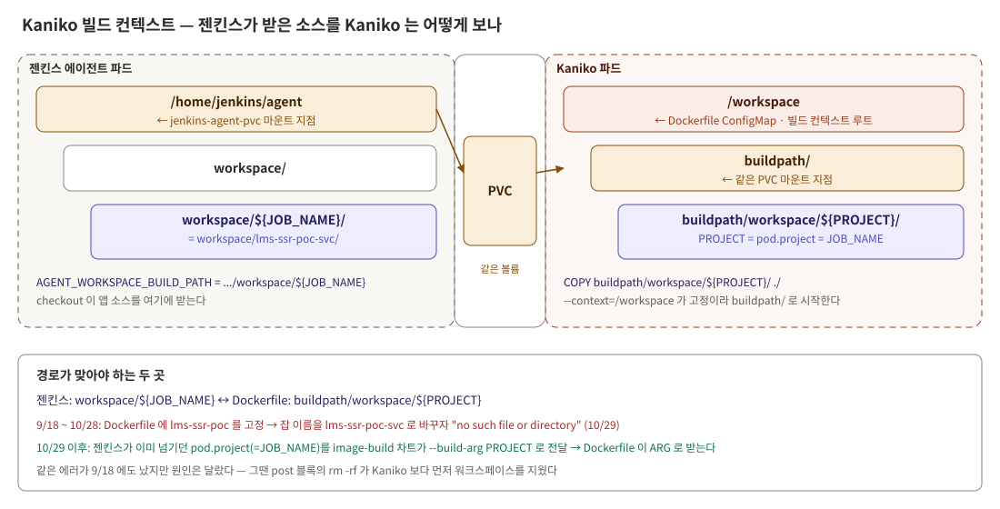
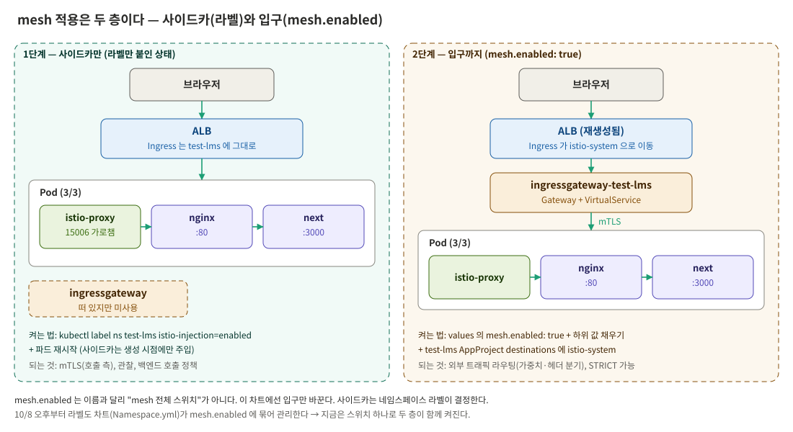
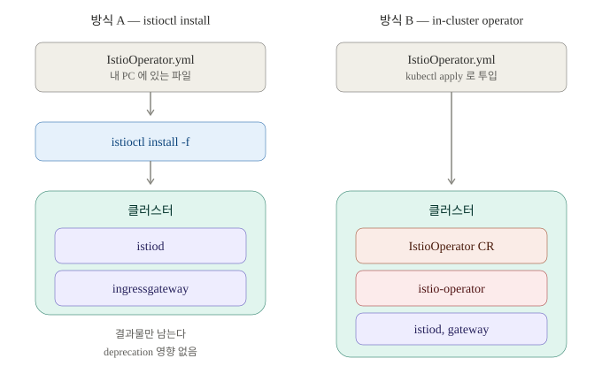
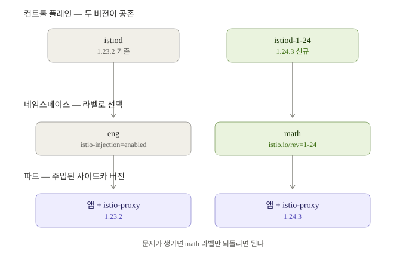



뒤에서 나오는 판단과 트러블슈팅은 대부분 아래 개념 중 하나를 모르거나 헷갈려서 생겼다. 도구별로 **이번 작업에
필요한 만큼만** 정리하고, PoC 를 시작할 때 이미 있던 것과 정한 범위를 함께 적는다. ArgoCD 자체(컴포넌트, Project,
RBAC)는 [앞선 시리즈 2편](/posts/argocd-migration-2/)에서 다뤘다.

---

## 1. SSR 앱은 무엇이 다른가

| | CSR (기존 Vue) | SSR (신규 Next.js) |
|---|---|---|
| HTML 을 만드는 곳 | 브라우저 | 서버 (Node 프로세스가 렌더링해서 보냄) |
| 서버에 필요한 것 | 정적 파일을 내주는 웹서버 | **Node 런타임** + 앱 코드 |
| 배포 산출물 | `dist/` 정적 파일 | **컨테이너 이미지** |

SSR 은 "서버가 돌아야" 하는 앱이라 백엔드처럼 이미지로 만들어 파드로 띄운다. 이게 배포 모델이 바뀐 근본 이유다.

**`NEXT_PUBLIC_*` 은 빌드할 때 박힌다.** Next.js 에서 이 접두사가 붙은 환경변수는 빌드 시점에 클라이언트 번들에
문자열로 치환된다. 파드를 띄울 때 환경변수를 바꿔도 이미 만들어진 번들은 바뀌지 않는다. 그래서 환경마다 값이
다르면 **환경마다 따로 빌드**해야 한다. 기존 CSR 도 `vite build --mode staging` 으로 같은 방식을 쓰고 있어, 개발팀이
익숙한 이 방식을 따르기로 했다.

**pnpm 과 corepack.** `node:22-alpine` 에는 npm 만 있어서 corepack 으로 pnpm 을 켠다. 이때 `package.json` 에
`packageManager` 필드가 없으면 corepack 은 **최신 버전**을 받아 온다. 이번엔 그게 pnpm 12 였고, 빌드가 깨졌다(6편).

---

## 2. Kaniko — 도커 데몬 없이 파드 안에서 이미지 빌드

쿠버네티스 위의 젠킨스 에이전트는 파드라서 `docker build` 를 쓰려면 특권이 필요하다. Kaniko 는 데몬 없이
Dockerfile 을 해석해 이미지를 만들고 레지스트리에 푸시한다. 사내에 이미 Kaniko 파드를 띄우는 빌드 차트가 있어
그대로 썼다.


_젠킨스 에이전트와 Kaniko 가 같은 PVC 를 다른 경로로 본다_

빌드 차트는 Kaniko 의 빌드 컨텍스트를 `/workspace` 로 고정하고, 젠킨스 에이전트와 같은 PVC 를
`/workspace/buildpath` 에 붙인다. 그래서 젠킨스가 체크아웃한 소스를 Kaniko 가 그대로 볼 수 있다. 경로만 다르게 보인다.

**CSR 에서는 이게 문제가 된 적이 없다.** nginx 이미지는 소스를 `COPY` 하지 않았기 때문이다. SSR 은 `pnpm build` 가
이미지 빌드 안에서 돌아야 해서 소스를 `COPY` 해야 하고, 그래서 이 경로를 정확히 맞춰야 한다.

그리고 **젠킨스와 Kaniko 는 비동기다.** 젠킨스는 Kaniko 파드를 띄우고 다음 단계로 넘어가 `kubectl wait` 로 따로
기다린다. 기다리다 실패해 정리 단계에서 워크스페이스를 지우면, 아직 돌고 있는 Kaniko 가 소스를 잃는다. 실제로 겪었다.

---

## 3. GitOps 와 ArgoCD — 이번에 헷갈렸던 것

**역할 분리.** 젠킨스는 빌드 → 이미지 푸시 → values 파일의 이미지 태그를 Git 에 커밋까지만 한다. 젠킨스가 매번
바꾸는 값(태그)과 사람이 관리하는 값(리소스, 설정)은 **다른 values 파일**에 둔다. 섞으면 자동 커밋과 사람의 수정이
충돌한다. Application 의 `valueFiles` 는 뒤 파일이 앞을 덮어쓰므로 태그 파일을 마지막에 둔다.

**비교(refresh)와 적용(sync)은 다르다.**

| 단계 | 하는 일 | 자동 sync 를 끄면 |
|---|---|---|
| 비교 | Git 을 읽어 클러스터와 다른 점을 찾고 `OutOfSync` 로 표시 | **계속 돈다** |
| 적용 | 다른 점을 클러스터에 반영 | 멈춘다 |

자동 sync 가 켜져 있으면 **push 가 곧 배포**다. 위험한 작업 중에는 끄고, 끝나면 반드시 되돌린다.

**ArgoCD 는 자기가 넣지 않은 필드를 지우지 않는다.** 기본 적용 방식은 `kubectl apply` 와 같아서, 마지막 적용
기록 · Git · 지금 클러스터 상태를 비교한다. 기록에도 Git 에도 없는데 클러스터에만 있는 필드는 "누가 따로 넣었다"로
보고 **건드리지 않는다.** `kubectl rollout restart` 가 붙인 `restartedAt` 이 sync 를 아무리 해도 남는 이유다.

**`Synced` 가 "배포됨"을 뜻하지는 않는다.** 템플릿이 비어 있으면 렌더링 결과도 비고, ArgoCD 는 "적용할 게 없으니
일치"로 `Synced` 를 띄운다. 반대로 다른 컨트롤러가 런타임에 채우는 값은 Git 과 영원히 달라 멀쩡해도 `OutOfSync` 로
남는다. 이런 필드는 `ignoreDifferences` 로 비교에서 뺀다.

**App of Apps 와 sync-wave.** App of Apps 는 "Application 을 만드는 Application" 이다. 부모가 가리키는 헬름 차트의
템플릿 안에 자식 Application 매니페스트가 들어 있어서, 부모 하나만 적용하면 자식들이 따라 생긴다. sync-wave 는
같은 sync 안의 적용 순서다. 숫자가 작을수록 먼저다(기본 0).

---

## 4. 헬름 템플릿 — 이번에 사고가 난 문법

**`.` 은 "지금 위치"다.** 처음엔 차트 전체(Values, Release, Chart…)를 가리킨다. 터미널의 현재 디렉터리와 같다.

| 터미널 | 헬름 템플릿 |
|---|---|
| `.` = 현재 디렉터리 | `.` = 지금 보고 있는 값 |
| `cd proxyImage` | `{{- with .Values.deploy.proxyImage }}` |
| `cd -` | `{{- end }}` |
| `~` (언제나 홈) | `$` (언제나 차트 전체) |

```yaml
# with: 값이 비면 블록을 통째로 건너뛰고, 값이 있으면 블록 안에서 . 을 그 값으로 바꾼다
{{- with .Values.deploy.proxyImage }}
sidecar.istio.io/proxyImage: {{ . | quote }}     # 여기서 . = proxyImage 값
{{- end }}

# if: 조건만 검사한다. . 은 그대로라 전체 경로를 다시 쓴다
{{- if .Values.deploy.proxyImage }}
sidecar.istio.io/proxyImage: {{ .Values.deploy.proxyImage | quote }}
{{- end }}
```

`with` 줄을 빠뜨리고 가운데 줄만 남기면 `.` 이 **차트 전체**를 가리킨 채 찍힌다. 이번에 장애를 낸 원인이다(6편).

**`range` 와 `$`.** `range` 도 `.` 을 목록의 각 항목으로 바꾼다. 안에서 바깥 값을 쓰려면 `$` 로 차트 전체부터 짚는다.

```yaml
{{- range .Values.gateways }}                    # . = 목록의 한 항목 {name: test-lms}
  name: istio-gateway-{{ .name }}                 # 항목의 name
  namespace: {{ $.Values.argocd.namespace }}      # 바깥(차트 전체)의 값
{{- end }}
```

**`tpl` 과 `checksum/config`.** `tpl (.Files.Get "files/nginx.conf.tpl") .` 은 일반 파일을 헬름 템플릿처럼
렌더링한다. nginx.conf 를 템플릿 밖에 두고 값만 뺄 수 있다. `checksum/config` 는 ConfigMap 내용의 해시를 파드
어노테이션에 넣어, **설정이 바뀌면 파드가 자동으로 재시작**되게 한다.

**`yq` 는 없는 경로를 조용히 만든다.** 젠킨스가 태그를 고칠 때 쓰는 `yq -i '.a.b = "x"'` 는 `.a.b` 가 없으면 에러
없이 새로 만든다. 차트 구조가 바뀌면 엉뚱한 키가 생기고 잡은 성공으로 끝난다. `yq -e '.a.b'` 를 앞에 두면 경로가
없을 때 실패한다.

---

## 5. Istio — 이번에 필요한 만큼

| | 구성 | 하는 일 |
|---|---|---|
| 컨트롤 플레인 | `istiod` | 설정을 Envoy 용으로 바꿔 내려준다, 인증서 발급, 사이드카 주입 |
| 데이터 플레인 | 파드마다 `istio-proxy` + `ingressgateway` (둘 다 Envoy) | 실제로 트래픽을 받아 넘긴다 |

istiod 는 본사 관리실, 사이드카는 사무실마다 배치된 경비원, ingressgateway 는 정문 안내데스크라고 보면 쉽다.

**사이드카는 이렇게 들어간다.** 파드 생성 요청을 istiod 의 웹훅이 가로채, 네임스페이스에 `istio-injection=enabled`
라벨이 있으면 `istio-init` 과 `istio-proxy` 를 파드 정의에 끼워 넣는다. `istio-init` 이 iptables 규칙을 심고 끝나면
들어오고 나가는 TCP 가 Envoy 를 거친다. 그래서 **이미 떠 있는 파드에는 안 들어가고 재시작이 필요하다.** 같은 파드
안 루프백(127.0.0.1) 통신은 예외라 nginx → Next.js 는 사이드카를 거치지 않는다.

**mesh 적용은 두 층이다.**


_사이드카는 라벨이, 입구는 앱 차트의 mesh.enabled 가 켠다_

이번 PoC 는 둘을 일부러 따로 켰다. 되돌리기 쉬운 것(라벨)을 먼저 검증하고, 어려운 것(ALB 가 재생성되는 입구
전환)을 나중에 했다.

**Gateway 와 VirtualService.** Gateway 는 게이트웨이 파드에 "어떤 포트로 어떤 호스트를 받을지"(nginx 의 `listen`),
VirtualService 는 "어느 Service 로 보낼지"(nginx 의 `location`)를 정한다. 그리고 **쿠버네티스 Ingress 는 다른
네임스페이스의 Service 를 가리킬 수 없어서**, mesh 를 켜면 Ingress 가 게이트웨이 Service 가 있는 `istio-system` 으로
옮겨 간다.

**mTLS.** 양쪽에 사이드카가 있으면 자동으로 mTLS 로 암호화한다. 기본값 PERMISSIVE 는 평문도 받아서, mesh 밖(ALB)에서
오는 요청도 통과한다.

**설치 방식 두 가지.** 같은 `IstioOperator.yml` 파일 이름이 두 방식에서 전혀 다르게 쓰인다.


_운영은 방식 A — 파일을 istioctl 의 입력으로만 쓴다. deprecated 된 건 방식 B 의 컨트롤러다_

**웹훅의 caBundle.** API 서버가 istiod 의 웹훅을 HTTPS 로 부르려면 istiod 인증서를 믿어야 하고, 그 근거를 담는 칸이
`caBundle` 이다. 이 인증서는 **istiod 가 떠야 만들어지므로** 헬름 차트는 칸을 비워 두고 istiod 가 나중에 채운다.
Git 과 영원히 다르지만 틀린 값이 아니라 **비교 대상이 아닌 필드**다. 채워졌다는 건 오히려 istiod 가 정상이라는 신호다.

**리비전.** istiod 하나를 새 버전으로 바꾸면 이후 재시작하는 모든 파드가 새 사이드카를 받아 과목별로 나눠 올릴 수
없다. 그래서 Istio 는 istiod 를 버전별로 나란히 띄울 수 있게 해 두었다.


_라벨 istio.io/rev 를 바꾼 과목만 새 istiod 에서 사이드카를 받는다_

---

## 6. 전제 — 이미 있던 것과 정한 범위

### NKS 의 외부 노출 제약

| 방식 | 외부 접속 |
|---|---|
| ClusterIP | 불가 |
| NodePort | **불가** — 워커 노드가 프라이빗 서브넷이라 공인 IP 가 없다 |
| LoadBalancer | 가능. 서비스마다 LB 하나, 경로 분기 불가 |
| Ingress(ALB) | 가능. 한 진입점에서 경로 분기 |

ALB Ingress 를 쓸 때 알아둘 점이 셋이다. Service 는 **NodePort** 여야 하고(ALB 가 노드 포트를 타겟으로 잡는다),
경로는 `path: /*` 형식이며, **rewrite-target 을 지원하지 않는다.**

### 레포 — 관리 주체로 나눈다

| 레포 | 관리 | 담는 것 |
|---|---|---|
| 앱 레포 | 개발팀 | Next.js 앱 소스 |
| 인프라 레포 | 인프라 | Dockerfile, Kaniko 빌드 차트, 앱 헬름 차트, ArgoCD 설정, Istio 래퍼 차트 |

Dockerfile 을 앱 레포가 아니라 인프라 레포에 둔 이유는 관리 지점을 나누기 위해서다. 기존 nginx Dockerfile 도 같은
위치에 있었다. 대가는 Kaniko 가 다른 레포의 소스를 봐야 한다는 점인데, 위의 PVC 공유로 해결된다.

### 재사용한 자산

| 자산 | 재사용 방식 |
|---|---|
| Kaniko 빌드 차트 + 공유 PVC | 그대로 |
| 기존 nginx 헬름 차트 (mesh 분기 포함) | **복사해서 개조** |
| 기존 CSR Ingress 어노테이션 체계 | 관례를 그대로 따름 |
| 기존 nginx.conf 21개 | 값만 가져와 템플릿 1개로 |
| 앞선 시리즈의 AppProject 와 태그 커밋 패턴 | 그대로 |
| 운영 Istio 의 과목별 게이트웨이 구조 | 구조는 계승, 설치 수단만 교체 |

Kaniko 빌드 차트는 `--target=<환경>` 을 **항상** 넘긴다. 그래서 스테이지가 하나여도 Dockerfile 에 `AS stg` 처럼
같은 이름을 붙여야 했다.

### 범위

| 포함 | 제외 (이유) |
|---|---|
| SSR 이미지 빌드·배포 경로 전체 | 환경별 빌드 분리 (개발팀 작업 선행) |
| ALB 외부 노출 | `standalone` 출력 (앱 설정) |
| nginx 사이드카 + nginx.conf GitOps | 백엔드·외부·CDN 프록시 (PoC 에 백엔드 없음) |
| Istio ArgoCD 설치 + mesh 편입 | 성능 측정 (환경별 빌드 이후) |
| | 기존 CSR 차트·conf·잡 수정 (운영 중, 범위 혼재 방지) |

### 버전과 리소스

| 구성요소 | 버전 | 이유 |
|---|---|---|
| Next.js | 16 | 개발팀 레포 그대로 |
| pnpm | **10.15.0 고정** | 개발팀이 쓰는 10.x. 12 는 설정을 무시하고 빌드를 막았다 |
| nginx | `stable-alpine` | 기존 이미지도 여기에 스테이지 이름만 얹은 구조였다 |
| Istio | **1.23.2** | 운영과 맞춰 비교·이관을 쉽게. 업그레이드 검증은 범위 밖 |

리소스는 실사용량을 아직 못 쟀기 때문에 **"넉넉히 잡고 측정 후 조인다"**는 원칙으로 정했다. PoC 라 replicas 는 1,
HPA 는 껐다. nginx 는 기존 차트 값을 이어받고, Next.js 는 렌더링에 CPU·메모리를 쓰므로 여유 있게 잡았다.

---

이전: [(2) 도입 전후 한눈에](/posts/ssr-istio-gitops-2/) · 다음: [(4) SSR 배포 틀 만들기](/posts/ssr-istio-gitops-4/)

*(회사·인프라 관련 실명, 클러스터 식별자, 내부 호스트 주소, 레포·시크릿 이름 등은 전부 임의로 재구성해 게시했다.)*


