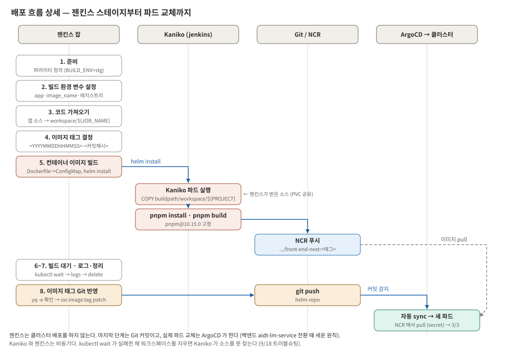
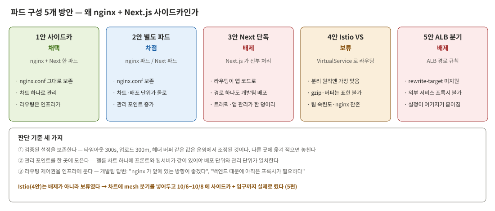
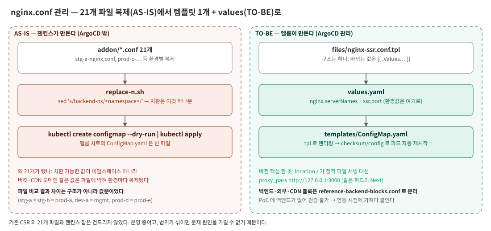
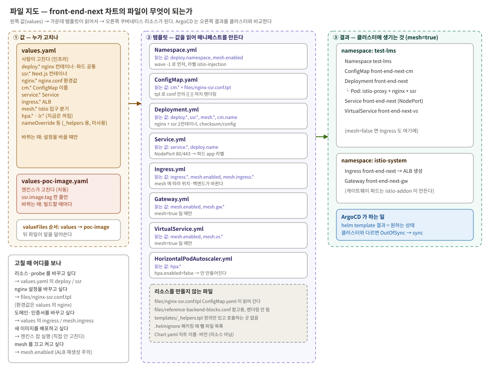



9월 16일부터 10월 2일까지, SSR 앱을 빌드해 띄우고 외부에 노출하고 nginx 를 앞에 세우기까지의 과정이다. 단계마다
무엇을 정했고 왜 그렇게 정했는지를 적고, 핵심 코드는 해설과 함께 싣는다. 이 단계에서 겪은 오류의 상세는 6편에 모았다.


_젠킨스 스테이지부터 파드 교체까지_

| 날짜 | 단계 | 결과 |
|---|---|---|
| 09-16 | 범위 결정 | "레포 그대로, 가장 단순하게 이미지화"로 좁힘 |
| 09-18 | 파이프라인 완주 | 젠킨스 → Kaniko → 레지스트리 → Git → ArgoCD → 파드 기동 |
| 09-29 | 외부 노출 | ALB Ingress. 개발팀이 브라우저로 확인 |
| 09-30 | 파드 구성 결정 | nginx + Next.js 한 파드. 기존 nginx 차트를 복사해 개조하기로 |
| 10-01 | 차트 개조 | nginx.conf 21개 → 템플릿 1개 + values, ConfigMap 을 헬름으로 |
| 10-02 | 차트 교체 배포 | label 체계 충돌로 장애 → 기존 운영 방식으로 통일 |
| 10-29 | 잡 이름 변경 대응 | Dockerfile COPY 경로를 build-arg 로 |

---

## 1. Dockerfile — 1단계로 단순하게

| 결정 | 이유 |
|---|---|
| 멀티스테이지가 아니라 **1단계** | `standalone` 출력이 없으면 실행 스테이지에서도 앱 전체를 복사해야 해서 나누는 의미가 없다 |
| 인프라 레포에 둔다 | 관리 주체 분리. 기존 nginx Dockerfile 과 같은 위치·같은 주입 방식 |
| `AS stg` | 빌드 차트가 `--target=<환경>` 을 항상 넘긴다 |
| `pnpm@10.15.0` 고정 | `packageManager` 가 없어 corepack 이 pnpm 12 를 받았고, 12 는 설정을 무시하고 빌드를 막았다 |
| `COPY buildpath/workspace/${PROJECT}/` | PVC 공유 구조상 경로가 이렇게 된다. 처음엔 잡 이름을 고정했다가, 잡 이름을 바꾸자 깨져서 build-arg 로 바꿨다 |

```dockerfile
FROM node:22-alpine AS stg          # 스테이지 이름 = 빌드 차트가 넘기는 --target

# 젠킨스가 넘기는 잡 이름. 젠킨스는 workspace/<잡 이름> 에 소스를 받으므로 같은 값으로 경로를 맞춘다.
# ARG 는 FROM 뒤에 있어야 이 스테이지 안에서 보인다.
ARG PROJECT

WORKDIR /app
RUN corepack enable && corepack prepare pnpm@10.15.0 --activate

# PROJECT 가 비면 COPY 가 buildpath/workspace// 가 되어 PVC 의 다른 잡 소스까지 통째로 복사된다.
# 에러 없이 엉뚱한 이미지가 나오느니 여기서 멈춘다.
RUN test -n "${PROJECT}" || (echo "PROJECT build-arg 가 비어 있다" && exit 1)

# Kaniko 컨텍스트(/workspace) 기준. PVC 가 /workspace/buildpath 에 붙어 있다 (3편 그림)
COPY buildpath/workspace/${PROJECT}/ ./

RUN pnpm install --frozen-lockfile  # lock 파일과 다르면 실패 → 개발자 PC 와 같은 의존성 보장
RUN pnpm build                      # 환경별 빌드 분리 전이라 기본 build 하나
EXPOSE 3000
CMD ["pnpm", "start"]               # next start, 기본 3000
```

---

## 2. 젠킨스 잡 — 빌드와 태그 커밋까지만

기존 CSR 잡(703줄)에서 `kubectl cp`·`env.js`·`reload` 같은 CSR 전용 단계와 배포 단계 전체를 덜어냈다. 잡의 마지막은
"Git 에 태그 반영"이다. **클러스터에 배포하는 코드는 없다.**

| # | 스테이지 | 하는 일 |
|---|---|---|
| 1 | 준비 | 파라미터 정의. 단계별로 끌 수 있게 했다(문제가 난 단계만 다시 돌리려고) |
| 2 | 빌드 환경 변수 설정 | 환경·네임스페이스·앱 이름 결정 |
| 3 | 코드 가져오기 | 앱 레포를 `workspace/<잡 이름>` 에 체크아웃, 커밋 해시 저장 |
| 4 | 이미지 태그 결정 | `<YYYYMMDDHHMMSS>-<커밋해시>` |
| 5 | 컨테이너 이미지 빌드 | Dockerfile 을 ConfigMap 으로 만들고 빌드 차트로 Kaniko 파드를 `helm install` |
| 6 | 빌드 대기 | `kubectl wait` 로 Kaniko 완료까지 |
| 7 | 로그 확인 및 정리 | Kaniko 로그 출력 후 파드·ConfigMap 삭제 |
| 8 | 이미지 태그 Git 반영 | 인프라 레포 clone → 태그 patch → commit·push |

이미지 태그에 시각을 앞에 붙인 이유는, 같은 커밋을 다시 빌드해도 태그가 겹치지 않아 ArgoCD 가 변경을 감지하기
때문이다. 마지막 스테이지의 핵심은 이 몇 줄이다.

```bash
cd /tmp/helm-repo-${BUILD_ID}/${chart_path}
# 차트가 태그를 읽는 경로가 실제로 있는지 먼저 확인한다.
# yq 는 없는 경로를 지정하면 에러 없이 새로 만들어 버린다.
# 차트 개편으로 태그 위치가 바뀌었는데 잡은 옛 경로를 고쳐서, 빌드는 성공해도 배포 이미지가 안 바뀐 적이 있다.
yq -e '.ssr.image.tag' ${image_tag_file} > /dev/null
yq -i '.ssr.image.tag = "${tag}"' ${image_tag_file}
git add ${image_tag_file}
git commit -m "chore(${app}): update image tag to ${tag} [skip ci]" || echo "변경사항 없음"
git push origin ${branch}
```

태그는 사람이 관리하는 `values.yaml` 이 아니라 **젠킨스 전용 파일**에만 쓴다.

```yaml
# values-poc-image.yaml — 젠킨스만 고친다. 이 파일의 커밋이 곧 배포다.
# 사람이 values.yaml 을 고치는 중에 젠킨스가 같은 파일을 자동 커밋하면 충돌하므로 분리했다.
ssr:
  image:
    repository: registry.example.com/front-end-next
    tag: "20261008014611-20b9504f..."
```

### ArgoCD Application

```yaml
apiVersion: argoproj.io/v1alpha1
kind: Application
metadata:
  name: front-end-next-poc
  namespace: argocd
spec:
  project: test-lms              # 앞선 시리즈에서 만든 앱용 프로젝트 재사용
  source:
    repoURL: https://gitlab.example.com/infra/helm-repo.git
    targetRevision: feature/argocd-front-apply
    path: services/helm/front-end-next
    helm:
      valueFiles:                # 뒤 파일이 앞을 덮어쓴다 → 젠킨스 태그 파일을 마지막에
        - values.yaml
        - values-poc-image.yaml
  destination:
    server: https://kubernetes.default.svc
    namespace: test-lms
  syncPolicy:
    automated:
      prune: true                # 앞선 시리즈와 같은 단계적 적용. selfHeal 은 관찰 후
```

9월 18일, Kaniko 가 PVC 로 소스를 받아 빌드하고 → 레지스트리에 푸시하고 → 젠킨스가 태그를 커밋하고 → ArgoCD 가
자동 sync 해 → 파드가 뜨는 것(`▲ Next.js 16 ✓ Ready in 199ms`)까지 한 줄로 이어졌다.

---

## 3. 외부 노출 — ALB Ingress

| 결정 | 이유 |
|---|---|
| NodePort 단독 ✗ | 노드에 공인 IP 가 없다 |
| LoadBalancer ✗ | 서비스마다 LB 가 생기고 경로 분기가 안 된다 |
| **ALB Ingress** | 한 진입점, 경로 분기 가능. 지금 만든 게 정식 구성의 뼈대가 된다 |
| 기존 CSR Ingress 관례를 따름 | PoC 의 목적이 "기존 방식으로 배포할 수 있는가"다. 처음 짠 버전은 경로 형식·LB 이름·헬스체크·공인 IP·TLS 설정이 전부 빠져 있었다 |
| 헬스체크 `/nginx_status` | SSR 루트(`/`)는 `/login` 으로 307 을 줘서 ALB 가 unhealthy 로 볼 수 있다 |
| 공인 IP 재사용 | 새로 받으면 비용이 늘고 DNS 도 바꿔야 한다. ALB 가 재생성돼도 IP 를 반납하지 않게 했다 |

노출 전에 포트포워딩으로 먼저 확인했다. `307 → /login` 이 돌아왔다는 건 포트만 열린 게 아니라 Next.js 미들웨어가
실제로 동작한다는 뜻이다.

---

## 4. 파드 구성 — nginx + Next.js 를 한 파드에

nginx.conf 를 Git 으로 옮기려고 열어 봤더니, 정적 파일 서빙은 일부였고 **API 프록시·보안 헤더·gzip·버퍼·타임아웃·
업로드 크기**를 다 하고 있었다. SSR 에서 필요 없는 건 정적 파일 관련 블록뿐이었다. 그래서 nginx 를 어디에 둘지가 곧
파드 구성 문제였다.


_다섯 가지 방안과 판단 기준_

개발팀 답("nginx 가 앞에 있는 방향이 좋겠다", "백엔드 때문에 아직은 프록시가 필요하다")으로 Next 단독 안이 빠지고,
라우팅 관리 주체가 인프라에 남았다. **Istio 안은 분리 원칙상 가장 맞는 방향이지만 보류했다.** gzip·버퍼는
VirtualService 로 표현되지 않아 nginx 가 어차피 남고, 팀의 Istio 숙련도도 아직이었다. 대신 **차트에 mesh 분기는
넣어 두고 꺼 두기로** 했다. 기존 차트를 복사하면 mesh 분기가 어차피 따라오고, 걷어 내면 나중에 다시 넣어야 한다.
이 분기를 10월 8일에 실제로 켰다(5편).

같은 파드 안의 컨테이너는 네트워크를 공유해서, nginx 는 Next.js 를 `127.0.0.1:3000` 으로 부른다. 바뀐 핵심은 한 곳이다.

```nginx
# AS-IS — 정적 파일 서빙
location / {
    root /usr/share/nginx/html/target;
    try_files $uri $uri/ /index.html;
}

# TO-BE — 같은 파드의 Next.js 로 프록시
location / {
    proxy_pass http://127.0.0.1:{{ $.Values.ssr.port }};
    # 업그레이드 헤더·X-Forwarded-*·타임아웃 300 은 운영 conf 값을 그대로 옮겼다
}
```

---

## 5. 차트 개조와 nginx.conf GitOps

기존 nginx 차트를 분석해서 알게 된 것이 넷 있었다.

1. **ConfigMap 을 헬름이 만들지 않고 있었다.** 차트의 `ConfigMap.yaml` 은 빈 파일이고 젠킨스가 직접 만들었다. ArgoCD 밖 리소스다
2. 치환은 **네임스페이스 한 단어뿐**이라, 나머지 환경값 때문에 파일이 21개로 복제됐다
3. 21개 파일의 차이는 구조가 아니라 **값**(버킷, CDN 도메인)이었다
4. 환경과 어긋나 보이는 값(stg 파일의 운영 버킷 등)은 **의도된 설정**이었다. 변수화할 때 임의로 "맞추면" 안 된다


_21개 복제 → 템플릿 1개 + values_

그래서 **템플릿 1개 + values** 로 갔다. 기존 CSR 의 21개 파일과 젠킨스 잡은 그대로 뒀다. 운영 중이고, 범위가 섞이면
문제가 생겼을 때 원인을 가릴 수 없다. CSR 이 폐기될 때 자연스럽게 사라진다.

ConfigMap 템플릿은 짧다. 핵심은 `tpl` 이다.

```yaml
apiVersion: v1
kind: ConfigMap
metadata:
  name: {{ .Values.cm.name }}
  namespace: {{ .Values.cm.namespace | default .Values.deploy.namespace }}
data:
  default.conf: |
{{ tpl (.Files.Get "files/nginx-ssr.conf.tpl") . | indent 4 }}
# .Files.Get 만으로는 파일 안의 {{ }} 가 그대로 남는다. tpl 로 한 번 더 렌더링해야 값이 들어간다.
# conf 를 templates/ 가 아니라 files/ 에 둔 이유: templates/ 안에 두면 헬름이 쿠버네티스 리소스로 착각한다.
```

Deployment 에서 꼭 볼 곳만 옮긴다.

```yaml
spec:
  selector:
    matchLabels:
      app: {{ .Values.deploy.name }}       # 생성 후 못 바꾼다. helper 가 아니라 values 를 직접 쓴다 (6편)
  template:
    metadata:
      labels:
        app: {{ .Values.deploy.name }}     # Service selector 와 같은 값이어야 엔드포인트가 잡힌다
      annotations:
        # ConfigMap 내용의 해시. conf 만 바꿔도 이 값이 바뀌어 파드가 재시작된다.
        # 없으면 conf 를 바꿔도 nginx 가 옛 설정으로 계속 돈다.
        checksum/config: {{ include (print $.Template.BasePath "/ConfigMap.yaml") . | sha256sum }}
      {{- if eq .Values.mesh.enabled true }}
        sidecar.istio.io/inject: "true"
        {{- with .Values.deploy.proxyImage }}     # 빈 값이면 줄 자체를 만들지 않는다 (6편의 장애 이후)
        sidecar.istio.io/proxyImage: {{ . | quote }}
        {{- end }}
      {{- end }}
    spec:
      containers:
        - name: {{ .Values.deploy.name }}         # nginx — ConfigMap 을 /etc/nginx/conf.d 에 마운트
          image: {{ .Values.deploy.image.repository }}:{{ .Values.deploy.image.tag }}
        - name: ssr                               # Next.js
          image: {{ .Values.ssr.image.repository }}:{{ .Values.ssr.image.tag }}
          startupProbe:                           # Next 가 뜨기 전에 nginx 가 요청을 받으면 502.
            tcpSocket: { port: ssrport }          # 5초 × 24 = 최대 2분 기다린 뒤에야
            periodSeconds: 5                      # readiness·liveness 가 돈다
            failureThreshold: {{ .Values.ssr.probe.startupFailureThreshold }}
      {{- if .Values.deploy.image.secret }}
      imagePullSecrets:                           # 컨테이너가 아니라 "파드" 단위다
        - name: {{ .Values.deploy.image.secret }}
      {{- end }}
```

| 바꾼 것 | 이유 |
|---|---|
| PVC·StorageClass 제거 | SSR 은 이미지에 서버가 들어 있다 |
| Next.js 컨테이너 추가 | nginx 가 localhost 로 프록시한다 |
| ConfigMap 을 헬름이 생성 + `checksum/config` | ArgoCD 관리로 가져오고, 설정 변경 시 자동 재시작 |
| selector 를 values 로 | 이름이 바뀌어도 selector 가 흔들리지 않는다 |

| 그대로 둔 것 | 이유 |
|---|---|
| mesh 분기 | 나중에 켤 것이다 |
| 컨테이너 포트·topologySpread·terminationGrace | 운영에서 검증된 값이다 |
| Service NodePort, Ingress 어노테이션 체계 | NKS ALB 가 요구한다 |

### 파일 지도

차트 파일이 무엇이 되는지, 무엇을 바꾸려면 어디를 고치는지 한 장으로 정리했다.


_값(values) → 템플릿 → 쿠버네티스 리소스. 사람이 고치는 파일과 젠킨스가 고치는 파일이 나뉜다_

---

## 6. 차트 교체 — 그리고 장애

10월 2일, 9월에 만든 최소 차트가 띄운 리소스 자리에 개조한 차트를 그대로 올렸다. selector 불변 에러, 503,
ALB 생성 실패가 한꺼번에 났다. 뿌리는 하나 — **두 차트의 label 체계를 대조하지 않았다.** 기존 운영 방식으로
통일하고 Deployment 를 다시 만들어 정상화했다. 원리와 체크리스트는 6편에 있다.

여기까지가 "SSR 앱을 기존 인프라 방식으로 배포하는 틀"이다. 다음 편에서는 이 앱을 서비스 메시에 넣기 위해 Istio 를
ArgoCD 로 설치한 과정을 다룬다.

---

이전: [(3) 알고 가야 할 개념과 전제](/posts/ssr-istio-gitops-3/) · 다음: [(5) Istio를 App of Apps로, 그리고 mesh 편입](/posts/ssr-istio-gitops-5/)

*(회사·인프라 관련 실명, 클러스터 식별자, 내부 호스트 주소, 레포·시크릿 이름 등은 전부 임의로 재구성해 게시했다.)*


