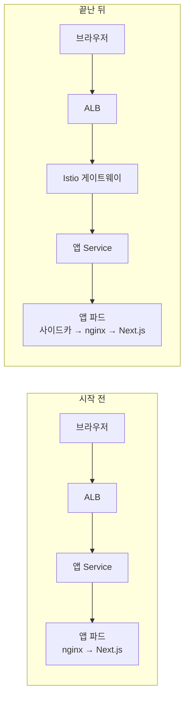
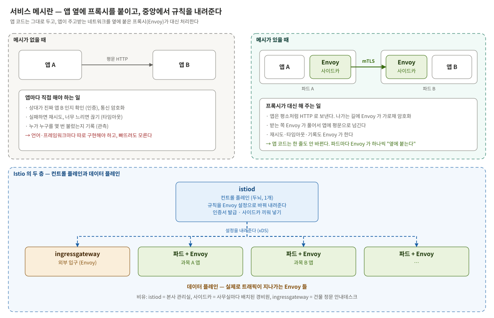
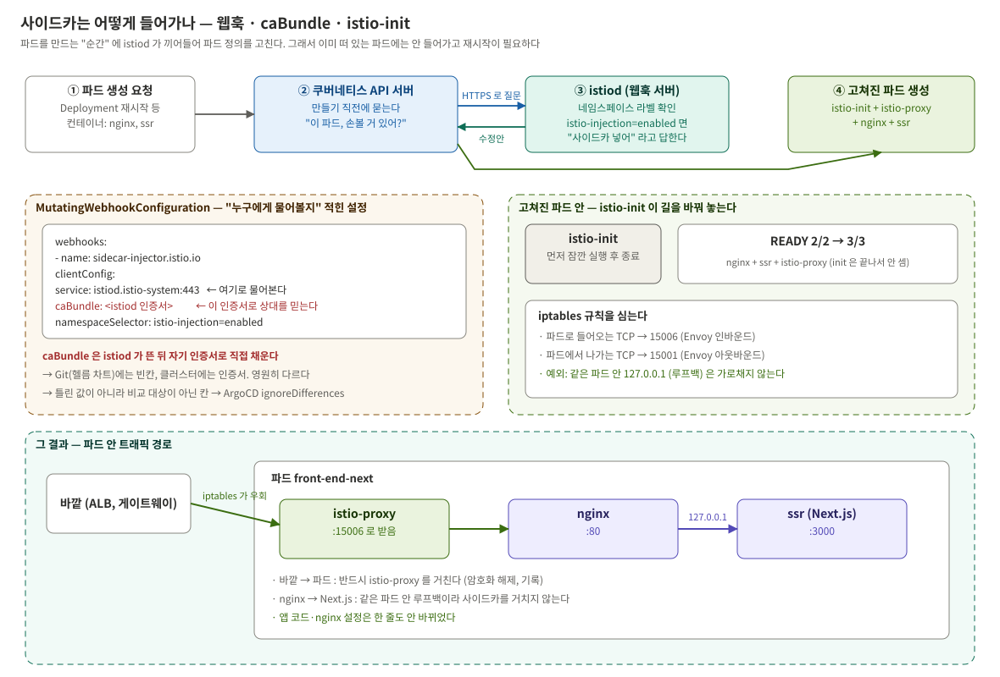
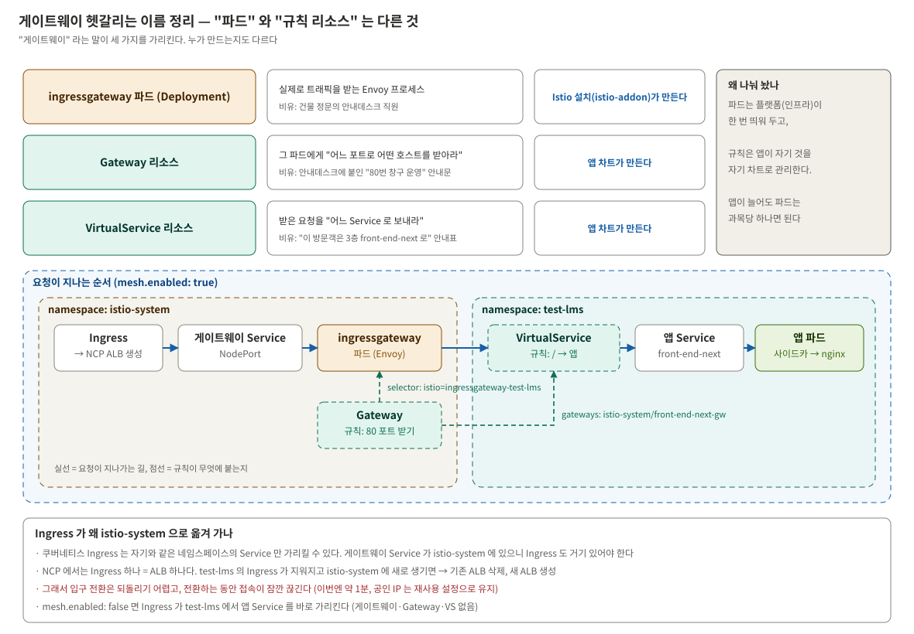
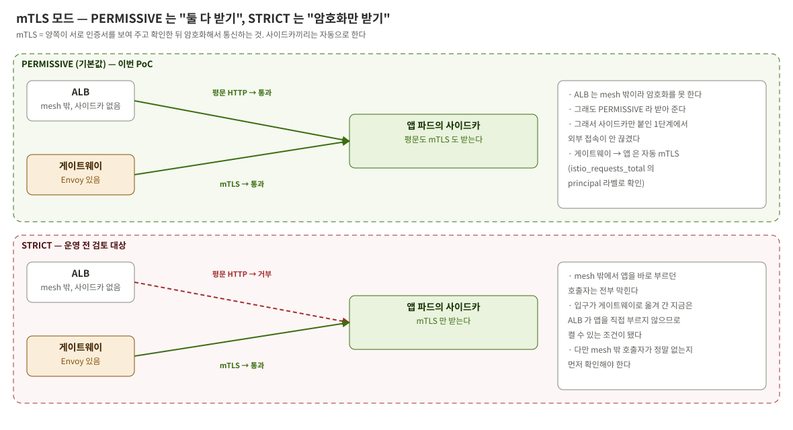
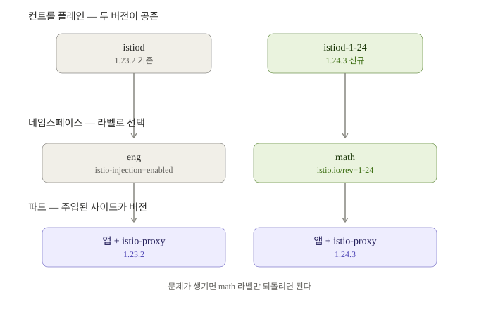
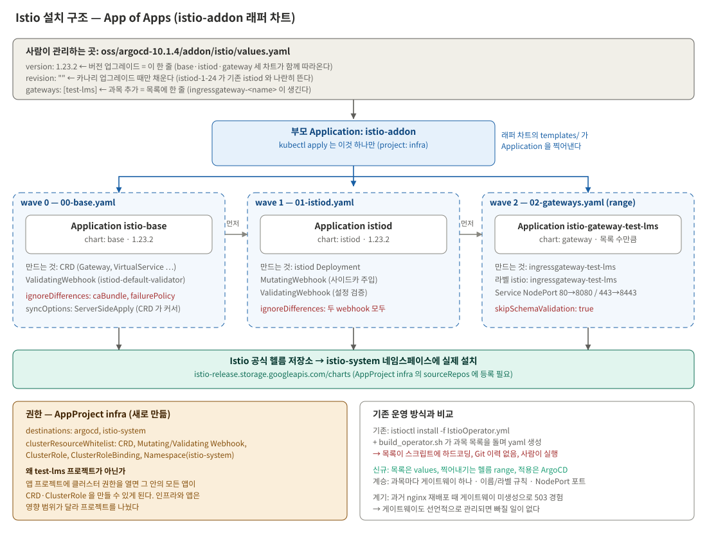
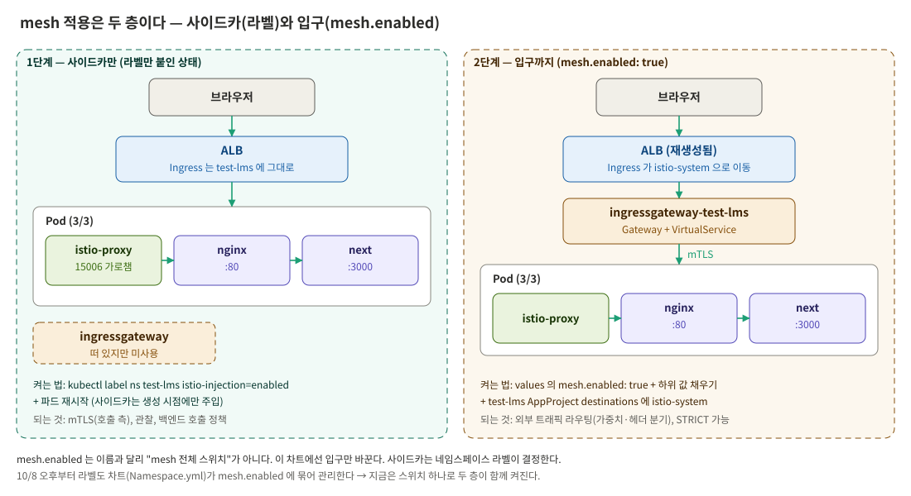
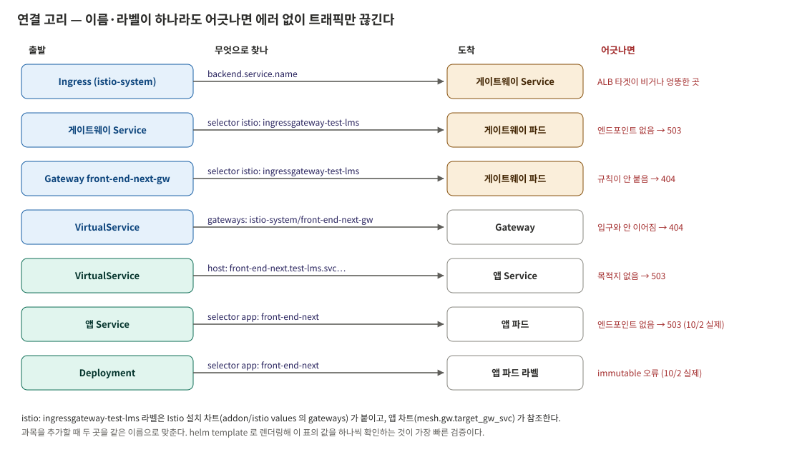
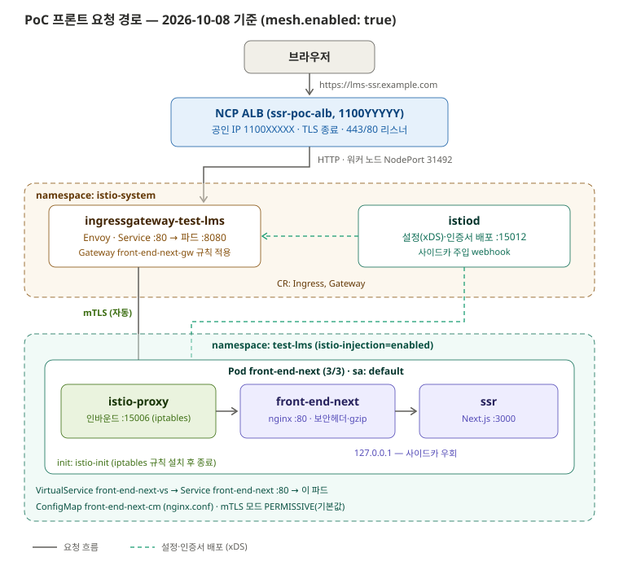



10월 6일부터 8일까지 사흘 동안 한 일이다. 4편에서 만든 SSR 앱은 아직 서비스 메시(Istio) 밖에 있었다. 운영 환경은
전부 mesh 안에서 돌기 때문에 이 앱도 언젠가는 mesh 에 들어가야 한다. 그러려면 먼저 PoC 환경에 Istio 를 깔아야 했고,
깔고 나서는 앱을 mesh 안으로 옮겨야 했다.

이 편은 Istio 를 처음 보는 사람도 따라올 수 있게 **기초 개념부터** 설명하고 시작한다. Istio 를 이미 안다면 1절은
건너뛰어도 된다.

## 이 편에서 하는 일

| 순서 | 한 일 | 끝나면 달라지는 것 |
|---|---|---|
| 1 | Istio 기초 개념 정리 | — |
| 2 | Istio 를 ArgoCD 로 설치 | `istio-system` 네임스페이스에 istiod 와 게이트웨이 파드가 뜬다 |
| 3 | 앱 파드에 사이드카 붙이기 | 앱 파드의 컨테이너가 2개 → 3개가 된다 |
| 4 | 외부 입구를 게이트웨이로 바꾸기 | 외부 요청이 Istio 게이트웨이를 거쳐 들어온다 |
| 5 | 손으로 붙인 라벨을 차트로 옮기기 | 사이드카 주입 설정이 Git 에 남는다 |
| 6 | 젠킨스부터 배포까지 한 바퀴 | 커밋 한 번이 파드 교체까지 이어지는 걸 확인한다 |

요청이 앱까지 가는 길은 이렇게 바뀐다.



달라진 건 두 가지다. 앱 파드 안에 **사이드카**가 끼어들었고, ALB 와 앱 사이에 **게이트웨이**가 생겼다. 이 두 단어가
무엇인지부터 본다.

---

## 1. Istio 기초 — 이 편을 읽기 위해 필요한 만큼

### 1-1. 서비스 메시가 푸는 문제

마이크로서비스 환경에서는 앱끼리 네트워크로 서로를 부른다. 그런데 "부른다"에는 생각보다 많은 일이 딸려 있다.

- 상대가 진짜 그 앱인지 확인하고, 주고받는 내용을 암호화해야 한다
- 실패하면 다시 시도하고, 너무 오래 걸리면 끊어야 한다
- 누가 누구를 몇 번 불렀고 얼마나 실패했는지 기록해야 한다

메시가 없으면 이걸 **앱마다 코드로 직접** 구현해야 한다. 자바 앱은 자바로, 노드 앱은 노드로. 빠뜨려도 티가 안 난다.

**서비스 메시는 이 일을 앱 코드 밖으로 빼낸다.** 앱 옆에 작은 프록시를 하나씩 붙이고, 앱이 주고받는 네트워크를 그
프록시가 대신 처리하게 한다. 앱은 평소처럼 평문 HTTP 로 보내기만 하면 되고, 암호화·재시도·기록은 프록시가 한다.
Istio 는 이 프록시로 **Envoy** 를 쓴다.


_위: 메시가 없을 때와 있을 때. 아래: Istio 의 두 층_

### 1-2. Istio 의 두 층 — 두뇌와 손발

Istio 는 크게 두 층으로 나뉜다.

| 층 | 구성 | 하는 일 | 비유 |
|---|---|---|---|
| 컨트롤 플레인 | `istiod` (하나) | 사람이 정한 규칙을 Envoy 가 알아듣는 설정으로 바꿔 내려준다. 인증서를 발급하고, 새 파드에 사이드카를 끼워 넣는다 | 본사 관리실 |
| 데이터 플레인 | 파드마다 붙은 Envoy (**사이드카**) + 외부 입구용 Envoy (**ingressgateway**) | 실제로 트래픽을 받아서 넘긴다 | 사무실마다 배치된 경비원, 건물 정문 안내데스크 |

중요한 점은 **트래픽은 istiod 를 지나지 않는다**는 것이다. istiod 는 규칙만 나눠 주고, 실제 요청은 Envoy 끼리 주고받는다.
istiod 가 잠깐 멈춰도 이미 설정을 받은 Envoy 들은 계속 일한다.

### 1-3. 사이드카는 어떻게 파드에 들어가나

"파드마다 Envoy 를 붙인다"는데, 앱 차트의 Deployment 에는 Envoy 컨테이너가 없다. 그럼 누가 넣을까? **파드가
만들어지는 순간에 istiod 가 끼어들어 파드 정의를 고친다.** 이 구조를 **웹훅**이라고 한다.


_파드 생성 요청 → API 서버가 istiod 에 물어봄 → istiod 가 사이드카를 추가한 정의를 돌려줌_

순서대로 보면 이렇다.

1. 누군가 파드를 만들라고 요청한다(Deployment 재시작 등). 이때 컨테이너는 nginx, ssr 두 개다
2. 쿠버네티스 API 서버는 파드를 실제로 만들기 직전에, 미리 등록된 웹훅 설정을 보고 istiod 에게 **"이 파드 만들려는데
   손볼 거 있어?"**라고 HTTPS 로 물어본다
3. istiod 는 그 파드의 네임스페이스에 `istio-injection=enabled` 라벨이 있으면 "사이드카 넣어"라고 답하면서, 컨테이너
   두 개(`istio-init`, `istio-proxy`)를 추가한 수정안을 돌려준다
4. API 서버는 수정된 정의로 파드를 만든다

여기서 두 가지가 따라 나온다.

- **이미 떠 있는 파드에는 안 들어간다.** 사이드카는 파드가 만들어지는 "순간"에만 들어가므로, 라벨을 붙인 뒤에는 파드를
  재시작해야 한다
- **"누구에게 물어볼지" 적힌 설정이 따로 있다.** 이게 `MutatingWebhookConfiguration` 이라는 리소스고, 그 안에 `caBundle`
  이라는 칸이 있다. 이 칸은 2절에서 문제가 된다

**caBundle 이 뭔가.** API 서버가 istiod 에게 HTTPS 로 물어볼 때, 상대가 진짜 istiod 인지 인증서로 확인해야 한다. 그
확인에 쓸 인증서 정보를 담는 칸이 `caBundle` 이다. 그런데 이 인증서는 **istiod 가 뜬 다음에 istiod 가 직접 만든다.**
그래서 설치용 헬름 차트에는 이 칸이 비어 있고, 설치가 끝난 클러스터에는 istiod 가 채운 인증서가 들어 있다.

### 1-4. 사이드카는 어떻게 트래픽을 가로채나

파드에 Envoy 가 들어갔다고 해서 트래픽이 저절로 Envoy 를 지나지는 않는다. nginx 는 여전히 80 포트로 요청을 받으려고
하니까. 여기서 `istio-init` 이 일한다.

`istio-init` 은 파드가 시작할 때 **가장 먼저 잠깐 실행되고 끝나는** 컨테이너다. 이 컨테이너가 리눅스 네트워크 규칙
(iptables)을 심는다.

- 파드로 **들어오는** TCP 는 전부 15006 포트(Envoy)로 돌린다
- 파드에서 **나가는** TCP 는 전부 15001 포트(Envoy)로 돌린다
- 단, **같은 파드 안끼리**(127.0.0.1, 루프백) 통신은 건드리지 않는다

그래서 바깥에서 오는 요청은 반드시 Envoy 를 먼저 거치고, nginx 가 같은 파드의 Next.js 를 `127.0.0.1:3000` 으로 부르는
건 Envoy 를 거치지 않는다. 앱 코드나 nginx 설정은 한 줄도 바꿀 필요가 없다. `istio-init` 은 일을 마치고 종료하므로 파드의
`READY` 에는 세지 않는다. 그래서 컨테이너는 nginx, ssr, istio-proxy 세 개, `3/3` 이 된다.

### 1-5. 게이트웨이 — 같은 이름이 세 가지를 가리킨다

Istio 를 처음 볼 때 가장 헷갈리는 게 "게이트웨이"다. 이 단어가 서로 다른 세 가지를 가리키고, 만드는 주체도 다르다.


_파드는 플랫폼이 한 번 띄워 두고, 규칙은 앱이 자기 차트로 관리한다_

| 이름 | 정체 | 누가 만드나 | 비유 |
|---|---|---|---|
| **ingressgateway** | 외부 트래픽을 받는 Envoy **파드**(Deployment + Service) | Istio 설치 | 건물 정문의 안내데스크 직원 |
| **Gateway** 리소스 | 그 파드에게 "80 포트로 이런 호스트를 받아라"라고 거는 **규칙** | 앱 차트 | 안내데스크에 붙인 "80번 창구 운영" 안내문 |
| **VirtualService** 리소스 | 받은 요청을 "이 경로는 이 Service 로 보내라"라고 정하는 **규칙** | 앱 차트 | "이 방문객은 3층 front-end-next 로" 안내표 |

nginx 설정에 빗대면 Gateway 는 `listen`(어느 포트로 받을지), VirtualService 는 `location`(어디로 보낼지)이다.

이렇게 나눠 둔 이유는 역할이 달라서다. 입구 파드는 인프라가 과목당 하나씩 띄워 두면 되고, 그 입구로 들어온 요청을
어디로 보낼지는 앱마다 다르니 앱이 자기 차트에서 관리한다. 앱이 늘어도 입구 파드를 새로 띄울 필요가 없다.

Gateway 리소스는 **라벨로** 자기가 붙을 파드를 찾는다. 예를 들어 Gateway 에 `selector: istio: ingressgateway-test-lms`
라고 적으면, 그 라벨이 붙은 게이트웨이 파드에 규칙이 걸린다. 라벨이 한 글자라도 다르면 규칙이 어느 파드에도 붙지 않고,
요청은 404 가 된다.

### 1-6. mTLS 와 PERMISSIVE / STRICT

양쪽에 사이드카가 있으면 Istio 는 둘 사이 통신을 **자동으로 mTLS** 로 바꾼다. mTLS 는 보내는 쪽과 받는 쪽이 **서로**
인증서를 보여 주고 확인한 뒤 암호화하는 방식이다. 인증서는 istiod 가 발급하고, 거기에는
`spiffe://cluster.local/ns/<네임스페이스>/sa/<서비스어카운트>` 같은 **신분증**이 들어 있다.

그런데 mesh 밖에 있는 것(예: ALB)은 사이드카가 없어서 mTLS 를 할 수 없다. 이런 평문 요청을 받을지 말지가 모드다.


_PERMISSIVE 는 평문과 mTLS 둘 다 받고, STRICT 는 mTLS 만 받는다_

| 모드 | 받는 것 | 언제 |
|---|---|---|
| **PERMISSIVE** (기본값) | 평문도, mTLS 도 | mesh 로 옮겨 가는 중일 때. 이번 PoC 는 이 상태 |
| STRICT | mTLS 만 | mesh 밖 호출자가 하나도 없을 때. 운영 전에 검토할 과제 |

### 1-7. 리비전 — 버전을 과목별로 나눠 올리는 장치

istiod 하나를 새 버전으로 바꾸면, 그 뒤 재시작하는 **모든** 파드가 새 버전 사이드카를 받는다. 문제가 생기면 전체가 영향을
받는다. 그래서 Istio 는 istiod 를 버전별로 **나란히** 띄울 수 있게 했다. 이게 리비전이다.


_라벨 istio.io/rev 를 바꾼 과목만 새 istiod 에서 사이드카를 받는다_

새 istiod 를 `istiod-1-24` 라는 이름으로 옆에 띄우고, 과목 네임스페이스 라벨을 하나씩 `istio.io/rev=1-24` 로 바꿔 가며
옮긴다. 문제가 생기면 그 과목 라벨만 되돌린다.

여기까지가 이 편을 읽는 데 필요한 개념이다. 이제 실제로 한 일을 본다.

---

## 2. Istio 를 ArgoCD 로 설치하기

### 왜 기존 방식으로 깔지 않았나

1편에서 적었듯, 운영 Istio 는 사람이 `istioctl` 명령과 sh 스크립트를 순서대로 실행해서 깐다. 이 방식을 그대로 쓰지 않은
이유는 세 가지다.

- 운영 버전(1.23)은 이미 지원이 끝났다. 어차피 언젠가 설치 방식을 다시 정해야 한다
- 앱은 ArgoCD 로 배포하는데 그 밑의 Istio 만 사람이 깔면, "Git 에 없는 상태"가 Istio 에서 다시 생긴다
- PoC 환경은 운영과 분리돼 있어서 새 방식을 시험하다 실패해도 운영에 영향이 없다

그렇다고 운영 구조를 버리지는 않았다. **구조는 그대로 가져오고, 설치하는 수단만 바꿨다.**

| 그대로 가져온 것 | 구체적으로 | 이유 |
|---|---|---|
| 과목마다 게이트웨이 하나 | 수학이면 `ingressgateway-math`, 영어면 `ingressgateway-eng` 처럼 과목별 입구 파드 | Istio 기본은 게이트웨이 하나를 같이 쓰는 건데 운영은 일부러 나눴다. 한 과목에 트래픽이 몰리거나 장애가 나도 다른 과목이 영향받지 않게 하려는 의도로 보여 유지했다 |
| 이름·라벨 규칙 | 게이트웨이 파드에 `istio: ingressgateway-<과목>` | 앱 차트의 Gateway 가 이 라벨로 입구를 찾는다(1-5). 규칙이 바뀌면 운영 차트를 그대로 못 쓴다 |
| 포트 | 게이트웨이 Service 를 NodePort 로, 80→8080 / 443→8443 | NCP 의 ALB 는 노드의 포트를 대상으로 트래픽을 보낸다 |
| 버전 1.23.2 | 운영과 같은 버전 | 운영과 비교하거나 옮길 때 버전 차이까지 신경 쓰지 않으려고 |

| 바꾼 것 | 이전 | 이후 |
|---|---|---|
| 설치 수단 | `istioctl install -f` 를 사람이 실행 | Istio 공식 헬름 차트 3개(base, istiod, gateway)를 ArgoCD 가 설치 |
| 과목 목록 | sh 스크립트 안에 하드코딩 | Git 에 있는 `values.yaml` 의 목록 |
| 권한 | 실행하는 사람의 kubeconfig | ArgoCD 의 `infra` 프로젝트 |

### App of Apps — "설치 주문서를 찍어 내는 주문서"

ArgoCD 에서 무언가를 설치하려면 **Application** 이라는 리소스를 만든다. Application 은 일종의 주문서다. "이 Git 레포의
이 차트를, 이 값으로, 이 네임스페이스에 설치해라"라고 적혀 있고, ArgoCD 는 이 주문서대로 설치한 뒤 계속 지켜본다.

Istio 공식 헬름 차트는 세 종류다.

| 차트 | 설치되는 것 | 비유 |
|---|---|---|
| `base` | Istio 가 쓰는 리소스 **종류**(CRD). "Gateway", "VirtualService" 라는 단어를 쿠버네티스에 등록한다 | 사전에 새 단어 등록 |
| `istiod` | 컨트롤 플레인(1-2)과 사이드카 주입 웹훅(1-3) | 본사 관리실 |
| `gateway` | 입구 파드(1-5). **과목 수만큼** 필요하다 | 과목별 정문 |

과목이 3개면 Application 이 base 1 + istiod 1 + gateway 3 = 5개 필요하다. 파일로 직접 쓰면 과목이 늘 때마다 파일을
복사해야 하고, 버전을 올릴 때 파일 5개를 다 고쳐야 한다. 하나만 빠뜨려도 버전이 섞인다.

그래서 **Application 을 찍어 내는 Application** 을 하나 만들었다. 이게 App of Apps 다.


_부모 Application 하나가 base → istiod → 과목별 게이트웨이 순으로 자식 Application 을 만든다_

실제로는 이렇게 동작한다.

1. 사람이 `kubectl apply` 를 **두 번** 한다. 권한 설정(`infra` 프로젝트)과 부모 Application(`istio-addon`)
2. 부모가 가리키는 곳에는 **래퍼 차트**가 있다. 이 차트 안에 Istio 자체는 없다. 대신 "base 를 이렇게 깔아라", "istiod 를
   이렇게 깔아라", "게이트웨이를 과목마다 이렇게 깔아라"라는 **자식 Application 템플릿**만 들어 있다
3. ArgoCD 가 부모를 처리하면 자식 Application 들이 생긴다. 과목이 하나(`test-lms`)인 지금은 `istio-base`, `istiod`,
   `istio-gateway-test-lms` 3개다
4. 자식들이 각자 Istio 공식 차트를 받아 `istio-system` 에 설치한다

ArgoCD 화면으로 보면 부모 1개 아래에 자식 3개가 매달린 모양이 된다. 그 뒤로 사람이 하는 일은 래퍼 차트의 `values.yaml`
을 고쳐서 커밋하는 것뿐이다.

```
addon/
├── projects/appproject-infra.yaml      ① 권한 — 맨 처음 한 번 apply
├── applications/istio-addon.yaml       ② 부모 Application — 그다음 한 번 apply
└── istio/                              ③ 래퍼 차트 (ArgoCD 가 읽는다)
    ├── values.yaml                        ← 평소에 고치는 유일한 파일
    └── templates/
        ├── 00-base.yaml                   자식 ①  base     (순서 0)
        ├── 01-istiod.yaml                 자식 ②  istiod   (순서 1)
        └── 02-gateways.yaml               자식 ③  gateway  (순서 2, 과목 수만큼)
```

### 설치 순서가 중요한 이유 — sync-wave

세 자식은 **반드시 이 순서로** 깔려야 한다.

- `base` 가 없으면 쿠버네티스가 "Gateway" 라는 리소스 종류를 모른다. 사전에 없는 단어를 쓴 셈이라 거부된다
- `istiod` 가 없으면 게이트웨이 파드가 뜰 때 설정을 내려줄 주체가 없어서 게이트웨이가 제대로 동작하지 않는다

ArgoCD 는 기본적으로 한꺼번에 적용하므로, 각 자식에 `argocd.argoproj.io/sync-wave` 어노테이션으로 번호를 붙였다.
**번호가 작은 것부터 적용하고, 그게 정상이 된 뒤에 다음 번호로 넘어간다.** base 0, istiod 1, gateway 2 다.

### 평소에 고치는 곳 — values.yaml

```yaml
# base / istiod / gateway 세 차트가 모두 이 버전을 쓴다.
# 세 곳에 따로 적어 두면 업그레이드 때 하나를 빠뜨리기 쉬워 한 곳으로 모았다.
version: 1.23.2

# 비워 두면 일반 설치. 업그레이드할 때만 쓴다 (1-7 리비전)
revision: ""

# 과목 목록. 예전 sh 스크립트 안에 하드코딩돼 있던 목록이 여기로 왔다. 한 줄이 게이트웨이 하나다.
gateways:
  - name: test-lms

# 과목마다 같은 설정. 특정 과목만 다르게 하고 싶으면 그 항목에만 덮어쓴다.
gatewayDefaults:
  serviceType: NodePort
  ports:
    - { name: http,  port: 80,  targetPort: 8080 }
    - { name: https, port: 443, targetPort: 8443 }
```

`gateways` 목록이 Application 으로 바뀌는 부분은 아래 템플릿이다. 헬름의 `range` 는 목록을 하나씩 돌면서 같은 내용을
반복해서 찍어 낸다.

```yaml
{{- range .Values.gateways }}        # gateways 목록을 한 항목씩 돈다. 안에서 . 은 "지금 항목"({name: test-lms})
---                                  # YAML 문서 구분선. 항목마다 Application 을 하나씩 따로 만든다
apiVersion: argoproj.io/v1alpha1
kind: Application
metadata:
  name: istio-gateway-{{ .name }}    # → istio-gateway-test-lms
  annotations:
    argocd.argoproj.io/sync-wave: "2"
spec:
  source:
    chart: gateway                   # Istio 공식 gateway 차트를
    targetRevision: {{ $.Values.version }}   # 위의 version 으로. $ 는 "목록 바깥, 차트 전체"
    helm:
      values: |
        name: ingressgateway-{{ .name }}         # → ingressgateway-test-lms (입구 파드 이름)
        labels:
          istio: ingressgateway-{{ .name }}      # 앱 차트의 Gateway 가 이 라벨로 입구를 찾는다
{{- end }}
```

예를 들어 `gateways` 에 `- name: math` 를 한 줄 더하면, 이 템플릿이 `istio-gateway-math` 라는 Application 을 하나 더
찍어 내고, 그 Application 이 `ingressgateway-math` 파드를 띄운다. 예전에는 스크립트 수정 → 실행 → istioctl 재적용 → 라벨
→ 젠킨스 수정까지 해야 했던 일이 **한 줄 커밋**이 된다.

업그레이드도 같다. `version: 1.24.3`, `revision: "1-24"` 로 바꿔 커밋하면 `istiod-1-24` 가 기존 istiod 옆에 뜨고, 과목을
하나씩 옮기면 된다(1-7). 이번 PoC 에서는 이 장치를 넣어 두기만 했고 실제 업그레이드는 하지 않았다.

### 설치하면서 막힌 네 가지

부모를 apply 하고 바로 깔끔하게 끝나지 않았다. ArgoCD 화면에 뜬 상태, 원인, 조치를 순서대로 적는다.

**① 부모가 `Unknown` — 권한이 없었다**

처음엔 앱용으로 쓰던 프로젝트(`test-lms`)에 부모를 넣었다. ArgoCD 프로젝트는 "이 프로젝트의 Application 이 무엇을 만들 수
있는지"를 정하는 권한 상자인데, 앱용 프로젝트는 클러스터 전체에 영향을 주는 리소스를 거의 못 만들게 막혀 있었다. Istio 는
CRD, 웹훅, ClusterRole 처럼 **특정 네임스페이스가 아니라 클러스터 전체에 걸리는 리소스**를 만든다.

앱용 프로젝트의 권한을 넓히는 대신 **Istio 전용 `infra` 프로젝트를 새로 만들었다.** 앱 프로젝트를 넓히면 그 프로젝트에
속한 모든 앱이 클러스터 권한을 갖게 되기 때문이다. `infra` 에는 Istio 가 실제로 만드는 종류만 적었다.

```yaml
clusterResourceWhitelist:
  - { group: apiextensions.k8s.io,          kind: CustomResourceDefinition }        # 새 리소스 종류 등록 (base)
  - { group: admissionregistration.k8s.io,  kind: MutatingWebhookConfiguration }    # 사이드카 끼워 넣기 (1-3)
  - { group: admissionregistration.k8s.io,  kind: ValidatingWebhookConfiguration }  # Istio 설정 검사
  - { group: rbac.authorization.k8s.io,     kind: ClusterRole }
  - { group: rbac.authorization.k8s.io,     kind: ClusterRoleBinding }
  - { group: "", kind: Namespace, name: istio-system }
```

`*`(전부 허용)로 열지 않은 이유는, 목록에 하나하나 드러나 있어야 나중에 누군가 범위를 넓혔을 때 알아챌 수 있기 때문이다.

**② `istio-base` 는 설치됐는데 계속 `OutOfSync` — caBundle**

설치는 성공했는데 ArgoCD 가 계속 "Git 과 다르다"고 표시했다. 차이를 열어 보니 웹훅 설정의 `caBundle` 칸이었다. 1-3 에서
본 그 칸이다. Git(헬름 차트)에는 비어 있고, 클러스터에는 istiod 가 채운 인증서가 들어 있으니 영원히 다를 수밖에 없다.

이건 틀린 값이 아니라 **원래 Git 이 관리할 대상이 아닌 칸**이다. 그래서 ArgoCD 에 "이 칸은 비교하지 마"라고 알려 줬다.

```yaml
ignoreDifferences:
  - group: admissionregistration.k8s.io
    kind: ValidatingWebhookConfiguration
    jqPathExpressions:
      - '.webhooks[]?.clientConfig.caBundle'   # istiod 가 런타임에 채우는 인증서
      - '.webhooks[]?.failurePolicy'           # istiod 가 준비 상태에 따라 바꾸는 값
```

오히려 이 칸이 채워져 있다는 건 istiod 가 정상적으로 떠서 인증서를 만들었다는 신호다.

**③ 게이트웨이가 `Unknown` — 차트가 자기 값을 거부했다**

게이트웨이 Application 이 설치도 못 하고 멈췄다. 메시지는 값 검증 실패였다. Istio gateway 차트에는 "values 는 이런 형식만
허용한다"는 검증 규칙 파일(`values.schema.json`)이 들어 있는데, ArgoCD 가 쓰는 helm 3.21 이 이 규칙을 더 엄격하게 적용하면서
**차트에 원래 들어 있는 기본값까지** 형식이 틀렸다고 거부한 것이다.

ArgoCD 문제인지 헬름 문제인지부터 가렸다. 작업 서버에서 같은 helm 버전으로 `helm template` 을 돌려 보니 똑같은 에러가 났다.
ArgoCD 와 상관없이 **helm 3.21 과 차트 1.23.2 의 조합 문제**라는 게 확정됐다. 우리 쪽 값이 틀린 게 아니므로 검증을 건너뛰는
옵션(`skipSchemaValidation`)을 켰다.

다만 이건 **빚으로 남는 설정**이다. 검증을 끈 동안에는 values 에 오타를 내도 못 거른다. 버전을 올릴 때 이 옵션 없이
통과하는지 확인하고 끌 생각이다.

**④ `istiod` 도 계속 `OutOfSync` — 하나를 빠뜨렸다**

②와 같은 증상이 istiod 에도 있었다. istiod 는 웹훅을 **두 종류** 만든다. 사이드카를 끼워 넣는 것(Mutating)과 Istio 설정이
올바른지 검사하는 것(Validating)이다. 처음엔 Mutating 쪽만 비교에서 뺐고 Validating 쪽 caBundle 이 남아 있었다. Validating
도 추가해서 해결했다.

네 가지를 정리하자 부모 1개와 자식 3개가 모두 `Synced`, `Healthy` 가 됐다.

---

## 3. mesh 편입 1단계 — 사이드카만 붙이기

Istio 가 깔렸다고 앱이 자동으로 mesh 에 들어가지는 않는다. 앱을 mesh 에 넣는 일은 두 가지로 나뉜다.


_사이드카는 네임스페이스 라벨이, 입구는 앱 차트의 mesh.enabled 가 켠다_

| | 무엇 | 켜는 방법 | 되돌리기 |
|---|---|---|---|
| 사이드카 | 앱 파드 안에 Envoy 를 넣는다(1-3) | 네임스페이스에 라벨 하나 | 쉽다. 라벨 지우고 재시작 |
| 입구 | 외부 요청이 게이트웨이를 거쳐 들어오게 한다(1-5) | 앱 차트의 `mesh.enabled: true` | 어렵다. ALB 가 다시 만들어진다 |

**되돌리기 쉬운 것부터** 했다. 사이드카만 먼저 붙이고, 문제가 없는 걸 확인한 뒤에 입구를 바꿨다.

```bash
# 이 네임스페이스에 새로 만들어지는 파드에는 사이드카를 넣으라는 표시
kubectl label namespace test-lms istio-injection=enabled

# 이미 떠 있는 파드에는 안 들어간다(1-3). 재시작해서 파드를 새로 만든다
kubectl rollout restart deployment front-end-next -n test-lms
```

재시작한 파드의 `READY` 가 `2/2` 에서 `3/3` 으로 바뀌었다. nginx, Next.js 에 istio-proxy 가 하나 더 들어온 것이다.

그런데 **3/3 은 "컨테이너 세 개가 떠 있다"는 뜻일 뿐**이다. 사이드카가 실제로 일하고 있는지는 따로 확인해야 했다.

| # | 확인한 것 | 어떻게 | 이게 증명하는 것 |
|---|---|---|---|
| 1 | 사이드카가 들어갔다 | 파드 정의에 차트에 없는 `istio-init`, `istio-proxy` 가 있다 | 웹훅이 동작했다 (1-3) |
| 2 | 사이드카가 istiod 와 연결됐다 | 사이드카 로그에 `Envoy proxy is ready` | istiod 에서 설정을 받았다 (1-2) |
| 3 | 요청이 사이드카를 지난다 | 외부에서 curl 하니 응답 헤더에 `server: istio-envoy` | 응답이 Envoy 를 거쳐 나왔다 |
| 4 | 가로채기 규칙이 깔렸다 | `istio-init` 로그에 15006/15001 로 돌리는 iptables 규칙 | 트래픽이 사이드카로 우회된다 (1-4) |
| 5 | 입구는 아직 그대로다 | Ingress 가 여전히 `test-lms` 에만 있다 | 입구 전환은 아직 안 했다 |
| 6 | 암호화는 PERMISSIVE | PeerAuthentication 리소스가 없다 = 기본값 | 평문도 받는다 (1-6) |

사이드카를 붙였는데 **외부 접속이 끊기지 않은 이유**도 앞의 개념으로 설명된다.

- ALB 는 mesh 밖이라 평문으로 요청을 보낸다. PERMISSIVE 모드라 사이드카가 받아 줬다(1-6). STRICT 였다면 거부됐다
- nginx 가 Next.js 를 부르는 건 같은 파드 안 루프백이라 사이드카를 거치지 않는다(1-4). 그래서 nginx 설정을 하나도 안
  바꿔도 됐다

작업 서버에는 Istio 진단 도구(`istioctl`)가 없어서, 사이드카 컨테이너 안에 원래 들어 있는 `pilot-agent` 명령으로 대신
확인했다.

---

## 4. mesh 편입 2단계 — 입구를 게이트웨이로 바꾸기

### 무엇이 바뀌나

지금까지는 ALB 가 앱 Service 로 바로 들어왔다. 이제 ALB → 게이트웨이 → 앱 순서로 바꾼다. 1-5 의 그림 아래쪽이 바로
이 상태다.

| | 전 (`mesh.enabled: false`) | 후 (`mesh.enabled: true`) |
|---|---|---|
| Ingress 위치 | `test-lms` | **`istio-system`** |
| Ingress 가 가리키는 곳 | 앱 Service | **게이트웨이 Service** |
| 새로 생기는 것 | — | Gateway(`istio-system`), VirtualService(`test-lms`) |

Ingress 가 `istio-system` 으로 옮겨 가는 이유는 쿠버네티스 규칙 때문이다. **Ingress 는 자기와 같은 네임스페이스의 Service
만 가리킬 수 있다.** 게이트웨이 Service 는 `istio-system` 에 있으니 Ingress 도 거기로 가야 한다.

그리고 NCP 에서는 **Ingress 리소스 하나가 ALB 하나**다. `test-lms` 의 Ingress 가 지워지고 `istio-system` 에 새 Ingress 가
생기면, 기존 ALB 가 지워지고 새 ALB 가 만들어진다. 그 사이에 접속이 끊긴다. 되돌릴 때도 똑같이 ALB 를 다시 만들어야 해서,
2단계는 1단계보다 훨씬 조심해야 했다.

### 켜기 전에 결과물부터 확인

`mesh.enabled: true` 로 커밋하기 전에, 그 값으로 **무엇이 만들어지는지 먼저 렌더링해서 봤다.** `helm template` 은 실제로
설치하지 않고 "이 값이면 이런 매니페스트가 나온다"만 보여 준다.

```bash
helm template front-end-next . -f values.yaml -f values-poc-image.yaml \
  --set mesh.enabled=true \
  --show-only templates/Ingress.yml \
  --show-only templates/Gateway.yml \
  --show-only templates/VirtualService.yml
```

결과를 보고 놀랐다. Gateway 와 VirtualService 의 `name:` 이 비어 있었고, 목적지 주소가 `..svc.cluster.local` 처럼 중간이
빠진 모양이었다. 4편에서 운영 차트를 복사할 때 mesh 관련 **템플릿은 따라왔지만, 그 템플릿이 읽는 values 는 한 번도
채운 적이 없었던** 것이다. 이대로 커밋했으면 이름 없는 리소스를 만들려다 sync 가 실패했을 것이다.

값을 채우고 다시 렌더링해서, 요청이 지나는 연결 고리를 하나씩 맞춰 봤다.


_Ingress → 게이트웨이 → Gateway → VirtualService → Service → 파드. 이름과 라벨이 하나라도 어긋나면 끊긴다_

완성된 Gateway 와 VirtualService 는 이렇다.

```yaml
# Gateway — 게이트웨이 파드에 "80 포트로 오는 HTTP 를 받아라"고 문을 연다
# 게이트웨이 파드를 새로 만드는 게 아니라, 2절에서 이미 띄운 파드에 규칙을 거는 것이다
metadata:
  name: front-end-next-gw
  namespace: istio-system
spec:
  selector:
    istio: ingressgateway-test-lms     # 2절에서 게이트웨이 파드에 붙인 라벨. 한 글자라도 다르면 어느 파드에도 안 붙는다
  servers:
  - port: { number: 80, name: http, protocol: HTTP }
    hosts: ["*"]                       # 모든 호스트를 받는다. ALB 헬스체크는 Host 헤더가 IP 라서 도메인으로 제한하면 실패한다
                                       # HTTPS 는 ALB 가 인증서로 풀어서 HTTP 로 넘겨 주므로 여기선 80 만 연다
---
# VirtualService — 그 문으로 들어온 요청을 앱 Service 로 보낸다
metadata:
  name: front-end-next-vs
  namespace: test-lms
spec:
  hosts: ["*"]
  gateways: [istio-system/front-end-next-gw]    # 다른 네임스페이스의 Gateway 는 "네임스페이스/이름"으로 짚는다
  http:
  - match: [{ uri: { prefix: / } }]             # 모든 경로를
    route:
    - destination:
        host: front-end-next.test-lms.svc.cluster.local   # 앱 Service 로
        port: { number: 80 }
```

세부 경로 규칙(`/api` 는 백엔드로 등)은 여전히 파드 안 nginx 가 맡는다. VirtualService 는 "일단 앱으로 보낸다"까지만 한다.
경로 규칙을 두 곳에 나눠 두면 어디를 고쳐야 할지 헷갈리기 때문이다.

### 권한 열기

이제 앱 차트가 `istio-system` 에 Ingress 와 Gateway 를 만든다. 그런데 앱 프로젝트(`test-lms`)는 `test-lms` 네임스페이스에만
만들 수 있게 돼 있어서, `istio-system` 을 허용 목록(destinations)에 추가했다.

2절처럼 프로젝트를 따로 만들지 않은 이유는 두 가지다. Ingress 와 Gateway 는 네임스페이스 안의 리소스라 클러스터 전체 권한이
필요 없고, "앱의 입구 설정은 앱 차트가 관리한다"는 게 운영의 기존 구조다(1-5). 다만 이제 이 프로젝트가 `istio-system`
안에 **어떤 리소스든** 만들 수 있게 된 점은 운영 전에 좁혀야 할 과제로 남겼다.

### 적용 — 커밋하자마자 배포됐다

계획은 이랬다.

1. 자동 sync 를 끈다
2. 기존 Ingress 를 손으로 지우고, ALB 가 완전히 지워질 때까지 기다린다
3. 그다음 sync 해서 새 Ingress 를 만든다

ALB 를 지우는 데 시간이 걸리니, 기존 것이 다 지워진 뒤에 새것을 만들려는 순서였다. 그런데 **1번을 하기 전에 values 를
먼저 커밋해 버렸다.** 자동 sync 가 켜져 있으면 커밋이 곧 배포다. ArgoCD 가 바로 기존 Ingress 를 지우고 새 Ingress 를
만들기 시작했고, 자동 sync 를 끈 건 1분 뒤였다. 이벤트는 이렇게 찍혔다.

```text
Warning  FailedReconcileLoadBalancer  ... 사용중인 타겟 그룹입니다.     ← 기존 ALB 가 아직 지워지는 중
Normal   CreateLoadBalancer           ...                              ← 약 1분 뒤, 컨트롤러가 다시 시도해서 성공
Normal   CreateTargetGroup            ... nodePort: 31492               ← 게이트웨이 Service 의 NodePort 로 연결
```

첫 줄은 기존 ALB 가 아직 정리되는 중이라 같은 자원을 쓸 수 없다는 에러다. 10월 2일에도 똑같은 에러를 봤는데, 그때는 바로
설정을 바꿔 대응했다가 공인 IP 를 잃었다(6편). 이번엔 손대지 않고 지켜봤더니 컨트롤러가 알아서 재시도해 1분쯤 뒤에
성공했다. **ALB 는 새로 만들어졌지만 공인 IP 는 그대로**였고, 접속은 약 1분 끊겼다.

### 정말 게이트웨이를 지나는지

curl 로는 구분이 안 된다. 1단계(사이드카만 있을 때)에도 응답은 똑같이 `307 → /login` 이었기 때문이다. 요청이 정말
게이트웨이를 거쳐 앱에 도착했는지는 **게이트웨이가 남긴 기록**을 봐야 한다. Envoy 는 요청을 처리할 때마다
`istio_requests_total` 이라는 카운터를 올린다.

```bash
kubectl exec -n istio-system deploy/ingressgateway-test-lms -c istio-proxy -- \
  pilot-agent request GET stats/prometheus | grep '^istio_requests_total'
```

나온 결과의 라벨을 읽으면 이렇다.

| 라벨 | 값 | 읽는 법 |
|---|---|---|
| source_workload | `ingressgateway-test-lms` | 게이트웨이가 |
| destination_service | `front-end-next.test-lms.svc.cluster.local` | 우리 앱으로 요청을 보냈다 |
| response_code | 200 × 33 / 307 × 2 / 304 × 3 | ALB 헬스체크 33번, 내 curl 2번, 브라우저 재방문 3번 |
| source / destination_principal | `spiffe://cluster.local/ns/.../sa/...` | 양쪽 모두 Istio 신분증을 갖고 있다 |

마지막 줄이 중요하다. 보내는 쪽(게이트웨이)과 받는 쪽(앱 사이드카) 모두 신분증이 찍혀 있다는 건, **둘 사이 통신이 자동으로
mTLS 로 오갔다**는 뜻이다(1-6). 따로 설정하지 않았는데도 mesh 안에 들어온 것만으로 암호화됐다.


_최종 요청 경로: ALB → 게이트웨이 → 사이드카 → nginx → Next.js_

### 남은 OutOfSync 를 정리하다 장애를 냈다

입구 전환 뒤 ArgoCD 화면에서 Deployment 하나만 계속 `OutOfSync` 였다. 원인이 두 개 겹쳐 있었다.

- **`restartedAt`** — 3절에서 `kubectl rollout restart` 를 하면 쿠버네티스가 파드 템플릿에 "재시작한 시각" 어노테이션을
  붙인다. Git 에는 없는 값이다. 그런데 ArgoCD 는 **자기가 넣지 않은 필드는 지우지 않는다.** 누군가 일부러 넣은 값일 수 있어서다.
  그래서 sync 를 아무리 해도 이 차이가 남았다
- **빈 사이드카 이미지 어노테이션** — 차트가 사이드카 이미지 값이 비어 있어도 어노테이션 줄을 만들고 있었다. 쿠버네티스는
  빈 값을 버리는데 ArgoCD 렌더링 결과엔 남아 있어서 영원히 달랐다

두 번째를 고치다 실수를 했다. "값이 있을 때만 줄을 만든다"는 조건(`{{- with }}`) 한 줄을 빠뜨린 채 커밋했고, 그 결과
**차트 전체 내용이 사이드카 이미지 주소 자리에 들어갔다.** 새 파드는 이미지 주소가 이상하다며 뜨지 못했고, 롤링 전략이
"기존 파드를 먼저 내리고 새 파드를 올린다"로 돼 있어서 **약 3분 동안 서비스가 끊겼다.** `kubectl rollout undo` 로 이전
상태로 되돌려 복구했다. 한 줄 빠졌을 뿐인데 왜 차트 전체가 들어갔는지는 6편에서 자세히 다룬다.

---

## 5. 손으로 붙인 라벨을 차트로 옮기기

3절에서 사이드카를 붙일 때 `kubectl label` 명령으로 네임스페이스에 라벨을 **손으로** 붙였다. 이 라벨은 Git 어디에도 없다.
그러면 이런 일이 생긴다.

- 네임스페이스를 지웠다 다시 만들면 라벨이 사라지고, 사이드카가 조용히 빠진다
- 같은 차트를 스테이징에 올려도 라벨은 따라가지 않는다
- 다음 사람이 Git 만 보고는 "이 앱에 왜 사이드카가 붙어 있지?"를 알 수 없다

1편에서 말한 "명령이 상태를 들고 있지 않다"는 문제 그대로다. 그래서 네임스페이스 자체를 차트에 넣었다.
[앞선 시리즈 4편](/posts/argocd-migration-4/)에서 백엔드 차트에 쓴 방식과 같다.

```yaml
apiVersion: v1
kind: Namespace
metadata:
  name: {{ .Values.deploy.namespace }}
  labels:
    {{- if .Values.mesh.enabled }}
    istio-injection: enabled             # mesh.enabled 하나로 사이드카와 입구를 같이 켜고 끈다
    {{- end }}
  annotations:
    argocd.argoproj.io/sync-wave: "-1"   # 앱 리소스들보다 먼저 만든다 (네임스페이스가 있어야 그 안에 만들 수 있다)
    argocd.argoproj.io/sync-options: Delete=false,Prune=false
```

마지막 줄이 중요하다. 이 앱의 Application 은 "Git 에서 빠진 리소스는 클러스터에서도 지운다(prune)"로 설정돼 있다. 나중에
누가 이 템플릿을 실수로 지우면 네임스페이스도 지워지고, **그 안의 모든 것이 같이 사라진다.** 그래서 네임스페이스만은
ArgoCD 가 지우지 못하게 막았다.

넣기 전에 하나 더 확인했다. 다른 Application 이 이미 이 네임스페이스를 관리하고 있지는 않은지다. 두 Application 이 같은
리소스를 관리하면, 한쪽이 지울 때 다른 쪽 것까지 날아갈 수 있다. ArgoCD 가 관리하는 리소스에는 "누가 관리하는지" 표시
어노테이션이 붙는데, 확인해 보니 비어 있었다. 적용 후 그 표시가 이 앱으로 채워졌고, 이미 같은 라벨이 붙어 있던 터라 파드는
재시작되지 않았다.

---

## 6. 젠킨스부터 배포까지 한 바퀴

여기까지는 전부 **사람이 차트를 고치고, 사람이 sync 를 누른** 경로였다. 그런데 이 PoC 의 원래 목적은 "개발자가 코드를 바꾸면
젠킨스부터 배포까지 사람 손 없이 한 줄로 흐른다"다. 이 경로는 9월 말 이후 한 번도 돌려 보지 않았다.

마지막으로 젠킨스 잡을 실행해 봤더니 세 군데가 끊겨 있었다.

```
젠킨스 빌드 ─▶ 태그 수정 ─▶ git push ─▶ ArgoCD sync ─▶ 이미지 받기 ─▶ 파드 교체
                 ①                          ②               ③
```

**① 태그를 엉뚱한 자리에 적었다**

젠킨스는 빌드한 이미지 태그를 values 파일에 적는다. 그런데 4편에서 차트를 개편하면서 태그 자리가 `image.tag` 에서
`ssr.image.tag` 로 옮겨 갔는데, 젠킨스 잡은 여전히 옛 자리(`image.tag`)를 고치고 있었다.

문제는 `yq`(YAML 수정 도구)가 **없는 경로를 지정하면 에러 없이 새로 만들어 버린다**는 점이다. 그래서 파일 맨 위에 차트가
아무도 읽지 않는 `image.tag` 키가 새로 생겼다. 잡은 성공으로 끝났고, ArgoCD 입장에선 렌더링 결과가 이전과 같으니 할 일이
없었다. **빌드는 됐는데 배포 이미지는 안 바뀐** 상태였다.

경로가 실제로 있는지 먼저 확인하고(`yq -e`), 있을 때만 고치도록 바꿨다.

**② 커밋이 반영되지 않았다**

4절에서 입구를 전환할 때 자동 sync 를 껐는데, 다시 켜는 걸 잊었다. 젠킨스가 태그를 커밋해도 ArgoCD 는 "Git 과 다르다"고
표시만 하고 적용하지 않았다. 다시 켰다.

**③ 이미지를 받지 못했다**

드디어 새 파드가 만들어졌는데 `ImagePullBackOff`(403)로 이미지를 받지 못했다. 사설 레지스트리에서 이미지를 받으려면 파드에
접속 정보(pull 시크릿)가 있어야 하는데, 4편에서 차트를 교체할 때 이 값이 빠져 있었다.

더 궁금했던 건 **그동안은 왜 멀쩡했나**였다. 9월 말 이후 새 이미지를 빌드한 적이 없었다. 쓰던 이미지는 이미 노드에 받아져
있었고, 쿠버네티스는 노드에 같은 이미지가 있으면 레지스트리에 묻지 않는다. 그래서 시크릿이 없다는 게 드러나지 않았다가,
새 태그가 처음 나온 순간 터진 것이다. 값을 복구했다.

①과 ③은 뿌리가 같다. **차트 구조를 바꿀 때, 바뀐 값을 쓰는 곳(젠킨스 잡, pull 시크릿)을 나란히 놓고 비교하지 않았다.**
세 군데를 고치고 나서야 커밋 한 번이 새 파드 교체까지 사람 손 없이 이어졌다.

---

## 정리

| 단계 | 결과 | 기억할 것 |
|---|---|---|
| Istio 설치 | 부모 1 + 자식 3 모두 Synced·Healthy | 과목 추가·버전 변경이 values 한 줄. 런타임에 채워지는 칸은 비교에서 뺀다 |
| 사이드카 | 파드 3/3, 요청이 Envoy 를 거침 | 되돌리기 쉬운 것부터. 3/3 만으로 끝났다고 보지 않는다 |
| 입구 전환 | 게이트웨이 → 앱, 자동 mTLS | 켜기 전에 렌더링. ALB 에러는 잠깐 지켜본다 |
| 라벨 코드화 | 사이드카 설정이 Git 에 남음 | 손으로 한 일은 코드로 옮긴다 |
| 젠킨스 한 바퀴 | 커밋 → 파드 교체 자동 | 구조를 바꾸면 그 값을 쓰는 곳을 같이 본다 |

다음 편에서는 이 과정을 포함해 PoC 기간 동안 겪은 트러블슈팅 30건을 원리와 함께 정리한다.

---

이전: [(4) SSR 배포 틀 만들기](/posts/ssr-istio-gitops-4/) · 다음: [(6) 트러블슈팅 30건에서 배운 것](/posts/ssr-istio-gitops-6/)

*(회사·인프라 관련 실명, 클러스터 식별자, 내부 호스트 주소, 레포·시크릿 이름 등은 전부 임의로 재구성해 게시했다.)*


