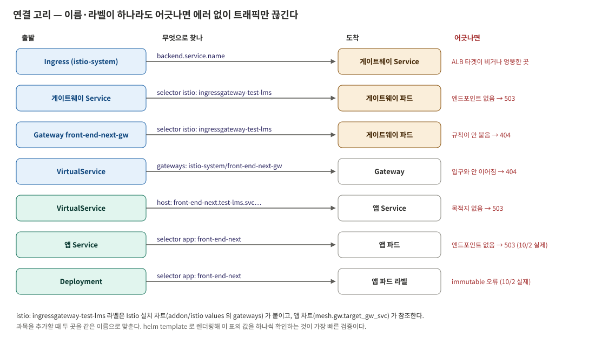



PoC 기간 동안 오류와 장애를 30건 겪었다. 전부 나열하기보다 **다시 겪기 쉽고 원리를 알아야 하는 것**을 골라 적고,
마지막에 여러 번 반복된 패턴을 정리한다. 장애도 두 번 냈다. 지우지 않고 남긴다.

---

## 전체 흐름

| 날짜 | 건수 | 무엇을 하다가 |
|---|---|---|
| 09-18 | 6 | 파이프라인을 처음 한 줄로 이을 때 (Kaniko, pnpm, ArgoCD) |
| 10-02 | 3 | 최소 차트를 개조 차트로 교체할 때 — **장애** |
| 10-06 | 4 | Istio 를 ArgoCD 로 설치할 때 |
| 10-08 | 15 | 사이드카 주입, 입구 전환, OutOfSync 정리, 젠킨스 경로 — **장애** |
| 10-29 | 2 | 젠킨스 잡 이름을 바꿨을 때 |

---

## 1. pnpm 12 — 가장 오래 걸린 이슈

```
ERR_PNPM_IGNORED_BUILDS  Ignored build scripts: @parcel/watcher, @swc/core, msw, sharp, unrs-resolver
```

pnpm 10 부터 공급망 공격 방어를 위해 패키지 설치 스크립트를 기본 차단하고 허용 목록을 요구한다. `.npmrc`,
`package.json` 의 `pnpm` 필드, `pnpm-workspace.yaml` 덮어쓰기를 다 시도했지만 실패했다.

결정적 단서는 `pnpm approve-builds` 가 "승인 대기 패키지 없음"이라고 답한 것이다. **설정은 읽히는데 설치만
실패한다**는 모순이었다. 원인은 버전이었다. `packageManager` 가 없어 corepack 이 pnpm 12 를 받았고, 12 는 허용 목록
설정을 무시하고 에러를 낸다. 로컬 도커로 재현해 확정했다.

```bash
docker run --rm -v $(pwd):/app -w /app node:22-alpine \
  sh -c "corepack enable && corepack prepare pnpm@10.15.0 --activate && pnpm install --frozen-lockfile"
# Done in 19.9s using pnpm v10.15.0
```

| 누가 | 조치 | 이유 |
|---|---|---|
| 개발팀 | 허용 목록에 나머지 패키지 추가 | 어떤 패키지 스크립트를 믿을지는 앱 의존성 판단이다 |
| 인프라 | Dockerfile 에서 pnpm 10.15.0 고정 | 근본 해결(`packageManager` 명시)은 개발팀 몫 |

**배운 것** — Kaniko 를 매번 돌리는 것보다 로컬 `docker build` 재현이 훨씬 빠르다. 이 이슈는 Kaniko 와 무관한 레포
자체 문제였는데, 로컬 재현으로 그걸 먼저 분리할 수 있었다.

---

## 2. Kaniko 가 소스를 못 찾았다 — 두 번, 원인은 달랐다

```
failed to get fileinfo for /workspace/buildpath/workspace/lms-ssr-poc: no such file or directory
```

**첫 번째(9월).** 젠킨스와 Kaniko 는 비동기다. `kubectl wait` 가 실패하자 젠킨스가 정리 단계로 넘어가 워크스페이스를
지웠고, 그때 Kaniko 는 아직 `COPY` 전이었다. PVC 를 임시 파드로 직접 열어 `@tmp` 디렉터리만 남은 걸 보고 확정했다.
기존 nginx 잡에서 안 드러난 건 nginx 이미지가 소스를 `COPY` 하지 않았기 때문이다. SSR 로 오면서 처음 노출된 구조 차이다.

**두 번째(10월 말).** 문구가 똑같아 같은 원인으로 보였지만, 워크스페이스 삭제는 여전히 꺼져 있었다. 이번엔 **잡
이름에 묶인 경로**였다. 젠킨스는 `workspace/<잡 이름>` 에 소스를 받는데, 잡 이름을 바꾸자 Dockerfile 이 고정으로 찾던
옛 경로와 어긋났다.

옛 경로가 PVC 에 남아 있었다면 **에러 없이 옛 소스로 이미지가 빌드됐을 것**이다. 에러가 난 게 오히려 다행이었다.
조치는 경로를 고정하지 않고 같은 값에서 나오게 한 것이다. 젠킨스가 이미 잡 이름을 빌드 차트에 넘기고 있었고 차트가
그걸 build-arg 로 Kaniko 에 전달하므로, Dockerfile 이 `ARG PROJECT` 로 받아 쓰게 했다(4편).

**배운 것** — 같은 에러 문구가 같은 원인이라는 보장은 없다. 당시 조치가 아직 유효한지부터 확인한다.

---

## 3. `Synced` 인데 아무것도 없다

차트의 `templates/` 없이 `Chart.yaml`·`values.yaml` 만 커밋했다. 렌더링 결과가 비었고 ArgoCD 는 "적용할 게 없으니
일치"로 `Synced` 를 띄웠다. **`Synced` 는 "배포됨"을 뜻하지 않는다.** Healthy 와 실제 리소스까지 본다.

---

## 4. 차트 교체 — 증상 셋, 뿌리 하나 (장애)


_이름과 라벨이 이어지는 고리. 차트를 바꿀 때 이 고리 전체를 대조해야 한다_

9월에 만든 최소 차트(`app.kubernetes.io/*` 라벨)가 띄운 리소스 자리에, 운영 차트를 개조한 것(`app: <이름>` 라벨)을
**대조 없이 그대로 올렸다.**

| 증상 | 원리 | 조치 |
|---|---|---|
| `spec.selector: field is immutable` | Deployment selector 는 생성 후 못 바꾼다 | 운영 방식으로 통일하고 Deployment 를 다시 만들었다 |
| 503 (Endpoints `<none>`) | Service 는 `app:` 으로 찾는데 파드엔 다른 라벨만 있었다 | 파드 라벨 통일 |
| ALB 생성 실패 ("사용중인 타겟 그룹") | 기존 ALB 삭제가 끝나기 전 같은 IP 요청 (추정) | IP 지정을 빼서 새 IP 로 생성 |

**selector 를 helper 가 아니라 values 로 둔 이유** — 헬름의 기본 helper 는 차트 이름과 릴리스 이름(= ArgoCD Application
이름)으로 라벨을 만든다. Application 이름만 바꿔도 selector 가 달라지고, selector 는 불변이라 되돌릴 수 없다.

**배운 것** — `helm template` 으로는 이 문제를 못 잡는다. 렌더링은 정상이었고 **이미 떠 있는 리소스와의 충돌**이
문제였다. `kubectl diff` 나 ArgoCD DIFF 로 기존 리소스와 비교해야 한다. 그리고 ALB 에러는 **일시적일 수 있다.** 10월
8일 같은 에러는 컨트롤러 재시도로 1분 만에 풀렸다. 10월 2일엔 바로 설정을 바꿔 IP 를 잃었다.

이때 만든 체크리스트를 이후 차트 변경마다 썼다.

- Deployment selector 가 기존 리소스와 같은가
- selector 가 values 기반인가 (helper 를 쓰면 이름에 종속된다)
- Service selector ↔ 파드 라벨이 맞는가
- 기존 ALB 삭제가 끝난 뒤 새 ALB 를 만드는가
- 이미 떠 있는 리소스와 충돌하지 않는가 (`kubectl diff`)

---

## 5. 영원히 OutOfSync — caBundle

Istio 설치 후 `istio-base` 가 sync 는 성공했는데 OutOfSync 로 남았다. 웹훅의 `caBundle` 은 istiod 가 뜬 뒤 자기 인증서로
채우는 칸이라, Git(빈 값)과 클러스터(인증서)가 영원히 다르다. **틀린 값이 아니라 비교 대상이 아닌 필드**라
`ignoreDifferences` 로 뺐다. istiod 쪽은 웹훅을 Mutating·Validating 두 종류 만드는데 처음엔 하나만 빼서 OutOfSync 가
남았다. "빼야 할 것을 전부 뺐나"는 직접 리소스 목록을 보고 확인한다.

같은 날 게이트웨이 차트가 스키마 검증에 걸렸을 때는 **로컬 `helm template` 로 같은 에러를 재현**해, ArgoCD 문제가
아니라 helm 과 차트 버전 조합 문제임을 먼저 분리했다.

---

## 6. 빈 줄 하나가 차트 전체를 이미지 주소에 넣었다 (장애)

입구 전환 후 Deployment 만 OutOfSync 로 남은 걸 정리하다 생긴 일이다. 흐름을 그대로 적는다.

```
Gateway 에 붙은 빈 사이드카 이미지 어노테이션 발견 → Gateway 만 고침
  → Deployment 에도 같은 게 있어 OutOfSync
     (null 값은 쿠버네티스가 버리는데 ArgoCD 렌더링 결과엔 남아 있어 영원히 다르다)
  → 고치다 {{- with }} 줄을 빠뜨리고, 커밋 전 렌더링 확인을 건너뜀
  → . 이 차트 전체를 가리킨 채 찍혀 사이드카 이미지 주소에 차트 전체가 들어감 → Init:InvalidImageName
  → 롤링 전략이 maxSurge 0 / maxUnavailable 1 이라 기존 파드가 먼저 내려가 있음 → 약 3분 장애
  → kubectl rollout undo 로 복구 (자동 sync 를 꺼 둔 덕에 ArgoCD 가 덮어쓰지 않음)
```

빠뜨린 건 이 한 줄이다.

```yaml
        {{- with .Values.deploy.proxyImage }}      # ← 이 줄이 빠지면
        sidecar.istio.io/proxyImage: {{ . | quote }} # . 은 proxyImage 가 아니라 차트 전체다
        {{- end }}
```

**배운 것** — 두 가지다. 첫째, 커밋 전 `helm template` 확인은 예외 없이 한다. 렌더링을 미리 봐서 막은 사고가 여럿이었는데,
한 번 건너뛴 날 장애가 났다. 둘째, replicas 1 에 `maxUnavailable 1` 이면 **새 파드가 실패하는 순간이 곧 장애**다. 롤링
전략은 `maxSurge 1 / maxUnavailable 0` 으로 바꿀 과제로 남겼다.

---

## 7. 캐시가 숨긴 문제 — pull 시크릿 누락

젠킨스부터 끝까지 처음 돌려 보니 새 이미지가 `ImagePullBackOff`(403)였다. 차트를 교체할 때 pull 시크릿 값이 빠져
있었다. 그런데 **그동안 왜 멀쩡했나**가 더 중요했다. 9월 말 이후 새 이미지를 받을 일이 없었다. 같은 태그가 노드에 이미
있었고 pull 정책이 `IfNotPresent` 라 레지스트리에 묻지 않았다. 새 태그가 처음 나온 순간 드러났다.

같은 날 찾은 "yq 가 옛 경로에 새 키를 조용히 만든 문제"도 같은 계열이다. 렌더링 결과가 이전과 같으니 ArgoCD 가
아무 반응을 하지 않았고, 잡은 성공으로 끝났다.

**배운 것** — 캐시와 우연이 문제를 숨긴다. 경로는 처음부터 끝까지 한 번 실제로 돌려 본다.

---

## 8. 아직 못 푼 것 — `yq: not found`

```
.../script.sh.copy: 11: yq: not found
```

잡 이름을 바꾼 뒤 났다. 10월 8일엔 같은 잡에서 yq 가 실행됐으니, 잡이 **다른 에이전트에서 돌았거나 그곳에 yq 가
없어진** 것이다. 잡이 어느 에이전트에서 돌지 고정돼 있지 않고(`agent any`), 기존 잡에서 가져온 `PATH` 설정이 특정
경로의 바이너리를 기대하고 있었다. 콘솔의 `Running on …` 을 이전 빌드와 비교하고, 에이전트 이미지에 yq 를 넣는 것이
영구 해결이다. 수동 설치는 에이전트가 다시 뜨면 사라진다.

---

## 반복된 패턴

| 패턴 | 나온 곳 | 앞으로 |
|---|---|---|
| **구조를 바꾸고 그 값을 쓰는 곳을 같이 안 봄** | mesh 하위 값, 사이드카 이미지 어노테이션, yq 경로, pull 시크릿, 잡 이름 ↔ COPY 경로 | 차트·잡을 바꿀 땐 기존 구성과 항목별로 비교하고, 값을 쓰는 곳을 grep 으로 전부 찾는다 |
| **켜기 전에 렌더링으로 확인** | mesh 값·권한·어노테이션을 미리 잡음 / 한 번 건너뛰어 장애 | 커밋 전 `helm template` 은 예외 없이 |
| **캐시·우연이 문제를 숨김** | 노드 이미지 캐시, 렌더링이 같아 ArgoCD 무반응, PVC 에 남은 옛 경로 | 경로는 끝까지 한 번 돌려 본다 |
| **걸러 낸 목록만 봄** | "Synced 아닌 것만" 보다가 이미 끝난 sync 를 놓침 | 전체 상태와 마지막 sync 시점부터 |
| **일시적 에러에 바로 개입** | ALB 타겟 그룹 에러에 설정을 바꿔 IP 상실 | 1~2분 이벤트를 지켜본 뒤 |
| **같은 에러 문구 = 같은 원인이라는 가정** | Kaniko 경로 에러 두 번 | 당시 조치가 아직 유효한지부터 |
| **로컬 재현으로 범위 좁히기** | pnpm 12, 게이트웨이 스키마 | CI 도구 밖에서 같은 명령을 먼저 돌린다 |

돌아보면 대부분은 GitOps 나 Istio 가 어려워서 생긴 문제가 아니었다. **바꾼 것과 그 영향을 받는 것을 나란히 놓고 보지
않아서** 생겼다. 레거시가 스크립트로 흩어져 있을 때 생기던 문제와 뿌리가 같다. 다른 점은 이번엔 Git 과 ArgoCD 가 있어서,
틀린 지점을 diff 와 이력으로 짚을 수 있었다는 것이다.

---

이전: [(5) Istio를 App of Apps로, 그리고 mesh 편입](/posts/ssr-istio-gitops-5/) · 다음: [(7) 결과와 남은 과제](/posts/ssr-istio-gitops-7/)

*(회사·인프라 관련 실명, 클러스터 식별자, 내부 호스트 주소, 레포·시크릿 이름 등은 전부 임의로 재구성해 게시했다.)*


