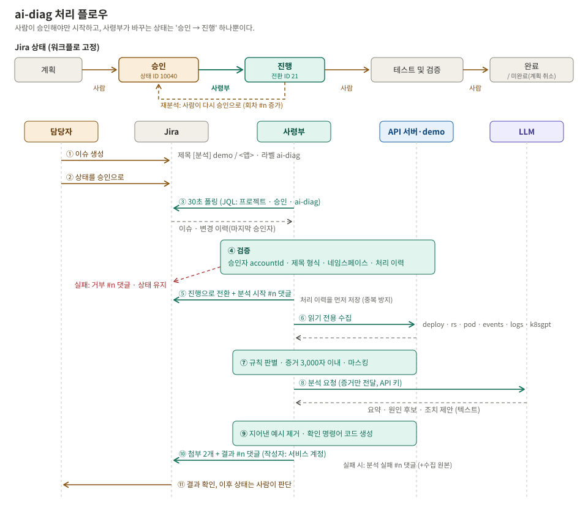
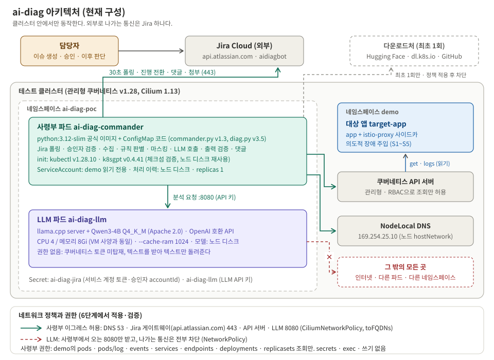

> **장애 분석 봇 만들기 시리즈**
> 1. **왜 만들었고, 어떻게 설계했나** (이 글)
> 2. [CPU 서버에서 4B 로컬 LLM 돌리기](/posts/ai-diag-bot-2-local-llm/)
> 3. [판단은 코드, 정리는 LLM](/posts/ai-diag-bot-3-rules-over-llm/)
> 4. [Jira 승인으로 움직이고, 최소 권한으로 가두기](/posts/ai-diag-bot-4-jira-and-least-privilege/)
> 5. [봇이 내 Jira 토큰을 쓰고 있었다: 서비스 계정으로 바꾸기](/posts/ai-diag-bot-5-jira-service-account/)
> 6. [한계와 다음 과제](/posts/ai-diag-bot-6-limits-and-next/)

## 들어가며: 나는 트러블슈팅이 느리다

솔직히 고백하고 시작한다. 나는 트러블슈팅에 서툴다. 장애가 나면 **무엇부터, 어떤 순서로** 봐야 하는지가 몸에 익을 때까지 시간이 꽤 걸리는 편이다. 그래서 예전 회사에서도, 지금 회사에서도 "대응이 느리다"는 말을 여러 번 들었다.

대신 내게는 다른 쪽의 고집이 있다. 시스템에 하자가 있거나 사람이 같은 일을 반복하게 만드는 구조를 발견하면, 시간이 걸리더라도 **끝까지 물고 늘어져 시스템 자체를 다시 설계해서** 고친다. 빠르게 불을 끄는 사람이라기보다, 불이 덜 나게 집을 고치는 쪽이다.

### 현장에서 느낀 것

지금 회사에서 장애를 쫓으며 반복해서 부딪힌 건 이런 상황이었다.

| 상황 | 결과 |
|---|---|
| 시스템에 레거시한 부분이 남아 있다 | 오래된 설정·구성에서 하자가 난다 |
| 인수인계가 충분하지 않아 **아무도 정확히 모르는 부분**이 있다 | 원인이 거기 있어도 바로 찾지 못한다 |
| 쿠버네티스에 모두가 익숙한 상황은 아니다 | 장애가 나면 무엇부터 어떤 순서로 볼지 **체계 없이** 더듬게 된다 |

결국 시간이 오래 걸렸다. 작년에는 이런 트러블슈팅으로 여러 번 밤을 새웠다. 그때마다 생각했다. **이 "순서"를 사람 머릿속이 아니라 시스템에 넣어 둘 수는 없을까.**

### 그래서 하고 싶었던 것: 역할 나누기

마침 AI는 정리를 잘한다. 그렇다면 역할을 나누면 된다.

| 누가 | 맡는 일 |
|---|---|
| **나** (두뇌) | 시스템을 어떻게 고치면 장애가 덜 나는지, **아키텍처와 플랫폼 안정화**에 집중한다 |
| **봇** | 배포 문제가 나면 정해진 순서로 상태·이벤트·로그를 확인하고, 원인 후보와 근거를 정리해 **요약된 인사이트만** 나에게 준다 |
| **다시 나** | 그 결과를 보고 **바로 조치**하고, 다시 내 일로 돌아간다 |

쿠버네티스에 배포한 앱이 죽으면 대개 이렇게 한다.

```
1. kubectl get pod          → 어떤 파드가 이상한지 본다
2. kubectl describe pod     → 왜 재시작하는지, 이벤트에 뭐가 찍혔는지 본다
3. kubectl logs --previous  → 죽기 직전 로그를 본다
4. 머릿속으로 "아, 메모리 부족이구나" → 조치
```

내가 서툰 건 바로 이 1~4를 **빠짐없이, 같은 순서로, 매번** 하는 일이다. 그래서 **1~4를 대신 해 주는 작은 도구**를 만들었다. 이름은 `ai-diag`다. 요청과 결과가 Jira에 남으니, 담당자 머릿속이나 메신저에만 남던 분석이 기록으로 쌓이는 덤도 생긴다.

> 만들어 보니 한 가지가 더 분명해졌다. **"정리"조차 작은 AI에게 통째로 맡기면 안 됐다.** 무엇부터 어떤 순서로 볼지, 패턴이 분명한 원인이 무엇인지는 코드가 정하고, AI는 그 결과를 문장으로 다듬기만 해야 믿을 수 있었다([3편](/posts/ai-diag-bot-3-rules-over-llm/)). 돌아보면 그게 바로 내가 원하던 것이다. 내가 매번 더듬던 **트러블슈팅의 순서를 시스템에 박아 넣는 일.**
{: .prompt-info }

이 시리즈는 그 도구를 PoC로 만들며 내린 결정과 막혔던 곳을 정리한 것이다.

### 진행 과정

| 날짜 | 한 일 | 이유·결과 |
|---|---|---|
| 1일차 | 요구 정리, 세 가지 안 비교(3장), 아키텍처, Jira 승인 방식 결정 | 처음 계획은 LLM을 **별도 VM**(4코어/8GB)에 두는 것이었다 |
| 2일차 오전 | 계획 변경: **VM 대신 테스트 클러스터 안에 LLM도 파드로** | VM을 만들려면 방화벽 검토 등 준비가 길다. "되는지"도 모르는 상태에서 인프라부터 만들 필요가 없다. LLM 파드를 **VM과 같은 4코어/8Gi로 제한**하면 측정값을 그대로 "VM이 필요한가"의 근거로 쓸 수 있다 |
| 2일차 오전 | LLM 띄우기, 속도 측정, 분석 로직 v1 → v3.3 | [2편](/posts/ai-diag-bot-2-local-llm/), [3편](/posts/ai-diag-bot-3-rules-over-llm/) |
| 2일차 오후 | Jira 연동, 파드로 이전, 권한·통신 제한, 연속 장애 시험, v3.5 | [4편](/posts/ai-diag-bot-4-jira-and-least-privilege/) |
| 3일차 | 결과 보고 → "봇이 개인 토큰을 쓴다"는 지적 | |
| 4일차 | Jira 접속을 서비스 계정으로 전환 | [5편](/posts/ai-diag-bot-5-jira-service-account/) |

---

## 1. 무엇을 만드나


_처리 플로우. 위는 Jira 상태, 아래는 누가 무엇을 하는지(① ~ ⑪)_

결과 댓글은 이런 모양이다. 일부러 DB 연결 실패로 죽게 만든 앱을 분석한 실제 출력이다.

```
[ai-diag] 분석 결과 #4 (demo / target-app, 44초)

요약
데이터베이스 연결 실패로 인해 앱이 지속적으로 재시작되고 있다.

원인 후보
1. 원인: 데이터베이스 연결 실패 / 근거: "ERROR Failed to connect to database: connection refused
   (DB_HOST=db.demo.svc:5432)"

조치 제안
• DB_HOST의 서비스(db.demo.svc)가 정상적으로 작동하는지 확인하고, 포트 5432가 열려 있는지 확인.

추가 확인 명령어 (규칙 생성)
• kubectl -n demo describe pod target-app-84676d98c7-l9fz7
• kubectl -n demo logs target-app-84676d98c7-l9fz7 -c app --previous

첨부: ...-evidence.md (수집 원본, 마스킹 적용) / ...-analysis.md (분석 전문)
```

**조치(설정 변경, 재배포)는 하지 않는다.** 보고 정리만 한다. 판단과 조치는 사람이 한다.

---

## 2. 조건

| 조건 | 이유 |
|---|---|
| 오픈소스, 상업적 사용 가능, 서버 외 비용 없음 | 회사 조건 |
| **외부 AI를 쓰지 않는다** | 클러스터 상태·로그는 내부 정보다. 외부 AI 서비스로 내보내지 않는다 |
| 서버는 4코어 / 8GB 정도 | 승인받을 수 있는 현실적인 크기. GPU 없음 |
| 1인 운영 | 관리할 부품이 늘면 안 된다 |

"외부 AI 금지 + CPU 4코어"라는 조건이 이후 거의 모든 결정을 좌우했다. 쓸 수 있는 건 **작은 로컬 LLM**뿐이고, 작은 모델의 한계를 설계로 메워야 했다.

---

## 3. 세 가지 안 비교

| 안 | 내용 | 판단 |
|---|---|---|
| A. K8sGPT 단독 | 쿠버네티스 문제 탐지 오픈소스. 설명은 연결한 AI 백엔드가 한다 | 외부 AI 연결이 전제다. Jira 이력이나 승인 흐름, 출력 검증이 없다 |
| B. 전부 자체 구축 | 수집·분석·설명을 모두 직접 만든다 | 이미 검증된 탐지 도구를 다시 만드는 셈이다 |
| **C. 중간안** | K8sGPT는 **분석기(문제 탐지)만** 쓰고, 수집·판별·설명·Jira 연동은 직접 만든다 | **선택** |

중간안을 고른 이유는 **검증된 것은 가져다 쓰고, 우리에게만 필요한 부분만 만든다**는 원칙 때문이다. 리소스 문제 탐지는 K8sGPT가 잘한다. 반면 "사람이 승인해야 시작", "결과를 Jira에 남김", "로컬 LLM 출력을 믿지 않고 검사" 같은 부분은 우리 사정이라 직접 만들어야 했다.

K8sGPT를 써 보니 그대로 쓰기엔 잡음이 많았다. 테스트 클러스터에 남아 있던 예전 webhook 설정 경고가 잔뜩 나왔고, 로그 분석기는 사이드카(istio-proxy) 로그의 평범한 문구를 오류로 잡았다. 그래서 분석기를 `Pod, Deployment, ReplicaSet, Service` 네 가지로 좁히고, 로그는 직접 모아 사이드카를 뺐다. **좋은 도구도 필요한 부분만 골라 쓰고, 해석은 우리가 한다.**

---

## 4. 아키텍처


_현재 구성. 외부로 나가는 통신은 봇 → Jira 하나뿐이다_

부품은 둘이다.

| 부품 | 비유 | 하는 일 | 권한 |
|---|---|---|---|
| **봇 (사령부)** | 비서 | Jira 확인, 승인자 확인, 대상 앱 조회, 원인 판별, LLM 결과 검사, Jira 기록. **모든 판단과 호출** | 대상 네임스페이스 **읽기 전용** |
| **로컬 LLM** | 문장 다듬는 직원 | 봇이 준 내용을 요약·원인·조치 문장으로 정리 | **없음.** 클러스터 접근 불가, 밖으로 나가는 통신 차단 |

**왜 이렇게 나눴나**: 판단과 권한을 한 곳(봇)에 모으고, LLM은 권한 없이 글만 다루게 하면 **LLM이 엉뚱한 답을 내도 시스템에 영향을 줄 수 없다.** 로그 속 문자열이 LLM을 속이는 경우(프롬프트 인젝션)도 피해가 "이상한 문장 한 줄"에 그친다. 또 LLM을 나중에 다른 서버로 옮겨도 봇의 주소 설정 하나만 바꾸면 된다.

"LLM이 직접 kubectl을 고르고 실행하는 에이전트"도 생각했지만 버렸다. 4B 모델은 도구 선택이 흔들리고, 그러려면 LLM에 권한을 줘야 한다.

### 4-1. 현재 구성 요소

| 구성 요소 | 내용 | 비고 |
|---|---|---|
| 봇 파드 | `python:3.12-slim` 공식 이미지 + 코드는 ConfigMap. 파이썬 표준 라이브러리만 사용 | 이미지 빌드 없음. 코드 교체 = ConfigMap 교체 + 재시작 |
| 봇 도구 | `kubectl`, `k8sgpt`(분석기만). initContainer가 공식 배포처에서 받아 **체크섬 검증** 후 노드 디스크에 보관 | 버전이 같으면 다시 받지 않는다. 이그레스가 막혀 있어도 재시작된다 |
| 봇 설정 | replicas 1 · Recreate, 비root, 읽기 전용 루트 파일시스템, capabilities 전부 제거 | 둘이 뜨면 같은 승인을 동시에 처리할 수 있다 |
| LLM 파드 | `llama.cpp` 서버 + **Qwen3-4B Q4_K_M**(약 2.5GB, Apache 2.0), CPU 4 / 메모리 8Gi | [2편](/posts/ai-diag-bot-2-local-llm/) |
| LLM 보호 | API 키 필수, 봇 파드에서 오는 8080만 받음, 밖으로 나가는 통신 없음 | [4편](/posts/ai-diag-bot-4-jira-and-least-privilege/) |
| 봇 권한 | 대상 네임스페이스의 pods · pods/log · events · services · endpoints · deployments · replicasets **조회만** | secrets · exec · 쓰기 없음 |
| 봇 이그레스 | DNS · Jira 게이트웨이(`api.atlassian.com`) · API 서버 · LLM만 | Cilium `toFQDNs` |
| Jira 신분 | Atlassian **서비스 계정**, 범위 제한 토큰(Bearer) | [5편](/posts/ai-diag-bot-5-jira-service-account/) |
| 처리 이력 | 노드 디스크의 `processed.json` (처리한 **승인 기록** 단위) | 재시작해도 같은 승인을 두 번 처리하지 않는다 |

### 4-2. 디렉터리 구조

```
ai-diag-src/
├── CHANGES-20261105.md           # 변경 기록 (파일 · 변경 · 이유)
├── commander/
│   ├── diag.py                   # 수집 · 규칙 판별 · 증거 문서 · LLM 호출 · 출력 검증
│   └── commander.py              # Jira 폴링 · 승인자 검증 · 진행 전환 · 댓글 · 첨부
├── manifests/                    # 번호 = 적용 순서
│   ├── 01-llm.template.yaml      # LLM Deployment · Service (모델 SHA256은 자리표시자)
│   ├── 02-commander-rbac.yaml    # 봇 ServiceAccount + 대상 네임스페이스 읽기 전용 Role
│   ├── 03-commander.yaml         # 봇 Deployment (initContainer로 도구 다운로드)
│   ├── 06-llm-netpol.yaml        # LLM: 봇만 들어오고, 밖으로는 못 나감 (NetworkPolicy)
│   └── 07-commander-egress.yaml  # 봇: 정해진 곳으로만 나감 (CiliumNetworkPolicy)
└── scenarios/                    # 정답을 아는 장애 (6장)
    ├── s1-oom.yaml
    ├── s2-imagepull.yaml
    ├── s3-crashloop.yaml
    ├── s4-readiness.yaml
    └── s5-normal.yaml
```

| 파일을 이렇게 나눈 이유 | 설명 |
|---|---|
| `diag.py` / `commander.py` 분리 | 분석 품질 문제와 Jira 연동 문제를 따로 검증하고 따로 고친다. `diag.py`는 혼자서도 돌아간다(`--no-llm`이면 수집 결과만) |
| 매니페스트 번호 = 적용 순서 | 권한 → 봇 → 정책 순서로 적용한다. **네트워크 정책은 맨 마지막**에, 하나씩 건다. 먼저 막으면 안 될 때 원인이 권한인지 통신인지 구분할 수 없다 |
| LLM 매니페스트는 템플릿 | 모델 파일 지문(SHA256)을 채운 사본만 적용한다. 지문이 비어 있으면 initContainer가 멈춘다(아무 파일이나 쓰는 일 방지) |
| 비밀값은 매니페스트에 없음 | Jira 토큰, LLM 키는 명령으로 Secret을 만든다. 파일(나중에 Git)에 값이 남지 않게 |

쿠버네티스에 만들어지는 객체는 이렇다.

| 네임스페이스 | 객체 |
|---|---|
| 봇 네임스페이스 | 봇 Deployment, LLM Deployment · Service, Secret 2개(Jira, LLM 키), ConfigMap 1개(코드), 네트워크 정책 2개, 봇 ServiceAccount |
| 대상 네임스페이스 | Role(조회만) · RoleBinding (봇 ServiceAccount에 연결) |
| 노드 디스크 | 모델 파일, kubectl · k8sgpt 바이너리, 처리 이력 |

---

## 5. 설계 원칙과 이유

### 5-1. 사람이 승인해야만 시작한다

이슈를 만들기만 해서는 아무 일도 일어나지 않는다. 담당자가 상태를 **승인**으로 바꿔야 봇이 움직인다.

봇이 바꾸는 상태는 **"승인 → 진행" 하나뿐**이다. "분석 완료", "분석 실패" 같은 상태를 새로 만들지 않았다. 회사 Jira 워크플로가 고정돼 있어 상태를 늘릴 수 없었기 때문이다. 결과·실패·거부는 모두 **댓글**로 남긴다. 다시 분석하려면 사람이 다시 승인으로 바꾸면 되고, 회차(#1, #2, …)가 늘어난다.

한 가지 함정이 있었다. 우리 Jira는 모든 전환이 **전역 전환**이라, 누구나 어느 이슈든 승인으로 바꿀 수 있다. 그래서 안전장치를 두 개 넣었다.
- 특정 **라벨**이 붙은 이슈만 본다. 보드의 승인 열에는 일반 업무 이슈도 있기 때문이다.
- 변경 이력에서 **마지막으로 승인한 사람**이 허용 목록에 있는지 확인한다. 아니면 거부 댓글만 남긴다.

### 5-2. 웹훅이 아니라 폴링

| | 폴링 (선택) | 웹훅 |
|---|---|---|
| 방향 | 봇 → Jira ("승인된 거 있어?") | Jira → 봇 ("승인됐어!") |
| 필요한 것 | **나가는 경로만** | 클러스터로 **들어오는 경로**, 도메인, 인증 |
| 반응 | 최대 30초 늦음 | 즉시 |

웹훅은 외부(Jira Cloud)가 클러스터 안으로 들어와야 한다. 인그레스를 열고 인증을 붙여야 하니 보안 검토가 커진다. 장애 분석에서 30초 늦는 건 문제가 아니다.

### 5-3. 조회만, 정해진 명령만

봇이 실행하는 명령은 **코드에 고정된 조회 명령**뿐이다. Jira 이슈 내용이나 LLM 답이 명령으로 바뀔 길이 없다. LLM이 쓴 "확인 명령어"도 사람이 참고하는 글자일 뿐, 자동 실행되지 않는다(사실 이것도 4편에서 말하듯 LLM이 아니라 코드가 만든다).

### 5-4. 확정 결론은 코드가, LLM은 설명만

이 시리즈에서 가장 중요한 원칙이다. 처음엔 모은 정보를 LLM에 주고 "원인이 뭐야?"라고 물었다. 작은 모델은 정답이 증거에 다 들어 있는데도 **해석을 틀렸다.** 결국 "메모리 부족", "이미지 없음"처럼 패턴이 분명한 장애는 **코드가 결론 문장까지 써서** 넘기고, LLM은 그걸 읽기 좋게 정리만 하게 바꿨다. 자세한 과정은 [3편](/posts/ai-diag-bot-3-rules-over-llm/)에 있다.

### 5-5. 수집·분석과 Jira 연동을 분리

분석 로직(`diag.py`)과 Jira 연동(`commander.py`)을 별도 파일로 만들었다. Jira를 붙이기 전에 분석 품질부터 맞췄다. **분석 문제와 연동 문제가 섞이면 원인을 찾기 어렵기 때문이다.** 코드는 파이썬 표준 라이브러리만 쓴다. 덕분에 공식 python 이미지에 코드를 ConfigMap으로 넣기만 하면 돼서, 이미지 빌드 단계가 필요 없었다.

---

## 6. 정답을 아는 장애 다섯 개

도구가 맞혔는지 알려면 **정답을 아는 장애**가 필요하다. 같은 디플로이먼트를 다섯 가지로 고장 냈다.

| 시나리오 | 어떻게 고장 냈나 | 정답 |
|---|---|---|
| S1 | 메모리 상한 64Mi인데 메모리를 계속 먹는 명령 | 메모리 limits 부족 (OOMKilled) |
| S2 | 존재하지 않는 이미지 태그 | 이미지 태그 없음 |
| S3 | DB 연결 실패 메시지를 찍고 바로 종료 | 로그의 DB 연결 실패 |
| S4 | 앱에 없는 경로로 readiness 검사 | probe 경로 불일치 |
| **S5** | **정상 nginx** | **이상 없음** |

S3는 이렇게 생겼다. 메시지 두 줄을 찍고 죽는 게 전부다. 쿠버네티스는 계속 다시 띄우다 CrashLoopBackOff가 된다.

```yaml
containers:
  - name: app
    image: busybox:1.36
    command: ["sh", "-c", "echo 'INFO starting api server';
              echo 'ERROR Failed to connect to database: connection refused (DB_HOST=db.demo.svc:5432)';
              exit 1"]
```

**S5(정상)를 넣은 이유**: 작은 LLM은 문제가 없어도 문제를 지어내는 경향이 있다. **정상일 때 정상이라고 말하는가**가 믿을 수 있는 도구의 기준이다.

---

## 7. 결과 미리 보기

| 확인한 것 | 결과 |
|---|---|
| 요청부터 결과 댓글까지 동작하는가 | 동작한다. 실제 Jira 이슈로 13회 처리 |
| 4코어/8GB CPU에서 쓸 만한가 | 건당 약 20초~1분 30초, LLM 메모리 약 3.5GB |
| 원인을 짚는가 | 다섯 가지 모두 1순위 원인을 맞혔다 |
| 보안 장치가 동작하는가 | 권한 밖 조회·외부 통신 차단 확인 |

그런데 이 결과에 이르기까지 함정이 많았다. 기본 설정대로면 LLM 메모리가 7GB까지 불어났고([2편](/posts/ai-diag-bot-2-local-llm/)), LLM은 프롬프트로 금지해도 값을 지어냈고([3편](/posts/ai-diag-bot-3-rules-over-llm/)), 통신을 막았더니 DNS까지 막혔다([4편](/posts/ai-diag-bot-4-jira-and-least-privilege/)). 마지막으로 보고 자리에서 "봇이 개인 토큰을 쓴다"는 지적을 받았다([5편](/posts/ai-diag-bot-5-jira-service-account/)).

## 1편 정리

| 결정 | 이유 |
|---|---|
| 외부 AI 대신 클러스터 안 로컬 LLM | 내부 정보가 밖으로 나가지 않게 |
| K8sGPT는 분석기만, 나머지는 직접 | 검증된 것은 쓰고, 우리 사정만 만든다 |
| 판단·권한은 봇, LLM은 권한 없이 글만 | LLM이 틀려도 시스템에 영향이 없게 |
| 사람이 승인해야 시작, 봇은 상태 하나만 바꿈 | 통제권은 사람에게. 고정 워크플로를 존중 |
| 폴링 | 클러스터로 들어오는 경로를 만들지 않는다 |
| 정상 시나리오 포함 | 문제를 지어내지 않는지가 신뢰의 기준 |

→ [2편: CPU 서버에서 4B 로컬 LLM 돌리기](/posts/ai-diag-bot-2-local-llm/)
