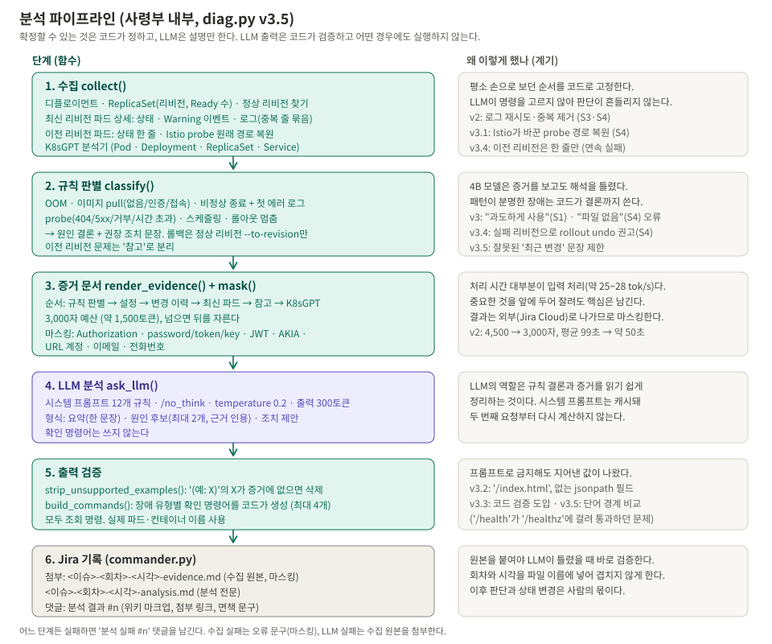

> **장애 분석 봇 만들기 시리즈**
> 1. [왜 만들었고, 어떻게 설계했나](/posts/ai-diag-bot-1-design/)
> 2. [CPU 서버에서 4B 로컬 LLM 돌리기](/posts/ai-diag-bot-2-local-llm/)
> 3. **판단은 코드, 정리는 LLM** (이 글)
> 4. [Jira 승인으로 움직이고, 최소 권한으로 가두기](/posts/ai-diag-bot-4-jira-and-least-privilege/)
> 5. [봇이 내 Jira 토큰을 쓰고 있었다: 서비스 계정으로 바꾸기](/posts/ai-diag-bot-5-jira-service-account/)
> 6. [한계와 다음 과제](/posts/ai-diag-bot-6-limits-and-next/)

## 들어가며

처음엔 단순하게 생각했다. "kubectl로 모은 정보를 LLM에 주고 원인이 뭐냐고 물으면 되겠지."

작은 모델은 **정답이 증거에 다 들어 있는데도 해석을 틀렸다.** 프롬프트로 "지어내지 마라"고 하자 **다른 값을 지어냈다.** 이 편은 분석 로직을 일곱 번 고치며(v1 → v3.5) 도착한 원칙, **"확정할 수 있는 결론은 코드가 정하고, LLM은 설명만 한다. LLM 출력은 코드가 검사한다"**에 이른 과정이다.

---

## 1. 지금의 분석 파이프라인

먼저 도착점부터 보자.


_봇 내부 6단계. 오른쪽은 각 단계를 이렇게 만든 계기_

| 단계 | 하는 일 | 누가 |
|---|---|---|
| 1. 수집 | 디플로이먼트·ReplicaSet·파드 상태, Warning 이벤트, 로그, K8sGPT 분석기 | 코드 |
| 2. **규칙 판별** | "OOM이다", "이미지가 없다" 같은 **결론 문장과 권장 조치**까지 작성 | **코드** |
| 3. 증거 문서 | 중요한 순서로 3,000자 안에 정리, 민감 정보 가림(마스킹) | 코드 |
| 4. 정리 | 규칙 결론 + 증거를 요약 / 원인 후보 / 조치 제안 문장으로 | **LLM** |
| 5. **출력 검사** | 증거에 없는 예시 삭제, 확인 명령어는 코드가 생성 | **코드** |
| 6. 기록 | Jira 댓글 + 첨부(수집 원본, 분석 전문) | 코드 |

LLM이 하는 일은 6단계 중 **하나**뿐이다. 처음부터 이랬던 건 아니다.

---

## 2. 고친 과정

Jira를 붙이기 전에, 작업 서버에서 파이썬 스크립트 하나(`diag.py`)로 분석 품질부터 맞췄다. 정답을 아는 장애 다섯 개([1편](/posts/ai-diag-bot-1-design/) 6장)를 번갈아 내면서 돌렸다.

```bash
kubectl apply -f scenarios/s3-crashloop.yaml                    # 장애 내기
python3 diag.py --namespace demo --app target-app --no-llm      # LLM 없이 수집 결과만
python3 diag.py --namespace demo --app target-app               # LLM까지
```

### v1 → v2: 보내는 글부터 정리

| 본 것 | 원인 | 고친 것 |
|---|---|---|
| 죽는 앱의 로그가 비어 있다 | 재시작 타이밍에 따라 직전 로그(`--previous`)가 없을 때가 있는데 한쪽만 시도했다 | 상태를 보고 맞는 쪽 먼저, 실패하면 반대쪽 |
| 같은 로그가 수십 줄 | 시각만 다른 같은 줄이 반복된다 | 같은 줄은 한 번만, "(같은 줄 N회 반복)" |
| probe 장애 원인을 못 짚는다 | probe 설정을 아예 수집하지 않았다 | 수집 |
| 평균 99초 | Normal 이벤트 등 필요 없는 정보까지 보냈다 | Warning만, 4,500자 → 3,000자 |

### v2 → v3: 결론은 코드가 쓴다 (가장 중요한 변화)

| 장애 | LLM이 한 말 | 실제 |
|---|---|---|
| OOM | "앱이 메모리를 **과도하게** 사용" | 상한(64Mi)이 낮은 것이다. 앱이 과한지는 증거로 알 수 없다 |
| probe 404 | "파일이 없어 404 → 파일을 만들어라" | 검사 경로가 앱에 없는 것이다. 파일을 만들 일이 아니다 |
| CrashLoop | "CrashLoopBackOff가 원인 → 재배포" | CrashLoop은 **증상**이다. 원인은 로그의 DB 연결 실패 |

증거에는 정답이 다 들어 있었다. `OOMKilled`, `limits: 64Mi`, `HTTP probe failed with statuscode: 404`, `connection refused`. **작은 모델이 해석을 틀린 것이다.**

그래서 패턴이 분명한 장애는 **코드가 결론 문장까지 써서** 넘기기로 했다.

```
# 규칙 기반 1차 판별 (확정 사실)
- OOMKilled(exit code 137), 재시작 3회 -> 메모리 사용량이 limits(memory=64Mi)를 넘어 강제 종료됨.
  limits가 실제 사용량보다 낮다
- 이미지 pull 실패(ErrImagePull) -> 레지스트리에 이미지 nginx:1.27-does-not-exist가 없다
  (이미지 이름 또는 태그 오류)
```

시스템 프롬프트에는 "규칙 판별은 **확정 사실**이다. 그 결론을 그대로 쓰고 새 결론을 만들지 마라"를 넣었다.

비유하면, 신입에게 현장 사진만 주고 원인을 묻던 것을 **선배(코드)가 결론을 적어 주고 신입(LLM)은 보고서 형식으로 정리**하게 바꾼 것이다. 작은 모델은 추리는 약하고 정리는 잘한다.

같은 일을 앞서 [보안 공지봇 2편](/posts/small-llm-failure-and-fix/)에서도 겪었다. 그때는 작은 모델이 Critical 취약점을 '중간'이라고 보고했다. 작은 모델에게 판단을 맡기면 안 된다는 교훈을 두 번째 도구에서 다시 확인한 셈이다.

### v3 → v3.1: 현장 사정

| 본 것 | 원인 | 고친 것 |
|---|---|---|
| probe 경로가 `/app-health/app/readyz:15020`로 보인다 | **Istio 사이드카**가 probe를 자기 쪽으로 돌려 놓는다. 원래 경로는 사이드카 환경 변수(`ISTIO_KUBE_APP_PROBERS`)에 있다 | 원래 경로(`/healthz:80`)를 찾아 표시 |
| "최근 변경" 판별이 빠진다 | 준비 상태 계산에 init 컨테이너를 섞었다 | init 컨테이너 구분 |

**현장 사정(Istio 같은)을 모르면 맞는 증거로도 틀린 결론이 나온다.**

### v3.1 → v3.2 → v3.3: 지어낸 값 막기

v3.1에서 probe 장애의 조치 제안에 **"`/healthcheck`로 바꿔라"**가 나왔다. `/healthcheck`는 증거 어디에도 없다. 지어낸 값이다.

| 버전 | 시도 | 결과 |
|---|---|---|
| v3.2 | 프롬프트에 **"증거에 없는 예시는 쓰지 마라"** 추가 | **이번엔 `/index.html`을 지어냈다.** 확인 명령어에는 존재하지 않는 jsonpath 필드를 썼다 |
| v3.3 | 프롬프트로 부탁하기를 그만두고 **코드로 검사** | 해결 |

v3.3의 검사는 두 가지다.

```python
def strip_unsupported_examples(answer, evidence):
    """'(예: X)'에서 X가 증거에 없으면 괄호째 지우고, 지운 목록을 돌려준다"""
    ...

def build_commands(ev, findings):
    """확인 명령어는 LLM에게 시키지 않는다. 장애 유형별로 코드가 만든다 (실제 파드·컨테이너 이름)"""
    ...
```

지운 게 있으면 결과 댓글에 `(후처리: 증거에 없는 예시 N건 제거)`를 붙인다. 사람이 "LLM이 뭔가 지어냈구나"를 알 수 있게 하기 위해서다.

확인 명령어를 코드가 만들자 부수 효과도 있었다. 명령어에 **실제 파드 이름**이 들어간다. 그대로 복사해 쓸 수 있고, 모두 조회 명령이라 실행해도 아무것도 바뀌지 않는다.

> **프롬프트는 부탁이고, 코드는 보장이다.** 작은 모델에서 "하지 마라"는 지시는 확률을 조금 낮출 뿐이다. 반드시 지켜야 하는 것은 코드로 검사한다.
{: .prompt-tip }

---

## 3. 실전처럼 시험하자 드러난 문제 (v3.4, v3.5)

오전에 다섯 개를 다 맞혀서 끝난 줄 알았다. 오후에 Jira와 연결하고, 시나리오를 **같은 디플로이먼트에 연달아** 배포하며 다시 시험했다.

### 3-1. 맞혔는데 이상하다

```
[이미지 오류 시나리오]
원인 후보: 1. 이미지 태그 오류 (nginx:1.27-does-not-exist가 존재하지 않음)
          2. 메모리 제한 부족                                ← ?

[probe 시나리오]
원인 후보: 1. readinessProbe 경로 누락 (/healthz:80 경로 없음)
          2. 이미지 태그 오류                                ← ?
조치 제안: ... 이전 리비전으로 롤백                           ← ?
```

1순위는 맞았는데, 다른 장애 이야기가 섞였다. 그리고 "이전 리비전으로 롤백"하라고 했다.

### 3-2. 왜 그랬나

```
리비전:   정상 → OOM → 이미지 없음 → probe 실패(최신)
                 ↑ 파드 남음  ↑ 파드 남음    ↑ 지금 문제
```

배포가 실패할 때마다 실패한 리비전의 파드가 남았다. 코드가 **이전 리비전 파드의 문제까지** 원인 후보로 넘겼고, LLM은 그걸 그대로 받아썼다.

롤백 권고는 더 심각했다. `kubectl rollout undo`는 **바로 전 리비전**으로 돌아간다. 바로 전은 "이미지 없음" 리비전이다. 롤백하면 또 실패한다. 실제로 리비전별 Ready 수를 확인해 보니:

```bash
kubectl -n demo get rs -l app=target-app \
  -o custom-columns='REV:.metadata.annotations.deployment\.kubernetes\.io/revision,IMAGE:.spec.template.spec.containers[0].image,READY:.status.readyReplicas'
```

```
REV   IMAGE                       READY
3     busybox:1.36                <none>
4     nginx:1.27-does-not-exist   <none>
2     nginx:1.27-alpine           <none>      ← 정상이었던 리비전
5     nginx:1.27-alpine           <none>      ← 최신
```

**모든 리비전의 READY가 비어 있었다.** 정상이던 리비전의 파드마저 이미 내려가 있었다. "바로 전 리비전은 정상일 것"이라는 가정이 완전히 틀렸다.

> **규칙이 틀리면 LLM도 틀린다.** LLM은 코드가 넘긴 규칙 문장을 확정 사실로 받아쓴다. "코드가 결론을 쓴다"는 원칙은 규칙의 품질에 책임을 진다는 뜻이기도 하다.
{: .prompt-warning }

실제 운영에서는 "배포 실패 → 고친다고 다시 배포 → 또 실패"가 흔하다. 오전 시험이 너무 깨끗했던 것이고, 오후 시험이 오히려 **실전에 가까웠다.**

### 3-3. 고친 것

| 문제 | v3.4 / v3.5 |
|---|---|
| 이전 리비전 문제가 원인에 섞인다 | 이전 리비전 파드는 상태 한 줄만 모아 **"참고: 이전 리비전 (현재 원인 아님)"**으로 분리. LLM에게 "참고는 원인·조치에 쓰지 마라" |
| 바로 전으로 롤백 권고 | **지금 Ready 파드가 있는 이전 리비전**(정상 리비전)을 찾아 `rollout undo --to-revision=N`으로만. 정상 리비전이 없으면 롤백을 권하지 않고 "rollout history에서 사람이 고르라"고 안내 |
| 이전 리비전 정보 때문에 글이 길다 | 이벤트·로그는 최신 리비전 파드만 (3.7KB → 1.5KB) |
| "최근 변경" 문장이 실패 리비전과 비교 | 정상 리비전과 비교할 수 있고, 다른 확정 원인이 없을 때만 남긴다 |
| `/health`가 지워지지 않았다 | 예시 검사가 "글자 포함"이라 `/health`가 `/healthz` 안에 있다고 통과했다. **단어 단위**로 비교 |
| 출력에 `limits{'memory': '64Mi'}` | 파이썬 표기 대신 `memory=64Mi` |

고친 코드는 실제 클러스터에 올리기 전에 **가짜 데이터로 "연속 실패가 쌓인 상태"를 만들어 오프라인으로** 먼저 시험했다. 그 덕분에 단어 단위 비교를 고치다 경로의 `/`로 단어를 나누는 바람에 `/healthz`가 오히려 지워지는 버그도 미리 잡았다.

| | v3.3 | v3.4 | v3.5 |
|---|---|---|---|
| 이전 리비전 문제 섞임 | 있음 | 없음 | 없음 |
| 잘못된 롤백 권고 | 있음 | 없음 | 없음 |
| 엉뚱한 원인 문장 | — | 있음 | 없음 |
| 지어낸 예시 | 1건 제거됨 | 남음 | 없음 |

---

## 4. 지금의 시스템 프롬프트 (요지)

규칙 하나하나에 생긴 계기가 있다.

| 규칙 | 계기 |
|---|---|
| 규칙 판별은 확정 사실. 그 결론을 그대로 쓰고 새 결론을 만들지 않는다 | v2의 틀린 해석 |
| 증거만 근거로, 근거는 60자 안으로 짧게 인용 | — |
| 원인 후보 최대 2개. 증상(Back-off, Ready 아님)은 원인이 아니다 | "CrashLoop이 원인" |
| 이상이 없으면 '이상 없음' / '해당 없음'만 | 정상 앱에서 문제를 지어내지 않게 |
| '참고: 이전 리비전'은 원인·조치에 쓰지 않는다 | 연속 실패 시험 |
| 재배포·단순 재시작 같은 무의미한 조치 금지 | "재배포" 권고 |
| 예시는 증거에 있는 값만, 확인 명령어는 쓰지 않는다 | 지어낸 경로·필드 (코드 검사와 이중으로) |
| 정해진 형식 (요약 / 원인 후보 / 조치 제안), 평어체 | 경어체가 섞였다 |

## 5. 결과

정상 시나리오는 "이상 없음 / 해당 없음"으로 나왔다. **문제를 지어내지 않았다.** 나머지 네 장애도 모두 1순위 원인을 맞혔고, 연속 배포 실패 상태에서도 v3.5로 정확해졌다.

| 장애 | 1순위 원인 | 시간 |
|---|---|---|
| 정상 | 이상 없음 | 22~24초 |
| OOM | limits가 실제 사용량보다 낮다 | 47~73초 |
| 이미지 | 태그 없음 | 50~90초 |
| CrashLoop | DB 연결 실패 | 43~65초 |
| probe | 경로 `/healthz` 불일치 | 50~89초 |

시간은 작업 서버의 반복 시험과 실제 Jira 이슈 처리(13회차까지)에서 나온 범위다. 시나리오별 정확한 시행 횟수는 따로 기록하지 않았다. 시나리오당 몇 회 수준이라 적중률을 통계로 말할 단계는 아니고, "정답을 아는 장애를 매번 맞혔다"까지만 주장한다.

남은 아쉬움도 있다. 같은 원인을 표현만 바꿔 두 번 쓰거나, `예:` 없이 값을 단정하는 경우가 가끔 있다. 그리고 **규칙 밖 장애**(규칙에 없는 유형)는 LLM 혼자 판단하는데, 그 품질은 아직 재지 않았다([6편](/posts/ai-diag-bot-6-limits-and-next/)).

## 3편 정리

| 배운 것 | 어디서 |
|---|---|
| 작은 LLM은 **판단**을 틀리고 **금지**를 어긴다. **정리**는 잘한다 | v2 ~ v3.3 |
| 확정할 수 있는 결론은 코드가 쓰고, LLM 출력은 코드로 검사한다 | v3, v3.3 |
| 프롬프트는 부탁, 코드는 보장 | v3.2 → v3.3 |
| 규칙이 틀리면 LLM도 틀린다. 규칙의 가정을 실제로 확인한다 | 롤백 권고, READY 확인 |
| 실제처럼(연달아 실패) 시험해야 실제 문제가 보인다 | v3.4 |
| 고친 코드는 가짜 데이터로 먼저 시험한다 | v3.4·v3.5 오프라인 시험 |

→ [4편: Jira 승인으로 움직이고, 최소 권한으로 가두기](/posts/ai-diag-bot-4-jira-and-least-privilege/)
