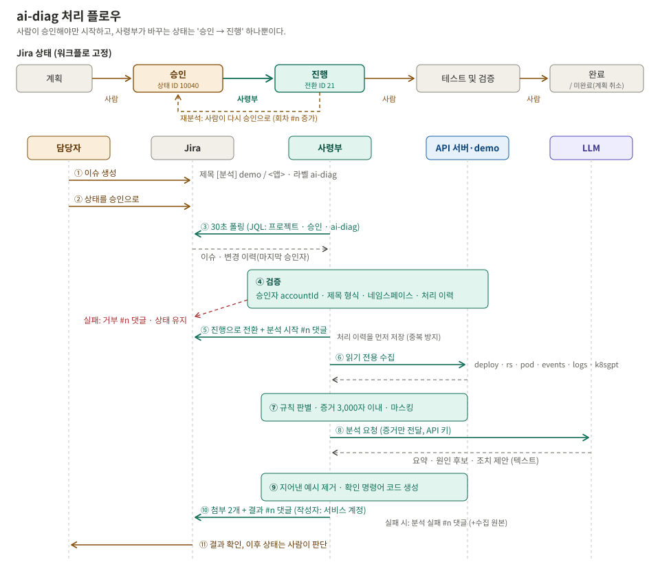
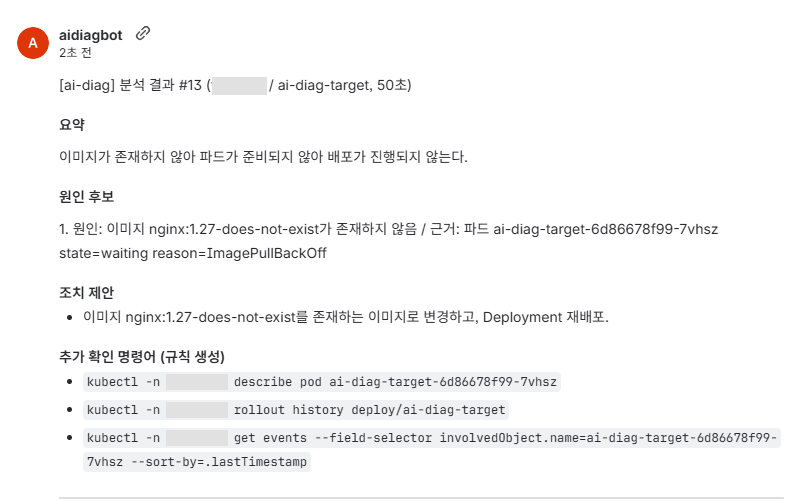
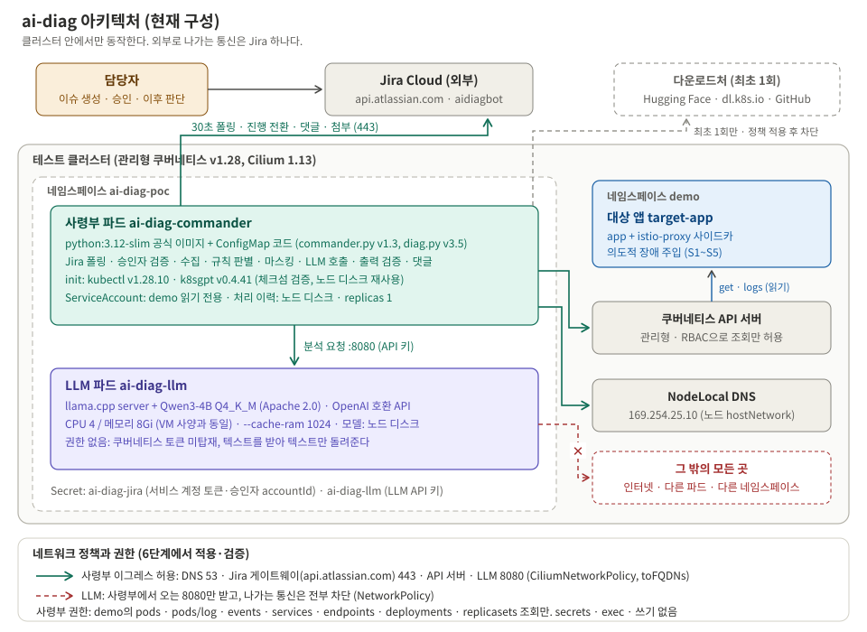

> **장애 분석 봇 만들기 시리즈**
> 1. [왜 만들었고, 어떻게 설계했나](/posts/ai-diag-bot-1-design/)
> 2. [CPU 서버에서 4B 로컬 LLM 돌리기](/posts/ai-diag-bot-2-local-llm/)
> 3. [판단은 코드, 정리는 LLM](/posts/ai-diag-bot-3-rules-over-llm/)
> 4. **Jira 승인으로 움직이고, 최소 권한으로 가두기** (이 글)
> 5. [봇이 내 Jira 토큰을 쓰고 있었다: 서비스 계정으로 바꾸기](/posts/ai-diag-bot-5-jira-service-account/)
> 6. [한계와 다음 과제](/posts/ai-diag-bot-6-limits-and-next/)

## 들어가며

[3편](/posts/ai-diag-bot-3-rules-over-llm/)까지는 작업 서버(베스천)에서 **내 관리자 권한으로** 분석 스크립트를 돌렸다. 이 편에서는 두 가지를 한다.

1. **Jira와 연결한다.** 사람이 이슈를 승인하면 봇이 분석하고 결과를 댓글로 남긴다.
2. **클러스터 안 파드로 옮기고 가둔다.** 봇은 대상 앱을 읽기만, LLM은 봇 요청만, 둘 다 정해진 곳으로만 통신하게 한다.

---

## 1. Jira 연결: 승인이 곧 실행 버튼


_위는 Jira 상태, 아래는 ① ~ ⑪ 처리 순서_

### 1-1. 이슈 형식과 상태 규칙

| 항목 | 규칙 | 이유 |
|---|---|---|
| 제목 | `[분석] <네임스페이스> / <디플로이먼트>` | 이 형식에서 분석 대상을 읽는다 (정규식) |
| 라벨 | `ai-diag` | 보드의 승인 열에는 일반 업무 이슈도 있다. 라벨이 있는 이슈만 본다 |
| 시작 | 사람이 상태를 **승인**으로 | 이슈를 만들기만 해서는 아무 일도 일어나지 않는다 |
| 봇이 바꾸는 상태 | **승인 → 진행** 하나뿐 | 워크플로가 고정이라 상태를 늘리지 않는다. 결과·실패·거부는 댓글로 |
| 재분석 | 사람이 다시 승인으로 | 회차가 #1, #2, … 로 늘고 첨부도 회차별로 남는다 |

봇은 상태를 **이름이 아니라 ID**로 다룬다. 실제로 조회해 보니 전환 이름은 "진행 중", 도착 상태 이름은 "진행"으로 **달랐다.** 이름으로 짰다면 엇나갔을 것이다.

### 1-2. 누가 승인했나

우리 Jira는 모든 전환이 **전역 전환**이라 누구나 어느 이슈든 승인으로 바꿀 수 있다. 그래서 봇은 이슈의 **변경 이력**에서 "마지막으로 승인으로 바꾼 사람"의 accountId를 찾아 허용 목록과 비교한다.

```
30초마다 반복:
  1. 검색: 프로젝트 + 승인 상태 + ai-diag 라벨 이슈가 있나?
  2. 변경 이력: 마지막 승인자가 허용 목록에 있나?
  3. 제목 형식이 맞나? 네임스페이스가 허용 목록에 있나?
     → 하나라도 아니면 "요청 거부" 댓글만 달고 끝 (상태는 안 바꾼다)
  4. 상태를 '진행'으로 바꾸고 "분석 시작" 댓글
  5. 수집 → 판별 → LLM → 검사
  6. 첨부 2개 + "분석 결과" 댓글
```

- **accountId로 비교하는 이유**: 표시 이름은 바뀔 수 있지만 accountId는 바뀌지 않는다.
- **처리 기록은 "승인 기록" 단위**로 남긴다. 이슈 번호 단위로 남기면 재분석을 못 한다. 같은 이슈를 사람이 다시 승인하면 새 승인 기록이 생기고, 그게 새 회차가 된다.
- **기록은 진행 전환 직후 먼저 저장**한다. 분석 도중 봇이 죽어도 같은 승인을 다시 집지 않는다.

### 1-3. 실제 Jira 화면

아래는 실제 Jira 이슈에 달린 결과 댓글이다. 작성자가 사람이 아니라 봇 전용 계정(`aidiagbot`)인 이유는 [5편](/posts/ai-diag-bot-5-jira-service-account/)에 있다. 내부 네임스페이스 이름은 가렸다.


_없는 이미지 태그로 배포한 장애를 분석한 13회차 결과. 50초 걸렸다_

| 부분 | 읽는 법 |
|---|---|
| `#13` | 이 이슈에서 13번째 분석이다(승인할 때마다 1씩 는다) |
| 요약 | 무엇이 왜 문제인지 한 문장 |
| 원인 후보 | 원인과 **근거**. 근거는 실제 이벤트·로그 원문을 인용한다 |
| 조치 제안 | 참고용. 실제 조치는 사람이 판단한다 |
| 추가 확인 명령어 (규칙 생성) | **LLM이 아니라 코드가 만든** 조회 명령. 실제 파드 이름이 들어가고, 실행해도 아무것도 바뀌지 않는다 |
| 첨부 2개 (화면 아래, 잘림) | `evidence.md`(봇이 실제로 모은 원본, 민감 정보 가림), `analysis.md`(분석 전문). **결과가 의심되면 원본에서 근거를 확인한다** |

처음엔 첨부가 안 된 줄 알았다. 댓글에 파일 이름만 글자로 보였기 때문이다. 화면 대신 API로 확인해 보니 첨부는 이슈의 첨부 영역에 잘 올라가 있었다. 두 가지를 고쳤다.
- 댓글의 파일 이름을 `[^파일명]`(Jira 첨부 링크 문법)으로 바꿔, 댓글 안에 첨부 카드로 보이게 했다.
- Jira는 첨부가 실패해도 **200 + 빈 목록**을 돌려줄 때가 있다. 빈 응답이면 오류로 처리하게 했다.

> **"안 된 것 같다"면 화면 말고 API로 사실을 먼저 본다.**
{: .prompt-tip }

### 1-4. 시험 이력

같은 이슈 하나로 13번 승인해 다양한 경로를 시험했다.

| 회차 | 실행 위치 | 시나리오 | 결과 |
|---|---|---|---|
| #1 ~ #2 | 베스천 (관리자 권한) | CrashLoop | DB 연결 실패 ✅ |
| #3 | **파드** (읽기 전용 권한) | CrashLoop | ✅ |
| #4 | 파드 + **네트워크 정책 2개** | CrashLoop | ✅ (DNS 사고 후 복구, 3장) |
| #5 ~ #8 | 파드 + 정책 | 정상 · OOM · 이미지 · probe | 정상은 "이상 없음" ✅. 연속 실패에서 다른 원인이 섞임 △ ([3편](/posts/ai-diag-bot-3-rules-over-llm/)) |
| #9 | 파드 + 정책 | **허용되지 않은 네임스페이스** | 거부 댓글만, 상태 유지 ✅ |
| #10 ~ #12 | 파드 + 정책 | probe · 이미지 (v3.4·v3.5) | ✅ |
| #13 | 파드 + 정책 + **서비스 계정** | 이미지 | ✅ ([5편](/posts/ai-diag-bot-5-jira-service-account/)) |

거부 시험(#9) 뒤에 함정이 하나 있었다. 제목을 고치고 다시 처리하려는데 봇이 조용했다. 거부했을 때 상태를 바꾸지 않으니 이슈는 **승인에 그대로** 있었고, 이미 승인인 이슈를 다시 승인으로 바꿀 수는 없어서 **새 승인 기록이 생기지 않았던** 것이다. 다른 상태로 옮겼다가 다시 승인하니 처리됐다. 이후 거부 댓글과 `--dry-run` 출력에 "다른 상태로 옮겼다가 다시 승인하라"는 안내를 넣었다. **조용히 건너뛰는 코드는 이유를 말하게 만든다.**

---

## 2. 파드로 옮기기: 읽기 전용 출입증

베스천에서는 내 관리자 권한으로 돌았다. 설계상 봇은 **대상 네임스페이스를 읽기만** 해야 한다. 이건 파드로 옮겨야 비로소 검증된다.

| 만든 것 | 비유 | 내용 |
|---|---|---|
| ServiceAccount | 신분증 | 봇 파드의 계정 (봇 네임스페이스) |
| Role | 출입 규칙 | 대상 네임스페이스에서 pods · pods/log · events · services · endpoints · deployments · replicasets **get/list만** |
| RoleBinding | 신분증에 규칙 연결 | 위 계정에 위 규칙을 붙인다 |

**"되는 것"만이 아니라 "안 되는 것"까지 확인**했다. `--as`로 봇 계정인 척 물어보는 명령이다. 실제로는 아무것도 바꾸지 않는다.

```bash
SA=system:serviceaccount:ai-diag:ai-diag-commander
for q in "get pods -n demo" "get pods/log -n demo" "list deployments -n demo" \
         "get secrets -n demo" "delete pods -n demo" "create pods/exec -n demo" \
         "get pods -n default" "get secrets -n ai-diag"; do
  printf "%-28s %s\n" "$q" "$(kubectl auth can-i $q --as=$SA)"
done
```

```
get pods -n demo             yes
get pods/log -n demo         yes
list deployments -n demo     yes
get secrets -n demo          no    ← 비밀값 못 봄
delete pods -n demo          no    ← 아무것도 못 바꿈
create pods/exec -n demo     no    ← 파드 안에 못 들어감
get pods -n default          no    ← 다른 네임스페이스 못 봄
get secrets -n ai-diag       no    ← 자기 네임스페이스 비밀값도 못 봄
```

이제 봇 계정이 유출돼도 볼 수 있는 건 대상 네임스페이스의 파드 상태와 로그뿐이다. K8sGPT 분석기도 이 좁은 권한에서 오류 없이 돌았다(`"errors": null`).

### 2-1. 이미지를 빌드하지 않는 봇

| 방법 | 이유 |
|---|---|
| 공식 `python:3.12-slim` + 코드는 ConfigMap | 표준 라이브러리만 쓰니 가능하다. 빌드·레지스트리 단계가 없다 |
| kubectl · k8sgpt는 initContainer가 받아 **체크섬 검증** | `sha256sum -c`로 공식 배포처의 지문과 맞을 때만 쓴다 |
| 바이너리는 노드 디스크에 보관 | 재시작 때 다시 받지 않는다. 이그레스가 막혀 있어도 5초 만에 뜬다 |
| kubectl 버전은 **서버와 같게** | 클라이언트·서버 마이너 버전 차이는 ±1 안이어야 안전하다 |
| `TZ=KST-9` | 로그·첨부 파일 이름을 한국 시각으로. POSIX 표기라 이미지에 시간대 데이터가 없어도 된다 |

### 2-2. 확인 명령이 틀릴 수도 있다

파드 안에서 kubectl이 되는지 보려고 이렇게 쳤다가 실패했다.

```bash
kubectl -n ai-diag exec deploy/ai-diag-commander -- kubectl -n demo get pod --request-timeout=5s
# The connection to the server localhost:8080 was refused
```

그런데 봇은 방금 분석에 성공했었다. 원인은 내가 붙인 `--request-timeout` 옵션이었다. 파드 안 kubectl은 설정이 **기본값일 때만** "나는 파드 안에 있으니 파드의 ServiceAccount로 접속하자"고 판단한다. 옵션 하나가 그 판단을 건너뛰게 해 기본 주소(`localhost:8080`)로 가 버렸다. **확인은 실제 프로그램과 같은 방식으로 한다.**

---

## 3. 통신 가두기


_허용된 통신(실선)과 차단(점선). 외부로 나가는 건 봇 → Jira 하나뿐이다_

순서는 **LLM 정책 → 봇 정책**, 그리고 **같은 시험 명령을 적용 전후로** 실행해 비교했다. 그래야 "막혔다"가 정책 때문인지 원래 안 되던 건지 구분된다.

### 3-1. LLM: 봇만 들어오고, 아무 데도 못 나간다

표준 NetworkPolicy 하나로 충분하다.

```yaml
spec:
  podSelector: { matchLabels: { app: ai-diag-llm } }
  policyTypes: [Ingress, Egress]
  ingress:
    - from: [{ podSelector: { matchLabels: { app: ai-diag-commander } } }]
      ports: [{ port: 8080, protocol: TCP }]
  egress: []          # 나가는 통신 없음
```

| 시험 | 적용 전 | 적용 후 |
|---|---|---|
| 임시 파드 → LLM | `200` (누구나 접속) | `000` (차단) |
| 봇 → LLM | — | `200` |

LLM은 이제 권한도 없고 나갈 길도 없다. 로그 속 문자열이 LLM을 속여도 할 수 있는 건 이상한 문장을 돌려주는 것뿐이다.

### 3-2. 봇: 정해진 네 곳으로만

봇이 나갈 곳은 **DNS, Jira, 쿠버네티스 API 서버, LLM** 네 곳이다. Jira를 도메인 이름으로 허용하려면 표준 NetworkPolicy로는 안 되고, Cilium의 `toFQDNs`를 써야 한다.

```yaml
apiVersion: cilium.io/v2
kind: CiliumNetworkPolicy
spec:
  endpointSelector: { matchLabels: { app: ai-diag-commander } }
  egress:
    - toEntities: [host]                        # DNS (NodeLocal DNS, 3-3)
      toPorts: [{ ports: [{ port: "53", protocol: ANY }], rules: { dns: [{ matchPattern: "*" }] } }]
    - toCIDR: [169.254.25.10/32]
      toPorts: [{ ports: [{ port: "53", protocol: ANY }], rules: { dns: [{ matchPattern: "*" }] } }]
    - toFQDNs: [{ matchName: api.atlassian.com }]   # Jira (5편에서 바뀜)
      toPorts: [{ ports: [{ port: "443", protocol: TCP }] }]
    # (coredns 파드로 가는 53번 규칙도 있다. NodeLocal DNS가 없는 노드 대비. 생략)
    - toEntities: [kube-apiserver]
    - toEndpoints: [{ matchLabels: { app: ai-diag-llm } }]
      toPorts: [{ ports: [{ port: "8080", protocol: TCP }] }]
```

`rules: dns`가 핵심이다. `toFQDNs`가 동작하려면 Cilium이 **DNS 대답을 엿봐서** "이 도메인은 이 IP다"를 알아야 한다. DNS 허용 규칙에 이걸 붙여야 Cilium의 DNS 프록시가 대답을 보고 그 IP로만 443을 열어 준다.

### 3-3. 사고: 정책을 걸었더니 Jira와 LLM까지 막혔다

```
Jira               차단/실패 (URLError)
LLM                차단/실패 (URLError)
외부-google        차단/실패 (URLError)
외부-huggingface   차단/실패 (URLError)
kubectl            (정상)
```

추리했다.

| 단서 | 생각 |
|---|---|
| kubectl은 된다 | kubectl은 API 서버를 **IP**로 찾아간다(파드 환경 변수에 IP가 있다). 이름 조회가 필요 없다 |
| Jira·LLM은 안 된다 | 둘 다 **이름**으로 찾아간다 |
| → DNS가 막혔다? | 이름 조회만 따로 시험 |

```
ai-diag-llm       -> 이름 조회 실패: [Errno -3] Temporary failure in name resolution
api.atlassian.com -> 이름 조회 실패: [Errno -3] Temporary failure in name resolution
```

(당시 Jira 대상은 회사 사이트 주소였다. 지금 구성에 맞춰 `api.atlassian.com`으로 바꿔 적었다.)

DNS 확정. 파드가 DNS를 어디에 묻는지 봤다.

```bash
kubectl -n ai-diag exec deploy/ai-diag-commander -- cat /etc/resolv.conf
# nameserver 169.254.25.10
```

`169.254.25.10`은 coredns 파드가 아니다. **NodeLocal DNS**였다. 노드마다 DNS 캐시를 두고, 파드는 노드의 특수 주소에 이름을 묻는다. 관리형 쿠버네티스에서 흔한 구성이다. 처음 정책은 "coredns 파드로 가는 DNS만 허용"이라 노드로 가는 DNS가 막혔던 것이다. 노드(`host`)와 `169.254.25.10`의 **53번만** 추가로 허용해 해결했다. 노드의 다른 포트는 여전히 막혀 있다.

```
Jira               통신 가능
LLM                통신 가능 (200)
외부-google        차단/실패 (URLError)
외부-huggingface   차단/실패 (URLError)
```

> **관리형 클러스터에서 이그레스 정책을 걸기 전에, 파드의 `/etc/resolv.conf`부터 본다.**
{: .prompt-warning }

덤으로, DNS가 막혀 있던 7분 동안 봇 로그에는 `폴링 오류`가 찍혔지만, 정책을 고치자 **재시작 없이** 다음 폴링부터 스스로 복구됐다. 오류가 나도 반복을 멈추지 않게 짜 둔 덕분이다.

---

## 4. 비밀값 다루기

| 장치 | 막아 주는 것 |
|---|---|
| `read -s`로 입력 | 화면에도, 셸 기록(history)에도 남지 않는다 |
| `${#변수}`로 확인 | 값이 아니라 **글자 수**만 본다 |
| Secret은 `--from-file=KEY=<(printf ...)`로 생성 | 값이 명령 인자(`ps`)에도 펼쳐지지 않는다 |
| `describe secret`로 확인 | 값이 아니라 **바이트 수**만 보인다 |
| 증거 문서 마스킹 | Authorization 헤더, password/token/key=값, JWT, 액세스 키, URL 속 계정, 이메일, 전화번호를 가린 뒤 Jira로 보낸다 |

Secret은 base64일 뿐 암호화가 아니다. 비밀 관리 도구(Vault 등)로 옮기는 건 [6편](/posts/ai-diag-bot-6-limits-and-next/)의 과제다.

## 5. 검증 결과 요약

| 항목 | 결과 |
|---|---|
| 봇 권한 | 조회 3개 yes, 비밀값·삭제·exec·다른 네임스페이스·자기 비밀값 5개 no |
| K8sGPT (좁은 권한) | `errors: null` |
| LLM 인그레스 | 정책 전 임시 파드 200 → 정책 후 000, 봇 200 |
| 봇 이그레스 | Jira · LLM · API 서버만 가능, 외부(google, huggingface) 차단 |
| 비밀값 | 토큰 · accountId · LLM 키가 명령 기록 · 파일 · 대화에 남지 않음 |

## 4편 정리

| 배운 것 | 어디서 |
|---|---|
| 승인 버튼은 **누가 눌렀는지**까지 확인해야 버튼이다 | 전역 전환, 변경 이력 |
| 화면 말고 API로 사실부터 본다 | 첨부 오해 |
| 권한은 "안 되는 것"까지 `can-i --as`로 확인한다 | RBAC |
| 통신 제한은 마지막에, 하나씩, 전후 비교로 | 네트워크 정책 |
| 관리형 클러스터는 DNS가 어디로 가는지부터 확인한다 | NodeLocal DNS |
| 확인 명령도 틀릴 수 있다. 실제 프로그램과 같은 방식으로 | `--request-timeout` |
| 오류에도 멈추지 않는 반복 구조는 스스로 복구된다 | 폴링 오류 |

여기까지 하고 결과를 보고했는데, 놓친 게 하나 있었다. 봇이 Jira에 **누구의 이름으로** 접속하고 있었는가.

→ [5편: 봇이 내 Jira 토큰을 쓰고 있었다](/posts/ai-diag-bot-5-jira-service-account/)
