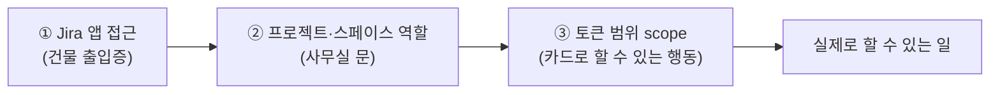
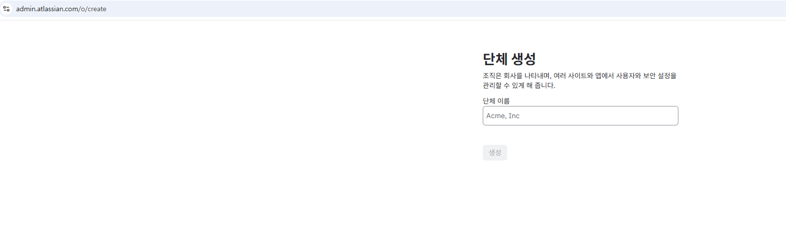
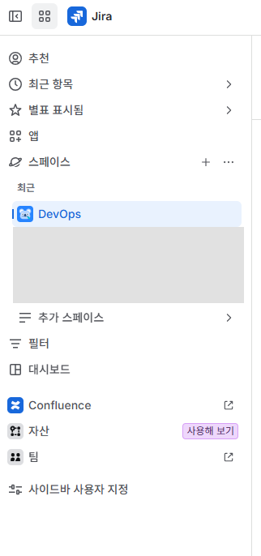
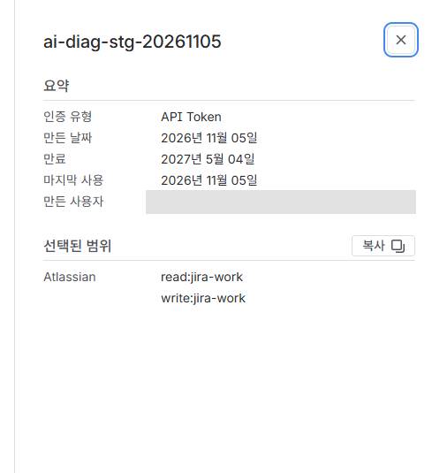
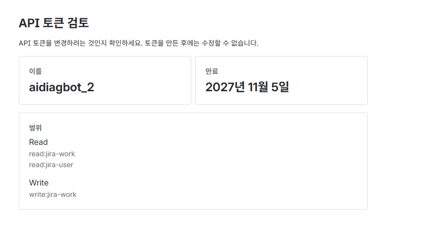
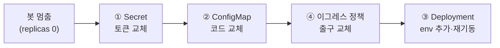
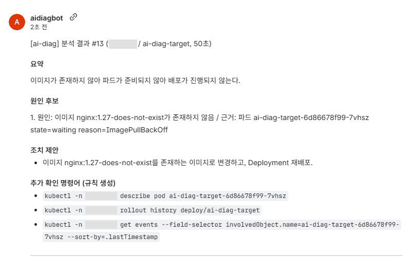

> **장애 분석 봇 만들기 시리즈**
> 1. [왜 만들었고, 어떻게 설계했나](/posts/ai-diag-bot-1-design/)
> 2. [CPU 서버에서 4B 로컬 LLM 돌리기](/posts/ai-diag-bot-2-local-llm/)
> 3. [판단은 코드, 정리는 LLM](/posts/ai-diag-bot-3-rules-over-llm/)
> 4. [Jira 승인으로 움직이고, 최소 권한으로 가두기](/posts/ai-diag-bot-4-jira-and-least-privilege/)
> 5. **봇이 내 Jira 토큰을 쓰고 있었다: 서비스 계정으로 바꾸기** (이 글)
> 6. [한계와 다음 과제](/posts/ai-diag-bot-6-limits-and-next/)

## 들어가며

[4편](/posts/ai-diag-bot-4-jira-and-least-privilege/)까지 만든 봇은 이렇게 동작한다. 사람이 Jira 이슈를 '승인'하면 쿠버네티스 안의 봇이 대상 앱의 상태·이벤트·로그를 읽기 전용으로 모으고, 클러스터 안 로컬 LLM이 정리한 결과를 Jira 댓글로 남긴다. 권한도 통신도 좁혀 뒀다.

PoC를 마치고 보고하는 자리에서 이런 지적을 받았다.

> "그 봇, 당신 개인 Jira 토큰으로 돌고 있는 거죠? 그건 위험합니다."

맞는 말이었다. 이 글은 봇의 Jira 접속을 **개인 API 토큰**에서 **Atlassian 서비스 계정**으로 바꾼 과정이다. 무엇이 왜 위험했는지, 어떤 선택지를 비교했는지, 실제로 어디서 막혔는지를 순서대로 적는다.

---

## 1. 개인 토큰이 왜 위험한가

PoC에서는 봇이 내 이메일과 내 개인 API 토큰으로 Jira에 접속했다. 빠르게 검증하기엔 편했지만 문제가 세 가지다.

| 문제 | 설명 |
|---|---|
| 권한이 너무 넓다 | 개인 API 토큰은 **범위를 정할 수 없다.** 내가 Jira에서 할 수 있는 모든 일(다른 프로젝트 조회, 이슈 삭제, 설정 변경)을 토큰도 할 수 있다 |
| 누가 했는지 구분이 안 된다 | 봇이 단 댓글이 **내 이름**으로 남는다. 사람이 쓴 건지 봇이 쓴 건지 알 수 없다 |
| 사람에 묶인다 | 내가 퇴사하거나 휴직하거나 계정이 정지되면 **봇도 같이 멈춘다** |

비유하면, 택배 기사에게 문을 열어 주려고 **내 사원증을 통째로 빌려준** 상태였다. 사원증으로는 택배함뿐 아니라 내 자리, 회의실, 서버실까지 다 열린다.

---

## 2. 선택지 비교

| 방법 | 판단 | 이유 |
|---|---|---|
| **A. Atlassian 서비스 계정** | **선택** | 공식 기능. 사람이 로그인할 수 없고, 라이선스를 차지하지 않고, 토큰에 범위를 정할 수 있다 |
| B. 봇용 일반 사용자 계정 (`ai-bot` 같은 사람 계정) | 차선 | 이름만 봇일 뿐 사람 계정이다. 라이선스 1석이 들고, 로그인이 되니 비밀번호·2단계 인증을 관리해야 한다 |
| C. OAuth 2.0 (3LO) 앱 | 제외 | 사용자가 동의하는 방식이라 결국 **동의한 사람의 권한**으로 동작한다. 지금 문제와 같다 |
| D. Forge 앱 / Jira 자동화 웹훅 | 제외 | 클러스터로 **들어오는** 경로가 필요하거나 구조를 크게 바꿔야 한다. 봇은 "밖으로 나가는 통신만" 하도록 설계돼 있다 |

서비스 계정은 다시 두 가지 인증 방식 중 하나를 고를 수 있다.

| 인증 방식 | 특징 | 판단 |
|---|---|---|
| **범위 제한 API 토큰** | 토큰 하나. 만료 1~365일 | **선택.** 구조가 단순하다 |
| OAuth 2.0 client credentials | 접근 토큰이 60분마다 만료돼 계속 새로 받아야 한다. 조직의 중앙 사용자 관리가 필요하다 | 지금 규모에는 과하다 |

---

## 3. Atlassian 서비스 계정 이해하기

### 3-1. 한 줄 정의

**사람이 아니라 프로그램이 쓰라고 만든 Atlassian 계정**이다. Jira 입장에서는 "사람이 아닌 별도 사용자"가 하나 생긴다. 비유하면 **택배함 문만 열리는 출입 카드**를 따로 만드는 것이다.

| | 개인 계정 + 개인 토큰 | 서비스 계정 + 범위 제한 토큰 |
|---|---|---|
| Jira가 보는 신분 | 나 | `aidiagbot` 같은 별도 계정 |
| 댓글 작성자 | 내 이름 | 봇 이름 |
| 화면 로그인 | 가능 | **불가능** (비밀번호가 없다) |
| 할 수 있는 일 | 내 권한 전체 | 정한 범위만 |
| 라이선스 | 1석 | **안 씀** |
| 사람에 묶임 | 그렇다 | 아니다 |
| 만드는 사람 | 본인 | **조직 관리자**만 |

### 3-2. 권한은 세 겹으로 잠긴다

이 부분이 가장 중요하다. 서비스 계정이 실제로 할 수 있는 일은 **세 가지를 모두 통과한 범위**뿐이다.



| 단계 | 비유 | 우리 봇에 준 것 |
|---|---|---|
| ① Jira 앱 접근 | 건물 출입증 | Jira 사용자 권한 |
| ② 스페이스 역할 | 특정 사무실 문 | 봇이 쓰는 스페이스 하나에만 '구성원' |
| ③ 토큰 범위 | 행동 제한 | `read:jira-work`, `write:jira-work` (+ `read:jira-user`) |

①이 없으면 토큰이 맞아도 **아무것도 보이지 않는다.** ②가 없으면 그 스페이스의 이슈를 볼 수 없다. ③에 없는 행동(사용자 관리, 설정 변경 등)은 ①②가 있어도 못 한다.

### 3-3. 접속 주소가 다르다

서비스 계정은 회사 사이트 주소(`https://<회사>.atlassian.net`)로는 인증되지 않는다. **Atlassian 게이트웨이**로만 호출해야 한다.

```
https://api.atlassian.com/ex/jira/{cloudId}/rest/api/3/...
```

- **cloudId**: 사이트 고유 식별자다. 로그인 없이 `https://<회사>.atlassian.net/_edge/tenant_info`로 조회할 수 있는 공개 정보다. **조직 ID와 다른 값**이라 헷갈리면 404가 난다.
- **인증 헤더**: `Authorization: Bearer <토큰>`. 이메일이 필요 없다.

---

## 4. 만들기 (조직 관리자 작업)

### 4-1. 내가 조직 관리자인가?

서비스 계정은 **조직 관리자만** 만들 수 있다. `admin.atlassian.com`에 들어가 보면 바로 알 수 있다.

관리하는 조직이 없는 계정이면 **"조직(단체) 생성"** 화면(`/o/create`)으로 보내진다.


_admin.atlassian.com에 들어갔더니 나온 화면_

이건 "관리자가 아니다"라는 뜻이다. **여기서 생성을 누르면 회사와 무관한 빈 조직이 생기니 그냥 닫는다.**

내 경우 조직 관리자는 다른 사람이었다. 직접 만들려면 그에게 조직 관리자 권한을 받아야 하는데, 이건 Atlassian 최고 권한(사용자·SSO·보안 설정·관리자 추가)이다. **"개인 계정 권한을 줄이는" 작업에서 개인 계정에 최고 권한을 붙이는 건 앞뒤가 맞지 않아**, 생성은 조직 관리자에게 부탁했다. 대신 따라 하기만 하면 되는 1쪽짜리 절차서를 만들어 드렸다.

### 4-2. 절차

| 순서 | 화면 경로 | 입력 | 이유 |
|---|---|---|---|
| 1 | admin.atlassian.com → **Directory → Service accounts → Create service account** | 이름(영문·숫자 6~30자, 하이픈 불가. 우리는 `aidiagbot`), 설명(용도·담당자) | 댓글 작성자로 보이는 이름이다. 설명은 나중에 다른 관리자가 봐도 용도를 알게 |
| 2 | 계정 선택 → 앱 접근 | 회사 사이트의 **Jira, 사용자** 권한 | ①출입증. 관리자 권한은 주지 않는다 |
| 3 | 계정 선택 → **Create credentials → API token** | 토큰 이름, 만료, 범위 | ③행동 제한. **만든 뒤 범위는 바꿀 수 없다** (바꾸려면 새로 만든다) |
| 4 | Jira 스페이스 설정 → **액세스 → 사용자 추가** | 서비스 계정을 **구성원**으로 | ②사무실 문. 스페이스 관리자면 조직 관리자 없이 할 수 있다 |

토큰은 **Create를 누른 직후 한 번만** 화면에 나온다. 바로 비밀 저장소에 넣는다.

새 Jira 화면에서는 "프로젝트"를 **스페이스**라고 부른다. 4번은 왼쪽 메뉴의 스페이스 이름 옆 **···** → 스페이스 설정에서 한다.


_왼쪽 메뉴의 스페이스 목록. 다른 팀 스페이스 이름은 가렸다_

---

## 5. 막혔던 곳들

### 5-1. 토큰은 맞는데 아무것도 안 보인다

첫 토큰으로 시험했더니 이렇게 나왔다.

```json
{"total":0,"isLast":true,"values":[]}
```

```
HTTP 404
{"errorMessages":["Issue does not exist or you do not have permission to see it."]}
```

`401`이 아니니 **토큰 자체는 정상**이다. 그런데 보이는 프로젝트가 0개다. 스페이스 사용자 추가 화면에서 서비스 계정을 검색해도 나오지 않았다.

원인은 **①Jira 앱 접근 권한이 없었던 것**이다. 출입증이 없으니 건물 입구에서 막힌 셈이다.

조직 관리자 화면의 토큰 상세는 이랬다.


_첫 토큰. 만료 180일, 범위 2개, 마지막 사용은 방금 한 시험. 만든 사람 이름은 가렸다_

> 토큰 상세 화면에는 앱 접근 권한이 나오지 않는다. 앱 권한은 **토큰이 아니라 계정**에 붙는 설정이라, 계정 화면에서 봐야 한다.
{: .prompt-tip }

### 5-2. "Jira 사용자 권한을 주면 개인 계정이랑 같은 거 아냐?"

조직 관리자가 앱 접근 권한을 주지 않았던 이유가 이 걱정이었다. 이름이 같은 "사용자 권한"이라 그렇게 보일 수 있다.

하지만 Jira 사용자 권한은 **건물 출입증일 뿐**이다. 실제로 앱 접근만 있고 스페이스 역할이 없을 때, 서비스 계정에 보이는 스페이스는 우리가 넣어 준 곳과 '누구나 접근 가능'으로 열린 곳뿐이었다. 위의 "세 겹" 그림으로 설명하니 바로 이해됐다. **결과를 실측해서 보여 주겠다**고 한 것도 도움이 됐다.

### 5-3. Jira를 주면 Studio가 따라 붙는다

조직 관리자 화면에서 Jira 접근을 추가하면 **Studio**(Rovo Studio, Atlassian의 AI 에이전트 앱)도 같이 붙고, 빼면 Jira까지 같이 빠졌다. Atlassian이 Studio를 독립 앱으로 바꾸면서 기존 Jira 권한 그룹에 Studio 권한을 자동으로 묶었기 때문이다 ([Atlassian 안내](https://support.atlassian.com/rovo/kb/rovo-studio-access-automatically-granted-to-all-users-after-v2-upgrade/)).

그대로 두기로 했다. 서비스 계정은 **로그인할 수 없어** 화면 앱인 Studio를 쓸 방법이 없고, 토큰 범위도 Jira로 한정돼 있어 할 수 있는 일이 늘지 않는다. Studio만 빼려면 조직 그룹 설정을 바꿔야 해서 직원 전체에 영향이 간다.

### 5-4. 다른 팀 스페이스도 보인다

앱 접근 권한을 추가하면서 조직 관리자는 범위를 다시 골라 토큰을 새로 만들었다. `read:jira-user`가 더해졌는데, 사람 이름 같은 사용자 정보를 읽는 범위라 위험하지 않고, 오히려 "이 토큰이 누구로 접속하나"(`/myself`)를 확인할 수 있게 해 줘서 그대로 쓰기로 했다. 쓰지 않게 된 첫 토큰은 폐기(Revoke)를 요청했다. 쓰지 않는 열쇠가 살아 있으면 새는 경로만 늘기 때문이다.


_두 번째 토큰. 만료 365일, 범위 3개_

앱 접근과 스페이스 역할을 주고 다시 시험하니, 봇이 쓰는 스페이스 말고 **다른 스페이스 3곳**이 더 보였다. 그 스페이스들이 **"Jira 사용자라면 누구나"**에게 열려 있었기 때문이다.

이럴 때는 "보인다"에서 멈추지 말고 **실제로 무엇을 할 수 있는지**를 물어봐야 한다. Jira에는 그걸 알려 주는 API가 있다(`/rest/api/3/mypermissions`).

```
봇 스페이스   O조회 O댓글 O전환 O첨부 O생성 O수정 -삭제 -관리
공개 스페이스1 O조회 O댓글 O전환 O첨부 O생성 O수정 -삭제 -관리
공개 스페이스2 O조회 O댓글 -전환 O첨부 -생성 -수정 -삭제 -관리
공개 스페이스3 O조회 O댓글 O전환 O첨부 O생성 O수정 -삭제 -관리
```

판단은 **그대로 둔다**였다.
- 일반 직원 누구나 가진 권한이라 새로운 위험이 아니다.
- **삭제·관리는 어디서도 안 된다.** 개인 토큰일 때는 내가 관리자인 스페이스의 관리 권한까지 있었다.
- 서비스 계정 하나만 콕 집어 막을 방법이 없고, 막으려면 다른 팀 스페이스의 공개 범위를 바꿔야 한다.
- 봇 코드의 검색 조건(JQL)은 자기 프로젝트로 고정돼 있다.

---

## 6. 토큰 검증 스크립트

클러스터를 건드리기 전에, 작업 서버(베스천)에서 토큰부터 시험했다. 모두 **조회만** 하는 명령이다.

```bash
SITE=your-company   # <회사>.atlassian.net 의 앞부분

# 1) 토큰 입력: 화면에 안 보이고, 셸 기록에도 안 남는다
read -rs JIRA_TOKEN; echo; echo "토큰 길이: ${#JIRA_TOKEN}"

# 2) cloudId 조회 (공개 정보)
CLOUD_ID=$(curl -s "https://$SITE.atlassian.net/_edge/tenant_info" \
  | python3 -c 'import sys,json; print(json.load(sys.stdin)["cloudId"])')
BASE="https://api.atlassian.com/ex/jira/$CLOUD_ID"

# 3) 토큰을 붙여 GET 하는 함수
jget() { curl -s -H @<(printf 'Authorization: Bearer %s\nAccept: application/json\n' "$JIRA_TOKEN") "$BASE$1"; }

# 4) 나는 누구로 접속했나 (read:jira-user 범위 필요)
jget /rest/api/3/myself | python3 -c 'import sys,json; d=json.load(sys.stdin); print(d.get("displayName"), d.get("accountType"))'
# 기대: <서비스 계정 이름> app
```

`accountType`이 `app`이면 서비스 계정이다. 사람 계정은 `atlassian`으로 나온다.

> **`-H @<(...)`를 쓰는 이유**: `curl -H "Authorization: Bearer $TOKEN"`처럼 쓰면 토큰이 **명령 인자**에 펼쳐져, 실행되는 동안 `ps`로 다른 사용자에게 보일 수 있다. 헤더를 프로세스 치환(`<(...)`)으로 파일처럼 넘기면 인자에 값이 나오지 않는다.
{: .prompt-info }

---

## 7. 코드 변경

봇은 파이썬 표준 라이브러리(`urllib`)만 쓴다. 바뀐 건 **인증 헤더**와 **접속 주소** 두 가지가 핵심이다.

**전 (개인 토큰, Basic)**
```python
JIRA_BASE = "https://your-company.atlassian.net"

def _auth():
    raw = f"{JIRA_EMAIL}:{JIRA_TOKEN}".encode()
    return "Basic " + base64.b64encode(raw).decode()
```

**후 (서비스 계정, Bearer)**
```python
JIRA_CLOUD_ID = os.environ.get("JIRA_CLOUD_ID", "").strip()
# 우선순위: JIRA_BASE(직접 지정) > JIRA_CLOUD_ID(게이트웨이) > 회사 사이트(이전 방식)
JIRA_BASE = os.environ.get("JIRA_BASE", "").rstrip("/") or (
    "https://api.atlassian.com/ex/jira/" + JIRA_CLOUD_ID if JIRA_CLOUD_ID
    else "https://your-company.atlassian.net")
JIRA_EMAIL = os.environ.get("JIRA_EMAIL", "")   # 서비스 계정에서는 비워 둔다
AUTH_MODE = "Basic" if JIRA_EMAIL else "Bearer"

def _auth():
    if AUTH_MODE == "Bearer":
        return "Bearer " + JIRA_TOKEN
    raw = f"{JIRA_EMAIL}:{JIRA_TOKEN}".encode()
    return "Basic " + base64.b64encode(raw).decode()
```

설계 포인트는 두 가지다.

1. **`JIRA_EMAIL`이 있으면 이전 방식으로 동작한다.** 문제가 생겼을 때 코드를 고치지 않고 설정(Secret)만 바꿔 되돌릴 수 있다.
2. **시작할 때 "누구로 접속했는지"를 로그에 남긴다.** 나중에 토큰을 교체할 때 로그 한 줄로 제대로 바뀌었는지 확인할 수 있다.

```python
def whoami():
    try:
        _, me = jira("GET", "/rest/api/3/myself")
        log(f"Jira 접속 계정: {me.get('displayName')} (유형 {me.get('accountType')}, 인증 {AUTH_MODE})")
    except Exception as err:   # 범위에 read:jira-user가 없으면 403. 동작에는 지장 없음
        log(f"Jira 접속 계정 확인 실패 (계속 진행) - {err}")
```

이슈 검색, 변경 이력 조회, 상태 전환, 댓글, 첨부 등 나머지 로직은 **한 줄도 바꾸지 않았다.** 같은 REST API를 주소와 인증만 바꿔 부르는 것이라, 기존에 검증된 부분은 그대로 두고 연결부만 교체했다.

---

## 8. 쿠버네티스 반영

봇은 쿠버네티스 파드로 돈다. 바꾼 건 네 가지다.



먼저 멈춘 이유는, 바꾸는 도중에 봇이 재시작되면 **새 토큰과 옛 코드가 섞여** 오류가 나기 때문이다.

### 8-1. Secret: `apply`가 아니라 `replace`

| 키 | 전 | 후 |
|---|---|---|
| `JIRA_EMAIL` | 내 이메일 | **삭제** |
| `JIRA_TOKEN` | 내 개인 토큰 | 서비스 계정 토큰 |
| `APPROVER_ACCOUNT_IDS` | 승인자 | 그대로 (승인은 계속 사람이 한다) |

```bash
kubectl -n ai-diag create secret generic jira-cred \
  --from-file=JIRA_TOKEN=<(printf %s "$JIRA_TOKEN") \
  --from-file=APPROVER_ACCOUNT_IDS=<(printf %s "$APPROVERS") \
  --dry-run=client -o yaml | kubectl replace -f -
```

여기에 함정이 두 개 있다.

- **`--from-literal=KEY="$값"` 대신 `--from-file=KEY=<(printf ...)`**: literal은 값이 명령 인자에 펼쳐진다. 토큰 검증 때와 같은 이유다.
- **`kubectl apply`가 아니라 `kubectl replace`**: 처음에 `kubectl create`로 만든 객체에는 "마지막으로 apply한 설정" 기록이 없다. 그래서 `apply`로 덮으면 새 설정에서 빠진 키(`JIRA_EMAIL`)가 **지워지지 않고 남을 수 있다.** 이 봇은 `JIRA_EMAIL`이 있으면 이전 방식으로 접속하니, 남으면 바로 401이다. `replace`는 객체를 통째로 바꾼다.

교체 후에는 값이 아니라 **길이만** 확인한다.

```bash
kubectl -n ai-diag get secret jira-cred -o json \
  | python3 -c 'import sys,json,base64; d=json.load(sys.stdin)["data"]; [print(k, len(base64.b64decode(v))) for k,v in sorted(d.items())]'
```

### 8-2. 이그레스 정책: 출구가 바뀐다

봇이 클러스터 밖으로 나갈 수 있는 곳은 Cilium 정책으로 Jira 하나만 열어 뒀었다. 도메인 단위로 허용하는 `toFQDNs` 규칙이다.

```yaml
    - toFQDNs:
        - matchName: api.atlassian.com     # 전: your-company.atlassian.net
      toPorts:
        - ports:
            - port: "443"
              protocol: TCP
```

원래는 `*.atlassian.net`이 아니라 **회사 사이트 이름 하나**로 좁혀 두었다. `*.atlassian.net`은 다른 회사 사이트도 포함하기 때문이다. 그런데 서비스 계정은 `api.atlassian.com`으로만 접속할 수 있어서 이걸 바꿔야 했다.

> **알고 있는 한계**: `api.atlassian.com`은 모든 Atlassian 고객이 같이 쓰는 주소다. 회사 사이트 하나로 묶던 때보다 출구가 넓어졌다. 이 길로 다른 회사 사이트에 데이터를 보내려면 **그 회사의 토큰과 봇 코드 변조**가 함께 필요하다. 경로 단위(`/ex/jira/<우리 cloudId>`만 허용)로 막으려면 TLS를 풀어 봐야 해서 이 구성의 범위 밖이다. 대신 쓰지 않는 회사 사이트 출구는 닫아, 열린 출구는 여전히 하나다.
{: .prompt-warning }

### 8-3. 결과

재기동한 봇의 첫 로그다.

```
11:26:52 시작: Jira = https://api.atlassian.com/ex/jira/xxxxxxxx-xxxx-...
11:26:53 Jira 접속 계정: aidiagbot (유형 app, 인증 Bearer)
11:26:53 승인자 1명, 폴링 30초
```

이어서 실제 분석 요청을 하나 처리했다(이미지 태그 오류 시나리오, 50초). 상태 전환, 결과 댓글, 첨부 2개가 모두 정상이었고, **Jira 화면의 작성자가 내 이름이 아니라 서비스 계정 이름으로** 나왔다.


_작성자 aidiagbot. 내부 네임스페이스 이름은 가렸다_

---

## 9. 바뀐 것 한눈에

| 항목 | 전 | 후 |
|---|---|---|
| 접속 신분 | 내 개인 계정 | 서비스 계정 (로그인 불가, 라이선스 미사용) |
| 인증 | 이메일 + 개인 토큰 (Basic) | 범위 제한 토큰 (Bearer) |
| 접속 주소 | `회사.atlassian.net` | `api.atlassian.com/ex/jira/{cloudId}` |
| 할 수 있는 일 | 내 권한 전체 (관리 권한 포함) | 이슈 조회·댓글·전환·첨부·생성·수정. **삭제·관리 불가** |
| 댓글 작성자 | 내 이름 | 봇 이름 |
| 사람에 묶임 | 그렇다 | 아니다 |
| 토큰 유효 기간 | 개인 설정 | 최대 1년, 만료 전 교체 |
| 문제 시 차단 | 내 토큰을 내가 폐기 | 조직 관리자가 **Revoke** (최대 10분 안에 효력 상실) |

**바뀌지 않은 것**: 분석 로직, 클러스터 조회 권한(읽기 전용), 사용 방법(이슈 → 사람이 승인 → 결과 댓글). 승인은 여전히 **사람**만 한다. 서비스 계정은 승인된 요청을 처리하는 손일 뿐이다.

## 10. 해결하지 못한 것

- **토큰은 여전히 비밀값이다.** 피해 범위가 "내 권한 전체"에서 "봇이 쓰는 이슈 읽기·쓰기"로 줄었을 뿐 0이 된 건 아니다.
- **보관 위치는 그대로 쿠버네티스 Secret이다.** base64일 뿐 암호화가 아니다. Vault 같은 비밀 관리 도구로 옮기는 건 다음 과제다.
- **토큰 교체에는 조직 관리자가 필요하다.** 만료일을 캘린더에 걸어 두었다.

---

## 마치며: 배운 것

1. **도구에 사람의 토큰을 넣지 말자.** PoC에서는 편하지만, 그 순간 도구의 권한 = 그 사람의 권한이 된다.
2. **권한은 "보이는가"가 아니라 "무엇을 할 수 있는가"로 확인한다.** `mypermissions` 같은 조회 API로 실측하면 설명하기도 쉽다.
3. **이름이 같다고 같은 권한이 아니다.** "Jira 사용자 권한"은 출입증일 뿐이다. 세 겹(출입증·문·행동)으로 나눠 설명하니 보안에 민감한 결정권자도 바로 이해했다.
4. **`kubectl apply`는 빠진 키를 지워 주지 않을 수 있다.** 키 구성이 바뀌는 Secret은 `replace`로 통째로 바꾼다.
5. **비밀값은 명령 인자에도 남기지 않는다.** `read -s`, `-H @<(...)`, `--from-file=<(...)`.
6. **보안 개선에도 대가가 있다.** 서비스 계정을 쓰면서 출구 주소가 넓어졌다. 숨기지 말고 한계로 적어 두고, 왜 받아들였는지 이유를 남긴다.

## 참고

- [Understand service accounts (Atlassian Support)](https://support.atlassian.com/user-management/docs/understand-service-accounts/)
- [Manage API tokens for service accounts (Atlassian Support)](https://support.atlassian.com/user-management/docs/manage-api-tokens-for-service-accounts/)
- [Rovo Studio access automatically granted after V2 upgrade (Atlassian Support)](https://support.atlassian.com/rovo/kb/rovo-studio-access-automatically-granted-to-all-users-after-v2-upgrade/)
