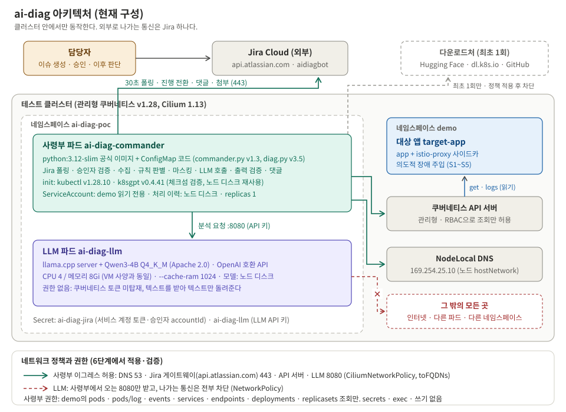

> **장애 분석 봇 만들기 시리즈**
> 1. [왜 만들었고, 어떻게 설계했나](/posts/ai-diag-bot-1-design/)
> 2. [CPU 서버에서 4B 로컬 LLM 돌리기](/posts/ai-diag-bot-2-local-llm/)
> 3. [판단은 코드, 정리는 LLM](/posts/ai-diag-bot-3-rules-over-llm/)
> 4. [Jira 승인으로 움직이고, 최소 권한으로 가두기](/posts/ai-diag-bot-4-jira-and-least-privilege/)
> 5. [봇이 내 Jira 토큰을 쓰고 있었다: 서비스 계정으로 바꾸기](/posts/ai-diag-bot-5-jira-service-account/)
> 6. **한계와 다음 과제** (이 글)

## 들어가며

PoC는 "된다"를 보여 주는 일이지만, 그만큼 **"아직 모른다"를 정확히 적는 일**이기도 하다. 마지막 편은 증명한 것과 증명하지 못한 것, 그리고 다음에 할 일을 정리한다.

---

## 1. 지금 상태 한눈에

| 항목 | 현재 |
|---|---|
| 위치 | 테스트 클러스터 하나, 대상 네임스페이스 하나 |
| 봇 | 파이썬 표준 라이브러리, 공식 python 이미지 + ConfigMap 코드 |
| LLM | llama.cpp + Qwen3-4B Q4_K_M, CPU 4 / 8Gi, `--cache-ram 1024` |
| Jira | 서비스 계정 + 범위 제한 토큰 (Bearer, `api.atlassian.com`) |
| 권한 | 대상 네임스페이스 읽기 전용 |
| 통신 | 봇: DNS · Jira · API 서버 · LLM만 / LLM: 봇만 들어옴, 나가는 길 없음 |
| 처리 | 건당 약 20초~1분 30초, 한 번에 한 건 |

## 2. 증명한 것

| 질문 | 답 | 근거 |
|---|---|---|
| 요청부터 결과까지 끝까지 동작하는가 | **동작한다** | 실제 Jira 이슈로 13회 처리 (승인 → 진행 → 댓글·첨부 → 재분석 → 거부) |
| 4코어/8GB CPU로 쓸 만한가 | **쓸 만하다** | 건당 20~90초, LLM 메모리 2.9~3.5Gi, 봇 19Mi |
| 원인을 짚는가 | **다섯 가지 장애 모두 1순위 적중** | OOM · 이미지 · CrashLoop · probe · 정상. 연속 배포 실패 상태에서도 v3.5로 적중 |
| 문제를 지어내지 않는가 | **정상 앱은 "이상 없음"** | 정상 시나리오 |
| 보안 장치가 동작하는가 | **동작한다** | 권한 8항목, LLM 인그레스, 봇 이그레스 전후 비교 |
| 허용 밖 요청을 막는가 | **막는다** | 허용 밖 네임스페이스 → 거부 댓글만, 상태 유지 |
| 사람 계정 없이 도는가 | **돈다** | 서비스 계정으로 13회차 처리, 삭제·관리 권한 없음 |

## 3. 한계

### 3-1. 분석 능력

| 한계 | 설명 | 영향 |
|---|---|---|
| **규칙 밖 장애** | 정확한 원인 판별은 미리 정한 유형(OOM, 이미지, 비정상 종료, probe, 스케줄링, 롤아웃 멈춤)에서만 한다. 그 밖의 장애는 4B 모델 혼자 판단하는데, **이 경우의 정확도는 아직 재지 않았다** | 처음 보는 복잡한 장애는 여전히 사람이 봐야 한다 |
| 앱 하나 단위 | 여러 서비스가 얽힌 원인(DB가 내려가 앱이 실패)은 따라가지 않는다 | "DB 연결 실패"까지는 짚지만, DB가 왜 내려갔는지는 모른다 |
| 노드·네트워크 수준 | 노드 상태, 디스크, 네트워크 장비는 확인 범위 밖 | 서버 문제를 앱 문제로 오해할 수 있다 |
| 지표가 없다 | CPU·메모리 추이, 응답 시간 같은 모니터링 지표를 보지 않는다 | "실제로 메모리를 얼마나 쓰나"를 수치로 말하지 못한다 |
| 문장 품질 | 같은 원인을 표현만 바꿔 두 번 쓰거나, `예:` 없이 값을 단정하는 경우가 가끔 있다 | 판단에 지장은 없다 |
| **시험 데이터가 인위적** | 일부러 만든 다섯 가지 장애다 | 실제 장애 분포와 다르다 |

### 3-2. 구성과 운영

| 한계 | 설명 |
|---|---|
| 클러스터 하나 | 다른 클러스터를 보는 구조(멀티 클러스터)가 아직 없다 |
| 한 번에 한 건 | LLM이 4코어라 순서대로 처리한다. 몰리면 1건당 약 1분씩 기다린다 |
| 노드 디스크 의존 | 모델·바이너리·처리 기록이 노드 디스크(hostPath)에 있다. 노드가 바뀌면 다시 받아야 하고, 그때 이그레스 정책을 잠시 풀어야 한다 |
| Secret 평문 보관 | 쿠버네티스 Secret은 base64일 뿐이다. 비밀 관리 도구 연동 전 |
| LLM 이미지 태그 미고정 | `:server` 태그. 재시작 때 다른 버전을 받을 수 있다 |
| 승인자가 사실상 한 명 | 승인자가 없으면 분석을 시작할 수 없다 |
| Jira 토큰 만료 | 범위 제한 토큰은 최대 1년. 교체에 조직 관리자가 필요하다 |
| Jira 출구 범위 | 서비스 계정 때문에 `api.atlassian.com`(공용 주소)을 열었다. 회사 사이트 하나로 묶던 때보다 넓다 ([5편](/posts/ai-diag-bot-5-jira-service-account/)) |
| 마스킹은 패턴 기반 | 시험 앱 로그로만 확인했다. 실제 앱 로그의 민감 정보 형태는 아직 검증하지 않았다 |
| **1인 운영** | 만든 사람이 운영도 한다. 쓰는 사람이 적으면 관리 부담만 남을 수 있다 |

## 4. 다음 과제

| 우선 | 과제 | 이유 |
|---|---|---|
| 1 | **멀티 클러스터 조회** (제목에 클러스터 이름, 클러스터별 읽기 전용 kubeconfig, 클러스터→네임스페이스 허용 목록) | 실제 대상은 여러 클러스터에 나뉘어 있다 |
| 1 | **실제 앱 로그로 마스킹 점검** | 결과가 외부(Jira Cloud)에 저장된다. 시범 운영 첫 주에 전수 확인 |
| 1 | 설치 위치 결정 | 아래 5장 |
| 2 | 비밀 관리 도구 연동 (Jira 토큰, LLM 키, 원격 kubeconfig) | 원격 클러스터 자격증명이 늘어난다 |
| 2 | LLM 이미지 digest 고정 | 재현성, 공급망 안전 |
| 2 | 실제 앱으로 시험 | 인위적 장애와 실제 장애는 다르다 |
| 3 | **규칙 밖 장애 품질 측정** | 4B 모델 단독 판단의 한계를 수치로 안다 |
| 3 | 규칙 보강 | 시범 운영에서 자주 나온 장애 유형을 규칙에 추가 |
| 3 | 해결 사례 축적 | 분석 결과와 실제 해결 내용을 모아 다음 분석에 참고 (원래 목표 중 하나였지만 PoC 범위 밖) |
| 3 | 모니터링 지표 연계 | 지표를 근거로 함께 쓰기 |

## 5. 어디에 둘 것인가 (일반론)

PoC는 테스트 클러스터에서 했다. 실제로 쓰려면 위치를 정해야 한다. 우리 사정의 결론보다, 판단에 쓴 **기준**을 적는다.

| 선택지 | 장점 | 단점 |
|---|---|---|
| **도구 전용 클러스터** (CI/CD 같은 운영 도구가 모인 곳) | 추가 서버가 없다. 관리 지점이 늘지 않는다. 특정 환경에 치우치지 않는다 | 빌드 작업과 CPU를 나눠 쓴다. 미리 관찰이 필요하다 |
| 비밀 관리 도구가 있는 **보안 핵심 클러스터** | 비밀 연동이 쉽다 | 외부 통신(Jira)을 가진 실험 단계 도구가 보안 핵심 옆에 들어간다. 침해·자원 경합 시 영향 반경이 커진다 |
| **LLM만 별도 VM** | 자원이 완전히 분리된다. 더 큰 모델로 키우기 쉽다 | 서버 관리(OS 패치·계정·보안 점검)와 방화벽 검토가 하나 늘어난다 |

**VM을 다시 볼 조건**: 빌드와 자원 충돌이 확인될 때, 품질 때문에 더 큰 모델(8B 이상)이 필요할 때, GPU가 필요할 때, 다른 팀과 LLM을 같이 쓸 때.

[1편](/posts/ai-diag-bot-1-design/)에서 "LLM은 권한 없이 글만 다룬다"고 나눠 둔 덕분에, LLM을 나중에 VM으로 옮겨도 **봇의 주소 설정 하나**만 바꾸면 된다. 지금 클러스터에서 시작해도 옮기는 비용이 작다.

## 6. 계속할지 판단하는 기준

시범 운영에서 **사람의 판단과 봇의 결과를 건마다 비교해 기록**하고, 충분한 건수(최소 10건)가 쌓이면 판단한다.

| 결과 | 다음 |
|---|---|
| 규칙 범위 안 장애 적중률이 높고(80% 이상), **잘못된 권고 0건, 민감 정보 노출 0건** | 확대 준비 |
| 규칙 범위 밖 장애가 많고 품질이 낮다 | 규칙 보강 먼저. 그래도 부족하면 더 큰 모델 검토 |
| 빌드와 자원 충돌 | LLM 우선순위 조정 또는 LLM만 VM으로 |
| 쓰는 사람이 거의 없다 | 사용 방식 점검. 필요하면 **접는다** |

접는 것도 정상적인 결론이다. 그때도 남는 것이 있다.

## 7. 그래서, 의미가 있었나

| 구분 | 내용 |
|---|---|
| **이미 얻은 것** | ① `--cache-ram` 하나로 8GB 서버의 운영 중 메모리 부족을 미리 막았다 ② NodeLocal DNS, 읽기 전용 RBAC 검증, 정책 전후 비교, 서비스 계정 전환은 다른 도구(GitOps, 비밀 관리 연동)를 만들 때 그대로 다시 만날 문제다 ③ **"판단은 코드, 정리는 LLM, 출력은 코드 검사"** 원칙은 다른 LLM 자동화(빌드 로그 분석, 설정 검토)에도 그대로 쓴다 |
| **아직 모르는 것** | "장애 대응 시간이 실제로 줄어드는가". 이번에 맞힌 장애는 전형적인 유형이다. 실제 가치(새벽 1차 정리, 기록 축적, 주니어 학습)는 실제 장애에서 건별로 기록해야 안다 |
| **경계할 점** | 1인 운영 도구가 하나 는다. 쓰는 사람이 없으면 관리 비용만 남는다. 그래서 단계마다 판단 지점을 뒀다 |

## 8. 처음 하고 싶었던 것으로 돌아보면

[1편](/posts/ai-diag-bot-1-design/)에서 "나는 트러블슈팅이 느리다, 그래서 그 순서를 시스템에 넣고 싶다"고 했다. 여기까지 와서 보면 이렇다.

| 하고 싶었던 것 | 지금 |
|---|---|
| 무엇부터 어떤 순서로 볼지를 사람 머릿속이 아니라 시스템에 | 수집 순서와 패턴별 결론을 **코드로 고정**했다. 규칙 안 장애는 매번 같은 순서로, 같은 기준으로 본다 |
| 나는 요약된 인사이트만 받고 바로 조치 | 승인 후 20초~1분 30초 안에 요약 · 원인 후보 · 근거 · 확인 명령어가 Jira에 남는다. 의심되면 첨부된 수집 원본으로 바로 확인한다 |
| 나는 아키텍처와 플랫폼 안정화에 집중 | 아직은 반쯤이다. 규칙 밖 장애, 여러 서비스가 얽힌 장애는 여전히 사람이 봐야 한다. 시범 운영에서 자주 나오는 유형을 규칙으로 옮길수록 이 비율이 늘어난다 |

도구를 만들면서 얻은 것도 있다. 장애 유형별로 "무엇을 보면 무엇을 알 수 있는가"를 규칙으로 쓰다 보니, 정작 **내 트러블슈팅 순서가 정리됐다.** 봇에게 가르치려고 쓴 규칙이 나에게 먼저 가르쳐 준 셈이다.

## 시리즈를 마치며: 다섯 가지

1. **작은 LLM은 판단을 틀리고 금지를 어긴다. 정리는 잘한다.** 그래서 결론은 코드가, 문장은 LLM이 쓰고, LLM 출력은 코드가 검사한다. ([3편](/posts/ai-diag-bot-3-rules-over-llm/))
2. **기본값을 믿지 말고 오래 돌려 본다.** 몇 시간 돌려서야 메모리 7GB가 보였다. ([2편](/posts/ai-diag-bot-2-local-llm/))
3. **실제처럼 시험해야 실제 문제가 보인다.** 깨끗한 시험은 다 맞혔고, 연속 실패 시험에서 잘못된 롤백 권고가 나왔다. ([3편](/posts/ai-diag-bot-3-rules-over-llm/))
4. **권한과 통신은 "안 되는 것"까지 확인한다.** 그리고 마지막에, 하나씩, 전후 비교로 건다. ([4편](/posts/ai-diag-bot-4-jira-and-least-privilege/))
5. **도구에 사람의 토큰을 넣지 않는다.** 편해서 넣은 토큰이 도구의 권한을 사람 권한 전체로 만든다. ([5편](/posts/ai-diag-bot-5-jira-service-account/))
