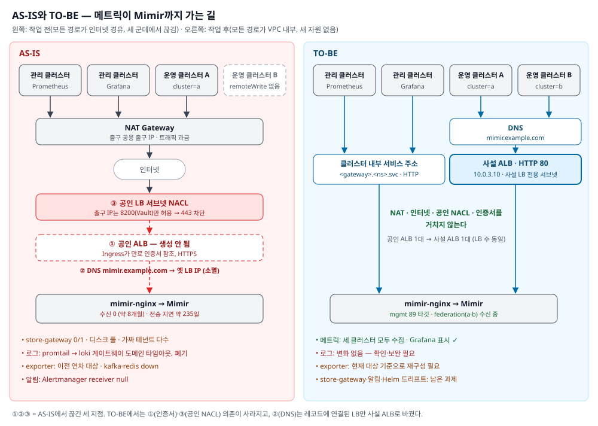
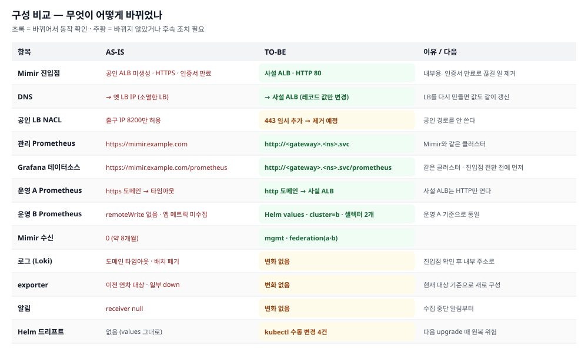
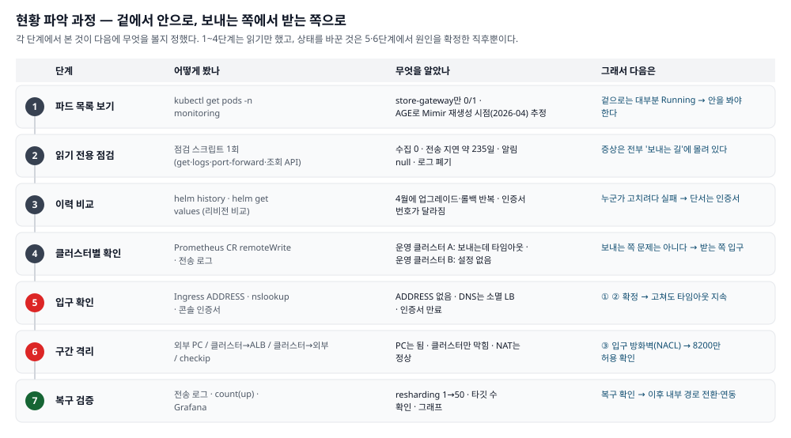
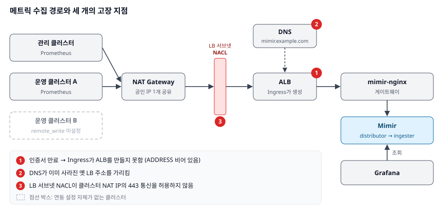
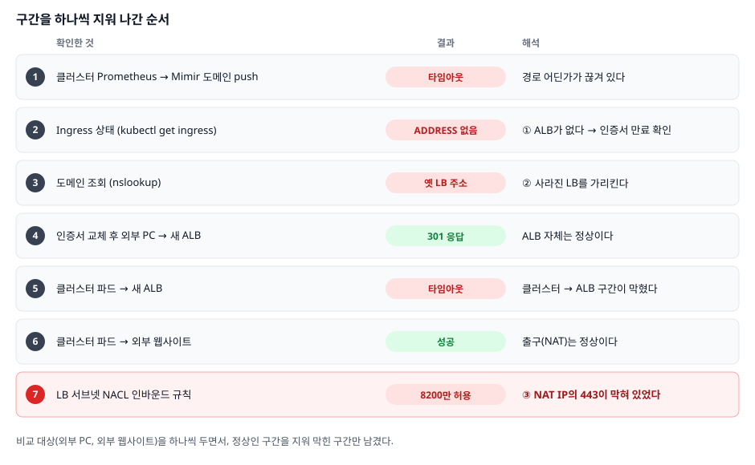
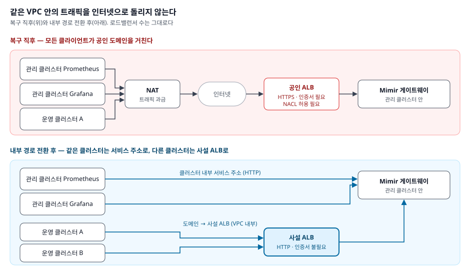

> **새 시리즈 「모니터링 시스템 복구기」를 시작한다.** 이전 시리즈 「[모니터링 시스템 역추적기](/posts/monitoring-reverse-engineering-0-prologue/)」(#0~#8)가 "이 시스템이 어떻게 만들어졌는가"를 커밋 히스토리로 되짚은 기록이라면, 이 시리즈는 그 지도를 들고 실제 시스템을 되살리고 다듬어 가는 기록이다. 이번 1편이 복구(페이즈 2)이고, 다음 편부터는 보완과 고도화(페이즈 3)를 다룬다. 중간에 나오는 개념은 [부록: 개념 정리](/posts/monitoring-recovery-appendix-concepts/)에 따로 풀어 두었다.
{: .prompt-tip }

## 들어가며

[역추적기 #0~#8편](/posts/monitoring-reverse-engineering-0-prologue/)에서 인수인계 없이 남겨진 모니터링 스택을 커밋 히스토리로 역추적한 과정을 정리했다. 그때는 "어떻게 만들어졌는가"를 알아내는 작업이었다. [에필로그](/posts/monitoring-reverse-engineering-8-epilogue/)에서는 "이제 이 시스템에 지도 없는 구역은 없다"고 썼다. 지도는 정확했다. 다만 그 지도 위의 길이 끊겨 있었다. 이번 글은 그 스택이 **실제로는 8개월째 아무것도 수집하지 않고 있었다**는 사실을 알게 된 날의 기록이다.

결론부터 말하면 세 단계로 진행했다.

1. **복구**: 장애 지점이 세 겹이었다. 구간을 하나씩 지워 세 지점을 특정했고, 진단 착수 후 약 1시간 만에 수집을 재개했다.
2. **개선**: 복구하고 보니 내부 트래픽이 인터넷으로 나갔다가 돌아오는 구조였다. 동료의 지적을 받아, 새 자원 없이 VPC 내부 경로로 바꿨다.
3. **확장**: 연동되지 않았던 두 번째 운영 클러스터를 첫 번째 클러스터 설정을 기준으로 붙였다.

로그 파이프라인과 일부 exporter는 아직 복구하지 않았다. 그 이야기는 마지막에 남은 과제로 정리했다.

## 왜 이 일을 하게 됐나

솔직하게 시작하자. 이 일은 계획에 없었다.

그 무렵 나는 "지금 내가 할 수 있는 게 뭘까"를 고민하고 있었다. 하고 있던 일들은 대부분 나 혼자 끝낼 수 없는 단계에 와 있었다.

- **[ArgoCD 전환](/posts/argocd-migration-1/)** 은 개발팀 쪽 개발이 어느 정도 진행됐다는 걸 확인해야 적용할 수 있다. 내가 먼저 밀어붙일 수 있는 일이 아니다.
- **AI를 활용한 자동화**([장애 분석 봇](/posts/ai-diag-bot-1-design/) 등)는 부분부분 진행하고 있었다. 하지만 그것도 다음 단계로 가려면 기다려야 하는 것들이 있었다.

그래서 솔직히, 할 수 있는 게 없다고 생각했다.

그러다 한 가지가 남아 있다는 걸 깨달았다. **역추적만 하고 정작 복구는 하지 않았던 LMS 모니터링 시스템**이다.

[역추적기 #0~#8편](/posts/monitoring-reverse-engineering-0-prologue/)에서 다섯 달 동안 이 시스템이 어떻게 만들어졌는지 되짚었다. 하지만 지도를 그리는 데서 멈췄고, 그 지도를 들고 실제로 고치러 들어간 적은 없었다. 그사이 시스템은 산소호흡기만 간신히 달고 있었다. 죽은 상태나 다름없는데, 자원은 자원대로 차지하고 있었다. 팀 안에서 이 시스템을 아는 사람은 아무도 없었다. 그런데 LMS 운영 배포와 연동돼 있었다. 그래서 함부로 지우면 안 된다는 생각에 그냥 두고 있었다.

여기서 생각이 바뀌었다. **역추적으로 이 시스템을 파악한 사람이 나뿐이라면, 복구할 수 있는 사람도 나뿐이다.** 시작을 내가 했으니 끝도 내가 지어야겠다고 마음먹었다.

물론 이런 반론이 가능하다. 운영 감시는 이미 클라우드 관리형 모니터링(NCP Cloud Insight)이 하고 있으니, 이 스택은 필요 없지 않느냐는 것이다. 그 말도 맞다. 그래도 두 가지 이유로 살리기로 했다.

- **역추적한 시간이 아까웠다.** 다섯 달을 들여 그린 지도를 서랍에 넣어 두기만 하는 건 아쉬웠다.
- **내부 테스트와 확인 용도로는 아직 쓸 만하다고 봤다.** PromQL로 자유롭게 묻고, 커뮤니티 대시보드를 쓰고, 클러스터를 나란히 비교하는 일은 관리형 모니터링으로는 하기 어렵다.

그래서 현황부터 파악했다. 무엇을 고쳐야 하는지 목록을 만들고, 한 단계씩 절차를 밟아 진행했다. 아래는 그 기록이다.

## 한눈에 보기: AS-IS → TO-BE

자세한 과정에 앞서, 시작과 끝 상태를 먼저 나란히 놓는다.



| 관점 | AS-IS | TO-BE | 이유 |
|---|---|---|---|
| 경로 | 모든 클라이언트가 NAT → 인터넷 → 공인 ALB | 같은 클러스터는 서비스 주소, 다른 클러스터는 사설 ALB | 같은 VPC 안의 통신이 밖으로 나갈 이유가 없다 |
| 외부 의존 | NAT, 공인 방화벽(NACL), 인증서, DNS | DNS만 | 끊길 수 있는 지점을 줄인다. 이번에 끊긴 세 지점 중 둘이 사라졌다 |
| 보안 | 인증 없는 저장소의 입구가 공인망에 있음 | 입구가 VPC 안에만 있음 | 인증 없는 저장소를 인터넷에 두지 않는다 |
| 비용 | NAT·공인 LB 트래픽 과금 | 내부 트래픽 | 메트릭은 쉬지 않고 흐른다 |
| 프로토콜 | HTTPS (인증서 필요) | HTTP | VPC 내부라 만료로 끊길 위험을 없앤다 |
| 자원 | 공인 ALB 1대 (실제로는 생성 실패) | 사설 ALB 1대 | 새로 만들지 않고 옮겼다 |
| 수집 | 0 (약 8개월) | 관리 클러스터 + 운영 클러스터 A·B | |

구성 항목별로 보면 이렇다. 초록은 바뀌어서 동작을 확인한 것, 주황은 아직 남은 것이다.



이제 어떻게 이 상태를 알아냈고, 어떤 순서로 바꿨는지 차례로 적는다.

## 시스템 상태: 화면만 남은 모니터링

구조는 단순하다. 관리 클러스터에 Mimir와 Grafana를 중앙 허브로 두고, 각 운영 클러스터의 Prometheus가 `remote_write`로 메트릭을 밀어 넣는다([역추적기 #1](/posts/monitoring-reverse-engineering-1-kube-prometheus-stack/)에서 추적한 구조다). 외부 도메인 → ALB → Mimir 게이트웨이를 거치는 경로이고, Mimir 안에서는 테넌트로 데이터를 나눈다([역추적기 #2](/posts/monitoring-reverse-engineering-2-mimir/)).

문제는 그 사이에 일어난 변화였다.

- 원래 연동돼 있던 운영 클러스터 두 개는 이미 사라졌다.
- 새 운영 클러스터 A, B가 생겼다. 연동을 시도한 흔적은 있었지만 끝까지 이어지지 못했다.
- Grafana 도메인은 접속이 됐다. 하지만 대시보드는 비어 있었다.

운영 모니터링은 클라우드 관리형 모니터링(NCP Cloud Insight)으로 하고 있었다. 그래서 이 스택이 멈췄다는 걸 아무도 체감하지 못했다.

## 1. 원칙: 바꾸기 전에 읽기만 한다

처음 한 일은 **읽기 전용 점검**이었다. `get`, `logs`, `helm history`, `port-forward`, 조회 API만 쓰는 스크립트를 만들어 상태를 한 번에 수집했다.

이렇게 한 이유는 세 가지다.

- **장소가 운영 관리 클러스터였다.** 원인을 모르는 채로 재시작이나 재배포를 하면, 남아 있는 증거(이전 컨테이너 로그, 큐 상태)가 사라진다.
- **무엇을 고칠지 모르는 상태였다.** 고장 지점이 몇 개인지도 몰랐기 때문에, 먼저 전체 그림을 그려야 했다.
- **다른 사람에게 보여줄 근거가 필요했다.** 점검 결과를 로그 파일로 남겨 두면, 판단 근거를 그대로 공유할 수 있다.

점검 항목은 이렇게 잡았다.

- Helm 릴리스 이력
- 리소스 사용량
- store-gateway 재시작 원인
- Mimir 수신 현황과 조회 결과
- Prometheus 스크레이프 타깃과 remote_write 상태
- Alertmanager 수신처
- 로그 파이프라인 잔존 여부

## 2. 읽기만으로 드러난 것

| 영역 | 상태 | 근거 |
|---|---|---|
| 메트릭 수집 | 약 8개월째 0 | remote_write 전송 지연 약 235일. 모든 테넌트 조회 결과가 비어 있음 |
| 로그 수집 | 수집 즉시 폐기 | promtail `final error sending batch` (재시도 소진 후 배치 폐기). [역추적기 #7](/posts/monitoring-reverse-engineering-7-loki-promtail/)에서 본 "Loki 직결" 경로가 그대로 막혀 있었다 |
| 알림 | 아무 데도 안 감 | Alertmanager receiver가 `null` 하나뿐. [역추적기 #6](/posts/monitoring-reverse-engineering-6-alertmanager-airflow/)에서 추적한 Airflow webhook 경로는 이미 설정에서 빠져 있었다 |
| store-gateway | 재시작 반복, CPU 과점유 | 디스크 풀(`no space left on device`), 정체불명 테넌트 1,700개 이상 |
| exporter | 일부 대상 다운 | Kafka, Redis exporter 스크레이프 타임아웃. [역추적기 #4](/posts/monitoring-reverse-engineering-4-managed-service-exporters/)의 원격 수집 exporter들이다 |
| 운영 클러스터 B | 연동 설정 없음 | Prometheus CR에 `remoteWrite` 필드 자체가 없음 |

### 현황을 파악한 순서

점검 스크립트 하나로 끝난 게 아니라, 각 단계에서 본 것이 다음에 무엇을 볼지 정했다.



두 가지 원칙을 지켰다.

- **겉에서 안으로.** 파드 목록에서는 대부분 Running이라 이상이 안 보였다. 그래서 점검 스크립트, Helm 이력, 클러스터별 설정, 입구, 구간 순서로 한 겹씩 들어갔다.
- **보내는 쪽에서 받는 쪽으로.** 증상이 모두 "보내다가 타임아웃"이었다. 보내는 쪽 설정이 맞다는 걸 먼저 확인했고, 그다음 받는 쪽 입구로 넘어갔다. 보내는 설정이 틀렸다면 입구를 볼 이유가 없기 때문이다.

1~4단계에서는 상태를 하나도 바꾸지 않았다. 바꾼 것은 원인을 확인한 직후뿐이다.

### 가장 충격적이었던 것

가장 충격적이었던 건 첫 줄이다. remote_write의 마지막 성공 전송 시각을 역산하니 약 8개월 전이었다. 그 사이 Prometheus 파드는 한 번도 재시작하지 않았다. 큐가 그 시점에 막힌 채로 계속 재시도만 하고 있었다는 뜻이다. 실패 카운터(`samples_failed_total`)는 0이었다. 타임아웃은 재시도 대상이라 실패로 세지 않기 때문이다. 카운터만 봤다면 정상으로 오인했을 것이다.

## 3. 원인 추적: 경로를 구간으로 쪼갠다



Prometheus 로그에 찍힌 건 `context deadline exceeded` 하나였다. 타임아웃은 "어딘가에서 끊겼다"는 것만 알려준다. **어디서** 끊겼는지는 알려주지 않는다. 그래서 데이터가 지나는 경로를 구간으로 나누고, 각 구간을 따로 두드려 보기로 했다.



### 첫 번째 겹: 인증서 만료로 ALB가 생기지 않았다

`kubectl get ingress`에서 Mimir 게이트웨이용 Ingress의 **ADDRESS 칸이 비어 있었다.** Ingress라는 요청서는 있는데, 클라우드가 그 요청서대로 로드밸런서를 만들어 주지 않았다는 뜻이다.

Helm 이력에는 몇 달 전 같은 날 업그레이드와 롤백을 여러 번 반복한 흔적이 남아 있었다. 그때 무엇을 바꾸려 했는지 리비전끼리 values를 비교해 보니, 인증서 번호가 서로 달랐다. 현재 배포된 설정이 참조하는 인증서를 콘솔에서 확인했더니 **만료 상태**였다. 만료된 인증서로는 HTTPS 리스너를 만들 수 없으니, ALB 생성 자체가 실패한 것이다.

이 단계에서 막힌 부분이 하나 있었다. ALB를 만드는 Ingress 컨트롤러가 관리형이라 클러스터 안에 파드가 없었다. 그래서 컨트롤러 로그를 볼 수 없었다. 같은 클러스터에 비교할 다른 ALB Ingress도 없었다. 결국 클러스터 바깥, 즉 콘솔에서 인증서 상태를 직접 확인하는 것으로 결론을 냈다.

### 두 번째 겹: DNS는 사라진 LB를 가리키고 있었다

도메인을 조회하니 특정 IP가 나왔다. 그 IP로는 아무 응답도 없었다. 예전 ALB의 주소로 보였다. ALB는 사라졌는데, 도메인은 옛 주소를 붙들고 있었던 것이다.

### 세 번째 겹: NACL 허용 목록에 443이 없었다

인증서를 교체해 새 ALB가 생긴 뒤에도 클러스터에서는 여전히 타임아웃이 났다. 여기서 비교 대상을 두 개 세웠다.

| 출발지 → 목적지 | 결과 | 해석 |
|---|---|---|
| 외부 PC → 새 ALB | 301 응답 | ALB 자체는 정상 |
| 클러스터 파드 → 새 ALB | 타임아웃 | 클러스터 → ALB 구간 문제 |
| 클러스터 파드 → 외부 웹사이트 | 성공 | 클러스터의 출구(NAT)는 정상 |

이 세 결과를 합치면 남는 구간은 하나다. **"우리 클러스터에서 출발한 요청이 ALB 입구에서 거절된다."**

두 클러스터에서 바깥으로 나갈 때 어떤 공인 IP로 보이는지 확인했더니, 둘 다 같은 NAT IP였다. LB 서브넷의 NACL 인바운드 규칙을 열어 보니 이 NACL은 허용 목록 방식이었다. 우리 NAT IP도 목록에 있었다. 다만 **다른 서비스용 포트(8200)만 허용**돼 있었고, Mimir로 가는 443은 없었다. 외부 PC는 사무실 IP가 따로 허용돼 있어서 들어갈 수 있었던 것이다.

> 확인한 것과 추정한 것을 구분해 둔다. 위 세 원인과 복구 결과는 직접 확인했다. 반면 "8개월 전에 처음 끊긴 계기"는 노드 교체 시기와 겹친다는 정황만 있다. 확정하지 않았다.
{: .prompt-warning }

## 4. 조치와 각 선택의 이유

| 순서 | 변경 | 방법 | 이유 |
|---|---|---|---|
| 1 | Ingress 인증서 번호 교체 | `kubectl annotate --overwrite` | 바꿀 값이 하나뿐이었다. `edit`로 YAML을 직접 고치다 들여쓰기를 망가뜨릴 위험 없이 같은 결과를 낸다. 변경 전 Ingress를 YAML로 백업해 즉시 되돌릴 수 있게 했다 |
| 2 | DNS 레코드 값 변경 | 기존 레코드에 연결된 LB 접속 정보만 새 ALB로 바꿨다 | 도메인은 그대로 두고 연결 대상만 바꾸면 클라이언트 설정을 건드리지 않아도 된다. 대신 LB를 다시 만들 때마다 이 값도 같이 바꿔야 한다. 이번 "옛 주소 붙들기"가 바로 그걸 놓친 결과였다 |
| 3 | NACL 인바운드 규칙 추가 | NAT IP `/32`, TCP 443만 허용 | 필요한 출발지와 포트만 연다. 서브넷 전체가 영향을 받는 규칙이라 `0.0.0.0/0`처럼 넓게 열지 않았다 |

순서도 의도한 것이다. **안쪽(ALB가 존재하는가)부터 바깥(DNS, 방화벽) 순서로**, 한 단계씩 확인하고 넘어갔다. 그래서 DNS를 바꾸기 전에 `Host` 헤더를 붙여 새 ALB 주소로 직접 요청을 보냈다.

```bash
curl -sk -o /dev/null -w '%{http_code}\n' -H 'Host: mimir.example.com' https://<ALB 주소>/
```

ALB가 정상인지 먼저 검증해 두면, DNS를 바꾼 뒤 실패하더라도 원인 후보에서 ALB를 지울 수 있다.

DNS를 바꾼 뒤에는 TTL(이번에는 약 4분)이 지날 때까지 기다렸다. 캐시된 옛 주소가 사라지기 전의 결과로 판단하지 않기 위해서다.

## 5. 결과: 수집 재개

NACL 규칙을 추가하자 1~2분 안에 Prometheus 로그가 바뀌었다.

```
msg="Remote storage resharding" from=1 to=50
```

이건 오류가 아니다. 전송이 성공하기 시작하자, 밀린 데이터를 따라잡으려고 Prometheus가 전송 샤드를 늘린 것이다. 몇 분 뒤 Mimir를 직접 조회했다.

| 테넌트 | `count(up)` | 의미 |
|---|---|---|
| 관리 클러스터 | 89 | 수집 대상 89개 수신 중 |
| 운영 클러스터 A | 17 | 수집 대상 17개 수신 중 |

Grafana 대시보드에도 그래프가 다시 그려졌다. 점검을 시작한 지 약 1시간 만이었다.

복구 결과를 보고하고 나서, 이 스택은 **운영 모니터링이 아닌 내부 분석용으로 유지**하기로 했다.

- **운영 모니터링에 쓰지 않는 이유**: 운영 감시는 이미 관리형 모니터링이 담당하고 있다. 같은 역할을 두 곳에서 하면 "어느 쪽 알림을 믿어야 하나"라는 혼선이 생긴다.
- **그래도 유지하는 이유**: 관리형 모니터링으로는 어려운 일들이 있다. PromQL을 이용한 자유로운 분석, 커뮤니티 대시보드 활용, 장기 메트릭 비교 같은 것들이다.

## 6. 복구에서 끝내지 않았다: 내부 경로 전환

### 계기: "이 데이터, 인터넷으로 나갔다가 다시 들어오는 거죠?"

NACL에 443을 열고 나서, 팀에서 기술 검토를 맡은 동료가 이렇게 짚었다.

> 현재 구성으로는 이 데이터가 인터넷망으로 갔다가 다시 들어오는 거라서요. 보안 측면도 있고 요금 측면도 있고요. 인터넷망으로 나갔다 들어오면 트래픽 비용이 발생하거든요.

맞는 지적이었다. 관리 클러스터와 운영 클러스터는 같은 VPC 안에 있다. 그런데 메트릭은 NAT를 통해 인터넷으로 나갔다가 공인 ALB로 다시 들어오고 있었다. 심지어 Mimir와 **같은 클러스터**에 있는 Prometheus와 Grafana까지 이 경로를 쓰고 있었다.

- **보안**: 내부 메트릭이 인터넷 구간을 지나고, 입구가 공인망에 열려 있다. Mimir 자체에는 인증이 없다.
- **비용**: NAT와 공인 LB를 거치는 트래픽은 과금 대상이다. 메트릭은 쉬지 않고 흐른다.
- **취약성**: 오늘처럼 인증서, DNS, NACL 중 하나만 어긋나도 끊긴다. 내부 통신인데 외부 요소에 의존하고 있었다.

이 구조는 원래 PoC 단계에서 만들어진 것이었다. 그 동료는 "이미 그런 구조가 사내에 너무 많아서, 하나 바꾼다고 뭐가 달라지나"라며 아쉬워했다.

솔직히 고백하면, 나는 이 지적을 받기 전까지 이 문제를 생각하지 못했다. Mimir 도메인은 원래 그렇게 공인 경로로 만들어져 있었다. 그래서 "원래대로 되돌리는 것"에만 신경을 썼다. 복구 직후의 나에게 그 구조는 고쳐야 할 대상이 아니라 되살려야 할 원본이었다.

듣고 보니 동료의 말이 맞았다. 이전 담당자가 왜 이 구조를 공인 경로로 만들었는지, 그 의도는 이제 알 수 없다. 당시 연동 대상 클러스터가 다른 망에 있었을 수도 있고, 모든 클러스터를 같은 방식으로 맞추려 했을 수도 있다. 하지만 원래 의도를 모른다고 해서 원래 구조를 그대로 지켜야 하는 것은 아니다. **시스템은 지금 팀이 처한 상황에 맞춰야 한다.** 그리고 그 기준들 가운데 **보안이 최우선**이라고 판단했다. 일단 동작하게 만드는 것보다, 지금 팀의 상황에서 안전한 구조인지가 더 중요하다.

그래서 동료가 걱정하는 바(보안, 비용)를 그대로 해결 조건으로 삼았다. 공인 LB가 아니라 사설 LB로 바꾸기로 했다.

그리고 오히려 이 스택이 바꾸기 좋은 첫 대상이라고 봤다. **내부 분석용 스택이니 공인 도메인이 아니라 사설 LB로 들어오는 게 맞다.** 굳이 외부로 나갔다가 들어올 이유가 없다. 게다가 운영에 쓰지 않는 스택이라 바꾸다 문제가 생겨도 파급이 작다. 같은 구조의 다른 경로를 정리할 때 참고할 선례도 된다.

### 제약: 새 자원은 만들지 않는다

처음 떠올린 건 사설 LB를 하나 새로 만드는 방법이었다. 하지만 자원을 늘리는 건 부담이었다. 그래서 다른 길을 찾았다.

| 선택지 | 판단 | 이유 |
|---|---|---|
| 사설 LB 신규 생성 | 제외 | 자원이 늘어난다 |
| 클러스터에 있는 다른 LoadBalancer 서비스 재사용 | 불가 | 모두 특정 서비스 전용 입구라 다른 서비스로 보낼 수 없었다 |
| 다른 클러스터가 관리 클러스터 노드 IP로 직접 전송 | 제외 | 노드가 교체되면 끊긴다. 방화벽도 따로 열어야 한다 |
| **기존 공인 ALB를 사설 LB 서브넷으로 옮긴다** | **채택** | 공인 1대가 사설 1대로 바뀔 뿐이라 LB 개수가 그대로다. 사설 LB 서브넷은 이미 클러스터에 등록돼 있었다 |

### 전환 순서



순서가 중요했다. **같은 클러스터 안의 클라이언트를 먼저 내부 주소로 옮기고, 그다음 진입점을 바꿨다.** 반대로 하면 진입점이 바뀌는 순간 Grafana 조회가 깨진다.

| 순서 | 대상 | 변경 | 이유 |
|---|---|---|---|
| 1 | 관리 클러스터 Prometheus | remote_write를 `http://<mimir 게이트웨이>.<ns>.svc/api/v1/push`로 | Mimir와 같은 클러스터라 밖으로 나갈 이유가 없다. 재시작 없이 반영된다 |
| 2 | Grafana Mimir 데이터소스 | 조회 주소를 클러스터 내부 서비스 주소로 | 같은 이유. 데이터소스는 기동 시에만 읽어서 재시작이 필요했다([역추적기 #5](/posts/monitoring-reverse-engineering-5-grafana/)에서 본 정적 데이터소스 프로비저닝 방식이다) |
| 3 | Mimir Ingress | `network-type: private`, HTTP 80만, 인증서·TLS 설정 제거 | 사설 LB 서브넷으로 옮겨 인터넷 노출을 없앤다. 내부 통신이라 HTTP로 충분하고, 인증서 만료로 끊길 일도 사라진다. ([에필로그](/posts/monitoring-reverse-engineering-8-epilogue/)의 운영 위생 항목에 "평문 http 구간"을 적어 둔 적이 있다. 이번 HTTP는 VPC 안에서만 열리는 구간이라 공인망의 평문과는 위험이 다르다고 판단했다. 그래도 같은 질문을 다시 받을 수 있게 여기 이유를 남긴다) |
| 4 | DNS | 도메인을 사설 ALB로 | 삭제된 공인 ALB를 가리키는 레코드를 남기지 않는다. 다른 클러스터는 주소의 `https`를 `http`로만 바꾸면 된다 |
| 5 | 운영 클러스터 A Prometheus | remote_write `https` → `http` | 사설 ALB는 HTTP만 연다 |

### 중간에 걸린 것: Ingress finalizer

네트워크 유형 어노테이션만 바꿔서는 ALB가 다시 만들어지지 않았다. 이 값은 생성 시에만 적용되기 때문이다. 그래서 Ingress를 JSON으로 저장하고, 지운 뒤 다시 만들었다.

그런데 새 Ingress가 이런 에러를 내며 멈췄다.

```
failed to reconcile load balancer: failed to get load balancer for ingress: lb instance with <옛 LB 번호> from finalizer not found
```

저장할 때 `metadata.finalizers`를 지우지 않은 게 원인이었다. 새 Ingress가 **이미 삭제된 옛 공인 LB의 finalizer를 달고 태어난 것**이다. finalizer를 제거하자 바로 새 사설 ALB가 만들어졌다. Ingress를 다시 만들 목적으로 저장할 때는 `resourceVersion`, `uid`뿐 아니라 `finalizers`도 지워야 한다.

### 결과

- 관리 클러스터의 Prometheus와 Grafana는 클러스터 내부 주소로 Mimir에 붙는다.
- 운영 클러스터는 도메인을 통해 사설 ALB로 들어온다. 사설 LB 서브넷 쪽 방화벽은 따로 열 필요가 없었다.
- 공인 ALB는 사라졌다. 오전에 연 NACL 443 규칙도 이제 필요 없다.
- 오늘 막혔던 세 지점 중 공인 NACL 의존은 사라졌고, 인증서 의존도 없어졌다.

## 7. 운영 클러스터 B 연동: 기준이 있는 클러스터를 기준으로

마지막으로 연동 설정이 없던 운영 클러스터 B를 붙였다. 기준은 이미 연동돼 있던 **운영 클러스터 A**로 잡았다. 두 클러스터가 같은 방식이어야 대시보드에서 똑같이 보이고 관리하기도 쉽다.

### 왜 두 클러스터가 달랐나

연동 작업을 시작하기 전에, 같은 시기에 생긴 두 운영 클러스터가 왜 이렇게 다른지부터 궁금했다. 이력과 정황을 맞춰 보면 이렇게 추정된다(확정은 아니다).

- 이전 담당자는 떠나기 전에 A에는 연동을 준비하며 values 파일을 만들어 올려 두었다. B에는 손을 대지 못하고 떠났다.
- 이후 팀 안에서 B를 맞추려고 나름대로 연구했지만, 기준이 될 문서가 없었다. 결국 차트 기본값 그대로 kube-prometheus-stack을 설치하는 데서 멈췄다.
- 그래서 A는 `p5-` 접두어가 붙은 손질된 설치가 됐고, B는 릴리스 이름부터 기본값인 설치가 됐다. 앱 메트릭이 빠진 셀렉터 문제도 여기서 생겼다.

누구의 잘못이라기보다, **어떻게 구축했는지가 사람 머릿속에만 있었던 것**이 원인이다. 만든 사람이 떠나자, 남은 사람은 무엇을 따라 해야 하는지 알 수 없었다.

이번에는 A를 기준으로 B를 임시로 맞췄다. 하지만 이걸로 끝나면 같은 일이 반복된다. 다음 클러스터가 생겼을 때 또 누군가 values를 비교하며 추측해야 한다. 그래서 이번에 만든 B의 values 파일에는 항목마다 "왜 A와 같은지, 왜 다른지"를 주석으로 남겼다. 그리고 따라 하기 절차서도 따로 정리했다.

### A를 기준으로, 그러나 그대로 복사하지 않고

A의 values를 그대로 복사하지 않았다. A의 values에는 차트 기본값까지 통째로 들어 있었다. 기본값과 다르게 바꾼 항목만 골라 옮겼다. 기본값까지 박아 두면 무엇을 일부러 바꿨는지 다음 사람이 읽을 수 없기 때문이다. 옮긴 항목 중에서도 일부는 고치거나 일부러 뺐다.

| A의 설정 | B에서 | 이유 |
|---|---|---|
| 클러스터 구분 라벨(`externalLabels`) | 값만 B로 바꿔 적용 | 같은 테넌트 안에서 클러스터를 구분하고, 대시보드 클러스터 변수에 잡히게 한다 |
| remote_write 주소 | 내부 경로 전환 후 값(`http`)으로 적용 | A의 values에는 아직 전환 전 주소가 남아 있었다 |
| 리소스 이름 override | 제외 | 넣으면 B의 리소스 이름이 모두 바뀌어 통째로 재생성된다 |
| Prometheus 서비스 LoadBalancer | 제외 | LB가 새로 생긴다. 외부 노출도 필요 없다 |
| 큰 리소스 요청(CPU 4 / 16Gi) | B의 실사용량 기준으로 축소 | B의 Prometheus는 실사용이 수백 MiB 수준이었다 |
| ServiceMonitor 셀렉터 | 두 release 라벨을 모두 고르게 | 아래 설명 |

ServiceMonitor 셀렉터가 가장 흥미로웠다. A는 Helm 릴리스 이름이 `prometheus`라서 차트가 만든 ServiceMonitor와 앱 팀이 만든 ServiceMonitor가 같은 `release=prometheus` 라벨을 달고 있었다. B는 릴리스 이름이 달라서 두 라벨이 갈려 있었다. 그래서 기본 셀렉터로는 차트 것만 골랐고, **B는 앱 메트릭을 수집하지 않고 있었다.** 이 차이는 values만 봐서는 보이지 않는다. 두 클러스터의 ServiceMonitor 라벨을 나란히 놓고 비교해서야 드러났다. [역추적기 #1](/posts/monitoring-reverse-engineering-1-kube-prometheus-stack/)에서 관리 클러스터의 `serviceMonitorSelectorNilUsesHelmValues: false`를 추적했는데, 같은 이름의 함정이 다른 클러스터에서 다른 모양으로 나타난 셈이다.

B는 처음부터 Helm values로 적용했다. 앞의 클러스터들은 급하게 kubectl로 바꿔서 values와 어긋나 있는데, 같은 빚을 하나 더 만들지 않기 위해서다. 적용 전에는 `helm diff`로 바뀌는 범위를 확인했다. 범위는 Prometheus와 node-exporter 변경, 쓰지 않던 클러스터별 Grafana와 기본 규칙 삭제였고, CRD와 다른 네임스페이스는 건드리지 않았다.

적용 후 중앙 Grafana에서 B 클러스터를 선택하면 노드, 파드, 워크로드 수가 표시된다. 다만 일부 패널(파일 시스템, 네트워크)은 아직 비어 있다. 패널별 검증은 남은 과제다.

## 8. 진행 과정 돌아보기

| 단계 | 목적 | 결과 | 이 단계를 둔 이유 |
|---|---|---|---|
| 0. 진단 | 무엇이 어디서 끊겼는지 | 세 겹의 원인 후보 | 원인을 모르는 변경은 증거만 지운다 |
| 1. 수집 복구 | 원래 구조대로 다시 흐르게 | 인증서·DNS·방화벽 복구, 수집 재개 | 살아 있는지부터 확인해야 다음 판단이 가능하다 |
| 2. 내부 경로 전환 | 내부 트래픽을 VPC 안에서 끝내기 | 내부 주소 전환, 공인 ALB → 사설 ALB | 보안·비용. 내부 분석용에 공인 도메인은 맞지 않다 |
| 3. 운영 클러스터 B 연동 | 운영 클러스터 전부 수집 | A 기준 Helm values 적용 | 같은 방식이어야 비교·관리가 쉽다 |

글 맨 앞의 AS-IS/TO-BE 그림은 이 네 단계를 거친 결과다. 1단계만 했다면 TO-BE가 아니라 "AS-IS가 다시 동작하는 상태"에서 멈췄을 것이다.

## 9. 배운 것

**지도가 있었기에 1시간이었다.**
진단 착수 후 약 1시간이라는 숫자는 이날 하루의 것이 아니다. [역추적기 #0~#8](/posts/monitoring-reverse-engineering-0-prologue/)의 다섯 달이 없었다면, Ingress가 왜 그 도메인을 쓰는지, 테넌트가 왜 그렇게 나뉘었는지, 4월의 롤백이 무엇을 시도한 것인지부터 다시 파야 했다. 역추적의 진짜 보상은 문서가 아니라, 문서가 있는 상태에서 장애를 만났을 때 나온다.

**장애는 한 겹이 아니다.**
인증서만 고쳤다면 DNS에서 막혔을 것이다. DNS까지 고쳤다면 NACL에서 막혔을 것이다. 고칠 때마다 "여전히 안 된다"는 결과만 나오니, 시도한 쪽은 지금 하는 방향이 틀렸다고 판단하기 쉽다. 몇 달 전의 복구 시도가 롤백으로 끝난 것도 이 때문이었다고 본다.

**비교 대상이 구간을 지운다.**
"클러스터에서 안 된다"만으로는 다음 수가 보이지 않는다. 외부 PC에서는 되고, 같은 클러스터에서 외부 웹사이트는 된다는 비교를 세우자 막힌 구간이 하나로 좁혀졌다.

**원래 의도를 모를 때는, 지금의 상황과 보안을 기준으로 삼는다.**
복구는 "원래대로"를 목표로 삼기 쉽다. 하지만 인수인계 없는 시스템에서 "원래"의 의도는 대개 알 수 없다. 그럴 때 기준은 지금 팀이 가진 상황이고, 그중 보안이 먼저다. 내가 놓친 것을 동료가 짚어 줬고, 그 지적을 받아들인 덕분에 복구가 개선이 됐다. 무조건 구현하고 되살리는 것보다 그 판단이 중요했다.

**복구한 것도 다시 의심해 볼 가치가 있다.**
1단계는 "원래대로 되돌리기"였다. 그런데 원래 구조 자체가 PoC 시절의 것이었다. 동료의 한마디 덕분에 복구에서 끝나지 않고 구조 개선까지 갔다. 내부용 트래픽은 내부에서 끝나야 한다는, 돌이켜 보면 당연한 원칙이었다.

**제약이 더 나은 답을 줬다.**
"사설 LB를 하나 더 만들자"에서 멈췄다면 공인과 사설이 둘 다 남았을 것이다. "있는 것을 쓸 수 없나"를 묻자 공인 ALB를 사설로 옮기는 답이 나왔고, 자원은 늘지 않았다.

**감시 시스템도 감시가 필요하다.**
8개월 동안 아무도 몰랐던 근본 이유는 "수집이 멈추면 알려주는 장치"가 없었기 때문이다. 알림 receiver마저 `null`이었다.

**시스템은 사람이 아니라 시스템에 의존해야 한다.**
이번 작업에서 가장 뼈저리게 느낀 것이다. 8개월간 아무도 몰랐던 것도, 두 운영 클러스터가 서로 달랐던 것도, 4월의 복구 시도가 길을 잃은 것도 뿌리는 같다. 시스템이 어떻게 만들어졌고 어떻게 운영해야 하는지가 문서와 코드가 아니라 **특정 사람에게** 있었다. 그 사람이 떠나자 시스템은 아무도 이어받을 수 없는 상태가 됐다.

그래서 IaC(Infrastructure as Code)를 해야 한다는 교훈을 다시 새긴다. 클러스터별 values가 저장소에 있고, 왜 그렇게 설정했는지가 주석과 문서로 남아 있다면 사정이 달라진다. 다음 사람은 추측하지 않고 이어서 운영할 수 있다. 구축만이 아니라 **구축 이후의 과정까지 정리해 다음 사람에게 넘기는 것이 도리**라고 생각한다. 나 역시 문서 없이 물려받으며 다섯 달을 들였기에 더 그렇다.

**손으로 바꾼 건 기록으로 남겨야 한다.**
부끄럽지만 이번 작업도 같은 빚을 만들었다. kubectl로 바꾼 값은 Helm에 저장된 values와 어긋난다. 누군가 다음에 `helm upgrade`를 하면 만료된 인증서를 단 공인 ALB로 되돌아가 똑같이 끊긴다. 이번 장애의 출발점도 결국 기록되지 않은 변경들이었다.

## 10. 남은 과제

메트릭 경로는 복구했고 내부화했다. 하지만 모니터링 스택 전체를 복구한 것은 아니다.

| 과제 | 내용 | 우선순위 이유 |
|---|---|---|
| IaC 정리 | 세 클러스터의 values를 저장소에 두고, 클러스터별 차이와 그 이유를 코드·주석으로 남긴다. 다음 단계로 GitOps(ArgoCD) 배포까지 검토 | 시스템이 사람 기억이 아니라 저장소에 의존하게 만든다. 다음 클러스터를 붙일 때 추측이 필요 없어진다 |
| Helm values 반영 | kubectl로 바꾼 값(Ingress, remote_write, Grafana 데이터소스)을 values와 저장소에 반영 | 다음 `helm upgrade` 때 원복되면 수집이 다시 끊긴다 |
| 대시보드 검증 | 클러스터별로 패널을 확인. 파일 시스템·네트워크 패널 No data, 일부 값이 비정상적으로 낮음 | 데이터가 "뜬다"와 "맞다"는 다르다 |
| **로그 파이프라인(Loki) 보완** ([역추적기 #7](/posts/monitoring-reverse-engineering-7-loki-promtail/)) | promtail → Loki 게이트웨이 도메인이 타임아웃이고, 배치를 버리고 있다. Loki 본체는 떠 있다 | 메트릭과 같은 유형(진입점·방화벽)일 가능성이 크다. 진입점부터 확인하고, 같은 클러스터 안은 내부 주소로 바꾼다. 다른 클러스터의 로그 수집은 promtail이 지원 종료 수순이라 후속 에이전트(Grafana Alloy)와 함께 검토한다 |
| exporter 재구성 ([역추적기 #4](/posts/monitoring-reverse-engineering-4-managed-service-exporters/)) | MySQL, nginx, Redis, Kafka exporter가 이전 연도 운영 대상 기준으로 설정돼 있다 | 엔드포인트만 바꾸는 게 아니라 현재 대상 목록부터 다시 정해 새로 구성한다. `mysql_up` 같은 대상 연결 지표까지 확인한다 |
| 공인 NACL 규칙 제거 | 복구 때 연 443 규칙 | 공인 ALB가 없어졌으므로 닫는다 |
| store-gateway 정리 ([역추적기 #2](/posts/monitoring-reverse-engineering-2-mimir/)) | 디스크 용량, 정체불명 테넌트, 블록 경로(`storage_prefix`) 분리, 보관 기간 명시 | 최근 약 12시간을 넘는 구간 조회가 안 되고, CPU를 계속 점유한다 |
| 수집 중단 알림 ([역추적기 #6](/posts/monitoring-reverse-engineering-6-alertmanager-airflow/)) | Alertmanager receiver 연결, remote_write 지연 알림 | "8개월간 아무도 몰랐다"를 반복하지 않기 위해 |
| 버전 업그레이드 | 아래 참고 | 내부 분석용이라 급하지는 않다 |

### 버전 업그레이드는 어떻게 접근할까

현재 버전은 이렇다.

- kube-prometheus-stack 65.x (Prometheus 2.55)
- mimir-distributed 5.5 (Mimir 2.14)
- promtail 6.16

접근 원칙은 이렇게 잡았다.

- **필요성부터 판단한다.** 운영 감시가 아니라 내부 분석용이다. 그래서 "최신이 나왔으니 올린다"가 아니라, 우리 구성에 실제로 영향이 있는 보안 이슈나 필요한 기능이 있을 때 올린다.
- **한 번에 컴포넌트 하나만 올린다.** Prometheus 쪽(CRD 선행 업그레이드 포함), Mimir, 로그 에이전트를 각각 별도 단계로 나눈다. 한꺼번에 올리면 문제가 생겼을 때 원인을 분리할 수 없다.
- **관리 클러스터부터 올린다.** 그다음 운영 클러스터 A, 마지막이 B다. 영향 범위가 작은 곳에서 먼저 검증한다.
- **메이저 버전을 건너뛸 때는 릴리스 노트를 확인한다.** 중간 버전들의 breaking change를 모두 확인하고, values diff를 리뷰한 뒤 적용한다.
- **promtail은 예외로 본다.** promtail은 지원 종료 수순에 있다. 그래서 버전업이 아니라 후속 에이전트로의 전환 검토 대상이다. 기존 것을 최대한 살리는 쪽을 선호하지만, 이건 "명확히 더 나은 대안이 있는" 경우에 해당한다.

그리고 이 모든 작업의 전제는 첫 번째 과제다. **values를 저장소에 정리해 두는 것.** 그래야 업그레이드도 diff로 검토할 수 있다.

## 11. 페이즈 2 — 이제부터가 시작이다

이번 작업으로 모든 게 끝난 것은 아니다. Loki는 아직 확인이 필요하고, exporter는 새로 구성해야 한다. 지금 데이터가 "뜬다"는 것과 "맞다"는 것도 아직 다르다. 그래서 이번 작업을 "복구 완료"라고 부르지 않으려 한다.

이 시스템과의 관계를 단계로 나누면 이렇게 본다.

| 페이즈 | 무엇을 했나 | 결과 |
|---|---|---|
| 페이즈 1 — 역추적 | 커밋 히스토리로 시스템을 되짚었다 ([역추적기 #0~#8](/posts/monitoring-reverse-engineering-0-prologue/)) | 지도. 왜 이렇게 만들어졌는지 안다 |
| **페이즈 2 — 복구 (복구기 #1, 이번 글)** | 끊긴 길을 잇고, 내부 경로로 바꾸고, 운영 클러스터를 모두 붙였다 | 메트릭이 다시 흐른다 |
| 페이즈 3 — 보완과 고도화 (복구기 #2~) | Loki 확인, exporter 재구성, 대시보드 검증, 알림, Helm values 정리와 IaC | 믿고 쓸 수 있는 내부 도구 |

이번 글은 페이즈 2다. 이제부터는 보완하면서 고도화를 생각해야 한다. 페이즈 3의 작업들은 이 시리즈의 다음 편으로 이어 쓴다.

관리 포인트가 늘어나는 건 사실이다. 운영 감시를 따로 하고 있는데 모니터링 스택을 하나 더 돌보는 셈이기 때문이다. 그래도 이 스택은 분명 팀에 도움이 될 거라고 생각한다. 장애가 났을 때 클러스터를 나란히 놓고 비교할 수 있다. 배포 전후의 변화를 PromQL로 직접 물을 수 있다. 그리고 무엇보다, 이제 이 시스템이 어떻게 생겼고 어떻게 고치는지 아는 사람이 팀에 있다.

## 마치며

돌아보면, 할 수 있는 게 없다고 생각했던 시기에 할 일이 가장 가까이 있었다. 남이 만들고 아무도 모르는 채로 방치된 시스템이었다. 그런데 그것을 가장 잘 아는 사람이 나였다.

이번 복구에 특별한 기술이 쓰이지는 않았다. 인증서, DNS, 방화벽, 사설 로드밸런서는 모두 기본기다. 차이를 만든 건 순서와 질문이었다. 손대기 전에 읽고, 경로를 구간으로 쪼개고, 비교 대상을 세워 구간을 하나씩 지웠다. 그리고 다 고친 뒤에 "이 경로가 왜 인터넷을 지나야 하지?"라는 질문을 받아들였다. 세 겹의 장애도 한 겹씩 벗기니 각각은 단순했고, 마지막 질문 하나가 복구를 개선으로 바꿨다.

---

**이 시리즈 — 모니터링 시스템 복구기**
1편 8개월간 멈춰 있던 스택을 되살리다 — 세 겹의 장애와 내부 경로 전환 (본 편)
[부록 — 개념 정리: 메트릭이 화면에 뜨기까지](/posts/monitoring-recovery-appendix-concepts/)
2편부터 — 페이즈 3: Loki 확인, exporter 재구성, 대시보드 검증 (예정)

**이전 시리즈 — 모니터링 시스템 역추적기** (이 시스템이 어떻게 만들어졌는지 되짚은 기록)
[0편 프롤로그 — 문서 없는 모니터링 시스템을 물려받았다](/posts/monitoring-reverse-engineering-0-prologue/)
[1편 kube-prometheus-stack — values 파일 두 개의 수수께끼](/posts/monitoring-reverse-engineering-1-kube-prometheus-stack/)
[2편 Mimir — 멀티테넌시는 왜 세 번 바뀌었나](/posts/monitoring-reverse-engineering-2-mimir/)
[3편 JMX Exporter — 빌드타임에 이미지로 굽는 설정의 함정](/posts/monitoring-reverse-engineering-3-jmx-exporter/)
[4편 관리형 서비스 시대의 Exporter — 에이전트를 설치할 수 없는 대상을 감시하는 법](/posts/monitoring-reverse-engineering-4-managed-service-exporters/)
[5편 Grafana — PMM 대시보드 이식기와 `__inputs`의 배신](/posts/monitoring-reverse-engineering-5-grafana/)
[6편 Alertmanager → Airflow — 스펙에 없는 필드와 싸운 기록](/posts/monitoring-reverse-engineering-6-alertmanager-airflow/)
[7편 Loki & Promtail — 로그 파이프라인: 폐기된 Kafka 완충로와 헬스체크 방랑기](/posts/monitoring-reverse-engineering-7-loki-promtail/)
[8편 에필로그 — 역추적이 남긴 것](/posts/monitoring-reverse-engineering-8-epilogue/)

---

*이 시리즈의 모든 내용은 특정 조직·시스템을 식별할 수 없도록 도메인, 명칭, 일부 수치를 일반화/변경했습니다.*
