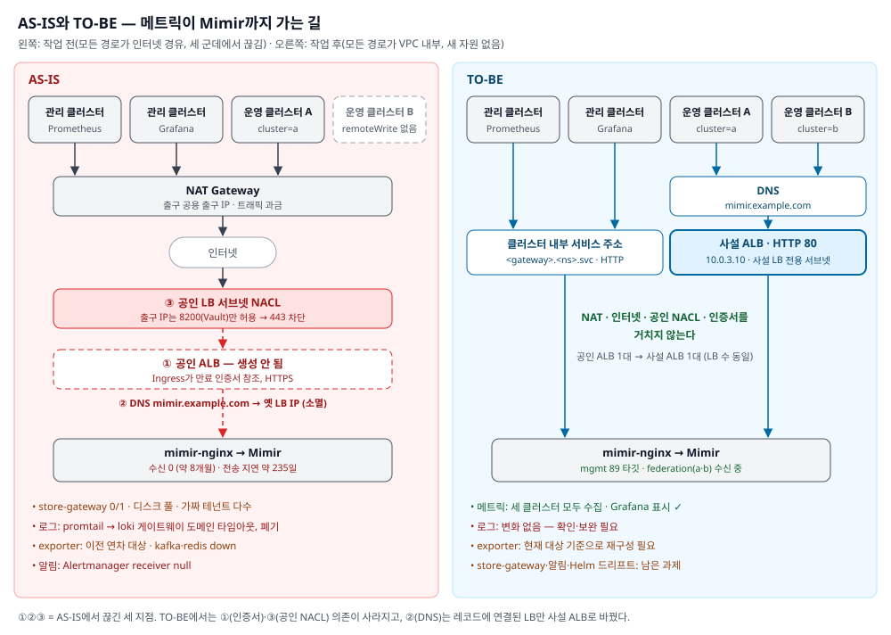

> 이 글의 도메인, IP, 클러스터 이름 등 사내 식별 정보는 모두 일반화했다.
{: .prompt-info }

[모니터링 시스템 복구기 #1](/posts/monitoring-recovery-1-revival/)을 쓰면서, 이전 시리즈 「모니터링 시스템 역추적기」 내내 써 온 개념들을 나 스스로 처음부터 설명할 수 있는지 돌아보게 됐다. 역추적할 때는 "이 설정이 왜 여기 있나"를 쫓느라 개념은 필요한 만큼만 짚고 넘어갔다. 이 글은 그 개념들을 처음 보는 사람도 따라올 수 있게 정리한 것이다.

순서대로 읽으면 "데이터가 어디서 생겨서 어떻게 화면까지 오는가"를 따라가게 된다. 각 개념 끝의 **이번 사례에서는** 항목은 [복구기 #1](/posts/monitoring-recovery-1-revival/) 복구 작업에서 실제로 마주친 장면이다. 개념이 현장에서 어떻게 문제로 나타나는지 같이 보면 기억에 오래 남는다. 그리고 **더 깊이** 항목은 같은 개념을 이 시스템의 히스토리로 파고든 시리즈 편으로 이어진다.

| 이 글의 장 | 이어지는 편 |
|---|---|
| 3·5·6. Prometheus, Operator, remote_write | [역추적기 #1 kube-prometheus-stack](/posts/monitoring-reverse-engineering-1-kube-prometheus-stack/) |
| 4. Exporter | [역추적기 #3 JMX Exporter](/posts/monitoring-reverse-engineering-3-jmx-exporter/), [역추적기 #4 관리형 서비스 Exporter](/posts/monitoring-reverse-engineering-4-managed-service-exporters/) |
| 7·8. Mimir, 멀티 테넌시 | [역추적기 #2 Mimir](/posts/monitoring-reverse-engineering-2-mimir/) |
| 10. Grafana | [역추적기 #5 Grafana](/posts/monitoring-reverse-engineering-5-grafana/) |
| 11. Alertmanager | [역추적기 #6 Alertmanager → Airflow](/posts/monitoring-reverse-engineering-6-alertmanager-airflow/) |
| 12. Loki와 promtail | [역추적기 #7 Loki & Promtail](/posts/monitoring-reverse-engineering-7-loki-promtail/) |
| 13. 네트워크 | [복구기 #1](/posts/monitoring-recovery-1-revival/) |

## 1. 큰 그림 — 택배 회사로 보기

모니터링 스택 전체를 택배 회사에 비유하면 이렇다.

| 택배 회사 | 모니터링 스택 | 하는 일 |
| --- | --- | --- |
| 물건 | 메트릭(숫자 데이터) | "CPU 사용률 30%", "요청 120건" 같은 측정값 |
| 지점 | 각 Kubernetes 클러스터 | 측정값이 생기는 곳 |
| 지점 직원 | Prometheus | 지점 안을 돌며 물건을 모으고, 잠깐 보관한다 |
| 통역사 | Exporter | Prometheus가 못 알아듣는 시스템(MySQL 등)의 말을 번역한다 |
| 본사로 가는 트럭 | remote_write | 지점에서 모은 물건을 본사로 보낸다 |
| 본사 정문 | 로드밸런서(ALB)·도메인 | 트럭이 들어오는 입구 |
| 본사 중앙 창고 | Mimir | 모든 지점의 물건을 오래 보관한다 |
| 선반 이름표 | 테넌트(X-Scope-OrgID) | 물건을 어느 선반에 둘지 구분한다 |
| 창고 들여다보는 창문 | Grafana | 창고 물건을 그래프로 보여준다 |
| 경보기 | Alertmanager | 이상하면 알린다 |
| 별도의 문서 창고 | Loki | 숫자가 아니라 글(로그)을 보관한다 |
| 문서 수거 직원 | promtail | 로그를 모아 Loki로 보낸다 |

이번 장애는 "지점 직원도, 본사 창고도 멀쩡한데 **정문과 길이 막혀** 8개월 동안 물건이 한 개도 도착하지 않은" 상황이었다.

```
[지점: 운영 클러스터]                       [본사: 관리 클러스터]
 Exporter ─┐                                ┌─ Mimir (창고) ─ Grafana (창문)
 앱 ───────┼→ Prometheus ─ remote_write ─→ 정문 ─┤
 노드 ─────┘   (직원)        (트럭)        (ALB)  └─ Alertmanager (경보기)
```

---

## 2. 메트릭이란 무엇인가

### 메트릭 = 시간에 따라 변하는 숫자

메트릭은 "어떤 대상을, 어느 시점에, 몇이라고 쟀는가"다.

```
node_cpu_seconds_total{cpu="0", mode="idle", instance="10.0.2.7:9100"}  123456.7  @ 11:35:00
└─────── 이름 ───────┘└──────────────── 라벨 ────────────────────────────┘  └─ 값 ─┘  └ 시각 ┘
```

- **이름**: 무엇을 쟀나 (`node_cpu_seconds_total` = CPU가 쓴 시간 누계)
- **라벨**: 어떤 대상을 쟀나. 키=값 쌍으로 붙는 꼬리표다
- **값**: 숫자 하나
- **시각**: 언제 쟀나

### 시계열(Time Series)

이름과 라벨 조합이 같은 값들이 시간 순으로 쌓인 것을 **시계열**이라 한다. 위 예시에서 `cpu="1"`로 라벨이 하나만 바뀌어도 별개의 시계열이다.

> 비유: 엑셀 시트 하나가 "CPU0의 idle 시간"이라는 시계열이다. 행마다 시각과 값이 하나씩 적힌다.

시계열 수는 라벨 조합 수만큼 늘어난다. 그래서 라벨에 사용자 ID처럼 값이 무한히 많은 것을 넣으면 시계열이 폭발한다(카디널리티 문제). Mimir가 테넌트별로 "시리즈 300만 개" 같은 한도를 두는 이유다.

### 메트릭 종류

| 종류 | 성질 | 예 | 읽는 법 |
| --- | --- | --- | --- |
| Counter | 계속 늘기만 한다 (재시작하면 0부터) | 요청 수 누계, 전송한 샘플 수 | 그대로 보면 의미가 없다. `rate()`로 "초당 얼마나 늘었나"를 본다 |
| Gauge | 오르내린다 | 메모리 사용량, 현재 Pod 수 | 값 자체를 본다 |
| Histogram / Summary | 분포 | 응답 시간 구간별 건수 | 백분위(p95 등)를 계산한다 |

복구 작업 때 본 `prometheus_remote_storage_samples_failed_total`은 Counter다. 이름 끝의 `_total`이 Counter라는 관례적 표시다.

### `up` — 가장 중요한 메트릭

Prometheus는 수집할 때마다 대상마다 `up`이라는 메트릭을 스스로 만든다.

- `up = 1`: 수집 성공
- `up = 0`: 수집 실패 (대상이 죽었거나 길이 막힘)

그래서 `count(up)`은 "수집 대상이 몇 개인가"이고, 복구 여부를 판정하는 데 썼다(관리 클러스터 89, 운영 클러스터 17).

**이번 사례에서는**: exporter가 `up=1`이어도 안심할 수 없다. `up`은 "Prometheus가 exporter에 접속했다"는 뜻일 뿐이다. exporter가 진짜 MySQL에 붙었는지는 `mysql_up`처럼 exporter가 따로 내는 지표를 봐야 한다.

---

## 3. Prometheus — 수집하고 저장하는 일꾼

### 끌어오기(Pull) 방식

Prometheus는 대상이 데이터를 보내주길 기다리지 않는다. **주기적으로 직접 찾아가서 가져온다.** 이를 **scrape(스크레이프)**라고 한다.

```
Prometheus ──(15~30초마다 HTTP GET /metrics)──→ 대상
           ←── 텍스트로 된 메트릭 목록 ─────────
```

대상은 `/metrics`라는 주소에 현재 값들을 텍스트로 걸어두기만 하면 된다. 아무나 그 페이지를 열어 볼 수 있다. 복구 작업 때 `curl localhost:18080/metrics`로 distributor의 메트릭을 직접 본 것이 바로 이것이다.

> 비유: 직원이 각 책상(대상)을 돌며 칠판(/metrics)에 적힌 숫자를 옮겨 적는다.

Pull 방식의 장점:
- 대상이 죽으면 바로 안다. 가져오기에 실패하니 `up=0`이 된다.
- 대상은 Prometheus가 어디 있는지 몰라도 된다.

### 타깃(Target)과 job

- **타깃**: 스크레이프할 주소 하나 (예: `http://10.0.2.7:9100/metrics`)
- **job**: 같은 종류의 타깃 묶음 (예: `node-exporter` job에 노드 6개)

복구 작업 때 돌린 점검 스크립트의 "job별 health 집계"가 이것이다. `kubelet 6 down`은 kubelet job의 타깃 6개가 실패했다는 뜻이었다. 원인은 교체돼 사라진 옛 노드였다.

### 로컬 저장소 (TSDB)와 보관 기간

Prometheus는 가져온 데이터를 자기 디스크에 저장한다. 이를 **TSDB**(시계열 데이터베이스)라고 한다.

- **retention(보관 기간)**: 얼마나 오래 둘지. 운영 클러스터는 `7d`(7일)다.
- **WAL**(Write-Ahead Log): 받은 데이터를 먼저 적어두는 일지다. 갑자기 꺼져도 다시 켜지면 이 일지를 읽어 복구한다. 복구 작업 로그에 찍힌 `Replaying WAL`이 이 일지를 다시 읽는 장면이다.

**Prometheus 혼자의 한계**
- 한 대의 디스크에 저장하니 오래, 많이 보관하기 어렵다.
- 클러스터마다 따로 있으니 여러 클러스터를 한 화면에서 보기 어렵다.
- 그래서 본사 창고(Mimir)로 보내는 구조를 쓴다.

**이번 사례에서는**: 운영 클러스터의 Prometheus는 영구 디스크(PVC)가 없다. 파드가 재시작하면 로컬 데이터가 사라진다. 운영 클러스터 B를 업그레이드할 때 로컬 데이터가 날아간 이유다. Mimir로 보내고 있으니 괜찮다는 설계다.

---

## 4. Exporter — 통역사

MySQL, Redis, Kafka, nginx 같은 프로그램은 스스로 `/metrics` 페이지를 만들지 않는다. 그래서 중간에 **exporter**를 둔다.

```
Prometheus ──scrape──→ mysqld-exporter ──SQL 질의──→ MySQL
                        (번역해서 /metrics로 내놓음)
```

exporter는 대상 시스템에 접속해 상태를 묻고, 그 답을 Prometheus 형식으로 바꿔 `/metrics`에 걸어둔다.

| exporter | 대상 | 기본 포트 |
| --- | --- | --- |
| node-exporter | 서버(노드) 자체: CPU, 메모리, 디스크, 네트워크 | 9100 |
| mysqld-exporter | MySQL | 9104 |
| redis-exporter | Redis | 9121 |
| kafka-exporter | Kafka | 9308 |
| nginx exporter | nginx | 9113 |
| kube-state-metrics | Kubernetes 오브젝트 상태(Pod 수, Deployment 상태 등) | 8080 |
| JMX exporter | Java 앱(JVM 메모리, 스레드 등) | 우리는 8090 |

### 주의: exporter가 살아 있다 ≠ 대상이 살아 있다

exporter와 대상 사이 연결이 끊겨도 exporter 프로세스는 멀쩡히 떠 있을 수 있다. 그래서 두 가지를 따로 봐야 한다.

- `up{job="mysqld-exporter"} = 1` → Prometheus가 exporter에 접속했다
- `mysql_up = 1` → exporter가 MySQL에 접속했다

**이번 사례에서는**: kafka·redis exporter는 대상에 붙지 못해 응답 자체가 늦어져 `up=0`(타임아웃)이었다. mysqld exporter는 `up=1`이지만 이전 연차 DB를 보고 있을 수 있다. 그래서 "엔드포인트만 바꾸기"가 아니라 "현재 대상 기준으로 새로 구성"이 과제다.


> **더 깊이** — [역추적기 #3 JMX Exporter](/posts/monitoring-reverse-engineering-3-jmx-exporter/) — 클러스터에 없던 exporter를 이미지 빌드 경로에서 찾아낸 이야기, [역추적기 #4](/posts/monitoring-reverse-engineering-4-managed-service-exporters/) — 에이전트를 설치할 수 없는 관리형 서비스를 원격으로 수집하는 패턴
{: .prompt-tip }

---

## 5. Kubernetes에서 Prometheus를 운영하는 방법

Kubernetes에서는 Pod가 수시로 생기고 사라진다. 수집 대상 주소를 사람이 일일이 적을 수 없다. 그래서 다음 도구들이 있다.

### CRD — Kubernetes에 새 종류의 오브젝트 추가하기

Kubernetes는 원래 Pod, Service, Deployment 같은 오브젝트만 안다. **CRD**(Custom Resource Definition)는 "이런 종류의 오브젝트도 있다"고 새로 등록하는 기능이다.

Prometheus 쪽에서 추가하는 주요 CRD:

| CRD | 뜻 | 복구 작업 때 본 예 |
| --- | --- | --- |
| `Prometheus` | "이런 설정의 Prometheus를 하나 띄워라" | 클러스터마다 하나씩 |
| `ServiceMonitor` | "이 라벨이 붙은 Service를 수집 대상으로 삼아라" | `app-monitor` |
| `PodMonitor` | Service 없이 Pod를 직접 수집 | — |
| `PrometheusRule` | 알림 규칙·계산 규칙 | 기본 규칙들(운영 클러스터 B에서는 껐다) |
| `Alertmanager` | Alertmanager 설정 | 클러스터마다 하나 |

### Prometheus Operator — CRD를 보고 실제로 일하는 관리자

**Operator**는 CRD를 지켜보다가, 거기 적힌 대로 실제 Prometheus를 띄우고 설정 파일을 만든다.

```
사람: kubectl patch prometheus <이름> (remoteWrite 주소 변경)
  → Operator: "Prometheus 설정이 바뀌었네" → 설정 파일(Secret) 다시 생성
  → config-reloader(사이드카): 설정 파일 변경 감지 → Prometheus에게 "다시 읽어"
  → Prometheus: 재시작 없이 새 설정 적용 ("Completed loading of configuration file")
```

> 비유: CRD는 "주문서 양식", 우리가 쓰는 Prometheus 오브젝트는 "주문서", Operator는 "주문서대로 일을 처리하는 매니저"다.

Prometheus 주소를 바꿨을 때 재시작 없이 1~2분 만에 반영된 이유가 이것이다.

### ServiceMonitor와 라벨 셀렉터 — "누구를 수집할까"

Prometheus 오브젝트에는 "어떤 ServiceMonitor를 따를지" 고르는 조건(**셀렉터**)이 있다.

```yaml
serviceMonitorSelector:
  matchLabels:
    release: prometheus      # release=prometheus 라벨이 붙은 ServiceMonitor만 따른다
```

**이번 사례에서는**: 이게 운영 클러스터 B에서 앱 메트릭이 빠져 있던 이유였다.

| | 차트가 만든 ServiceMonitor | 앱 팀이 만든 ServiceMonitor | 셀렉터 | 결과 |
| --- | --- | --- | --- | --- |
| 운영 클러스터 A | `release=prometheus` | `release=prometheus` | `release=prometheus` | 둘 다 수집 |
| 운영 클러스터 B (전) | `release=kube-prometheus-stack` | `release=prometheus` | 차트 기본값(`kube-prometheus-stack`) | **앱 누락** |
| 운영 클러스터 B (후) | 〃 | 〃 | 두 값 모두 허용 | 둘 다 수집 |

Helm 차트는 셀렉터 기본값을 **자기 릴리스 이름**으로 잡는다. A는 릴리스 이름이 마침 `prometheus`여서 앱 팀 라벨과 우연히 맞았다. B는 이름이 달라서 어긋났다.

### kube-prometheus-stack — 한 번에 설치하는 묶음

**kube-prometheus-stack**은 위 구성요소를 한 번에 설치하는 Helm 차트다. 들어 있는 것:

- Prometheus Operator + CRD
- Prometheus (CR 하나)
- Alertmanager
- Grafana (선택)
- node-exporter (DaemonSet: 노드마다 하나씩)
- kube-state-metrics
- 기본 ServiceMonitor들(kubelet, apiserver, coredns 등)
- 기본 알림 규칙(PrometheusRule)과 Grafana 대시보드(ConfigMap)

**이번 사례에서는**: 세 클러스터 모두 이 차트로 설치돼 있다. 운영 클러스터 B에서 `helm diff`를 했을 때 Grafana와 대시보드 ConfigMap, 기본 규칙이 삭제 목록에 뜬 것은 `grafana.enabled: false`, `defaultRules.create: false`로 이 묶음 중 일부를 끈 결과다.

### externalLabels — 지점 도장

`externalLabels`는 이 Prometheus가 내보내는 **모든** 데이터에 공통으로 찍는 라벨이다.

```yaml
externalLabels:
  cluster: b
  origin_prometheus: b
```

여러 클러스터의 데이터가 한 창고(같은 테넌트)에 섞여도, 이 도장으로 "어느 지점에서 왔는지" 구분한다. Grafana 대시보드 상단의 K8S 드롭다운에 `b`가 보인 것이 이 라벨 덕분이다. 대시보드 변수가 `cluster`·`origin_prometheus` 라벨 값을 읽어 목록을 만든다.


> **더 깊이** — [역추적기 #1 kube-prometheus-stack](/posts/monitoring-reverse-engineering-1-kube-prometheus-stack/) — values 파일 두 개, `serviceMonitorSelectorNilUsesHelmValues`, 클러스터별 values가 갈라진 과정
{: .prompt-tip }

---

## 6. remote_write — 본사로 짐 보내기

### 무엇인가

Prometheus가 수집한 데이터를 **다른 저장소로 실시간 복사해 보내는** 기능이다. 로컬에도 저장하면서 동시에 본사(Mimir)로도 보낸다.

```yaml
remoteWrite:
  - url: http://mimir.example.com/api/v1/push     # 어디로
    headers:
      X-Scope-OrgID: federation                   # 어느 선반에 (8장)
```

### 내부 동작 — 큐와 샤드

```
수집 → WAL에 기록 → WAL watcher가 읽음 → 큐(Queue) → 샤드 N개가 병렬 전송 → Mimir
```

- **큐**: 보낼 데이터가 줄 서는 곳
- **샤드(shard)**: 동시에 보내는 일꾼 수. 보통 1개로 시작해서, 밀리면 늘린다.
- **resharding**: 일꾼 수를 바꾸는 것. 복구 작업 때 본 `Remote storage resharding from=1 to=50`은 "밀린 게 많으니 일꾼을 1명에서 50명으로 늘린다"는 뜻이었다. 오류가 아니라 **전송이 다시 성공하기 시작했다는 신호**였다.

### 실패했을 때의 행동

| 실패 종류 | 예 | Prometheus의 행동 | 실패 카운터 |
| --- | --- | --- | --- |
| 재시도 가능 | 타임아웃, 5xx, 429 | 계속 재시도 (`Failed to send batch, retrying`) | **안 늘어난다** |
| 재시도 불가 | 4xx (잘못된 데이터, 너무 오래된 데이터) | 그 묶음을 버린다 | 늘어난다 |

이 표가 복구 작업 때 가장 함정이었던 부분이다. 8개월 내내 타임아웃이었는데 `samples_failed_total`은 **0**이었다. 타임아웃은 "재시도하면 될 수도 있는" 실패라 카운터에 안 잡힌다. 그래서 실패 카운터 대신 **전송 지연**을 봐야 한다.

```promql
time() - prometheus_remote_storage_queue_highest_sent_timestamp_seconds
# = 지금 시각 - 마지막으로 성공적으로 보낸 데이터의 시각
# 당시 값: 20,368,031초 ≈ 235.7일 → 3월 21일경부터 하나도 못 보냄
```

### 오래된 데이터는 결국 버려진다

막혀 있던 동안의 데이터를 나중에 다 보낼 수 있을까? 아니다.

- WAL은 보통 몇 시간분만 유지된다.
- Mimir는 너무 오래된 샘플을 거절한다(`out of bounds`).

그래서 복구 후 Mimir에는 "복구 시점 이후" 데이터만 쌓였다. 8개월치 공백은 메워지지 않는다.


> **더 깊이** — [역추적기 #1](/posts/monitoring-reverse-engineering-1-kube-prometheus-stack/) — 클러스터별 Prometheus가 중앙으로 remote_write하는 구조가 만들어진 과정, [복구기 #1](/posts/monitoring-recovery-1-revival/) — 그 경로가 8개월간 막혀 있던 이유
{: .prompt-tip }

---

## 7. Mimir — 본사 중앙 창고

### 왜 필요한가

Prometheus 혼자서는 1) 오래 보관하기 어렵고 2) 여러 클러스터를 합쳐 보기 어렵다. **Mimir**는 여러 Prometheus가 remote_write로 보낸 데이터를 받아 오래, 많이 저장하고 한곳에서 조회하게 해준다. Grafana Labs가 만든 오픈소스다.

### 구성요소 — 창고 안의 부서들

Mimir는 역할별로 쪼개진 여러 프로그램(마이크로서비스)으로 돌아간다. 우리는 `mimir-distributed` 차트로 이 구성을 쓴다.

**쓰기 경로 (데이터가 들어오는 길)**

```
remote_write → nginx(게이트웨이) → distributor → ingester ×6 → (2시간마다) Object Storage
```

| 구성요소 | 비유 | 하는 일 |
| --- | --- | --- |
| nginx (gateway) | 창고 안내 데스크 | 요청을 받아 쓰기는 distributor로, 읽기는 query-frontend로 보낸다 |
| distributor | 입고 담당 | 데이터를 검사(한도 초과?)하고 ingester들에게 나눠 준다 |
| ingester | 임시 선반 | 최근 데이터(약 2시간~12시간)를 메모리에 들고 있다가 블록으로 묶어 Object Storage에 올린다. 안전을 위해 같은 데이터를 3곳(zone a·b·c)에 복제한다 |
| Object Storage | 대형 장기 보관소 | S3 호환 저장소(우리는 NCP Object Storage, 버킷 하나). 싸고 크다 |
| compactor | 정리 담당 | 작은 블록들을 큰 블록으로 합치고, 보관 기간이 지난 블록을 지운다 |

**읽기 경로 (조회하는 길)**

```
Grafana → nginx → query-frontend → query-scheduler → querier ─┬→ ingester (최근 데이터)
                                                               └→ store-gateway → Object Storage (오래된 데이터)
```

| 구성요소 | 하는 일 |
| --- | --- |
| query-frontend | 큰 조회를 쪼개고 결과를 캐시한다 |
| query-scheduler | 조회 요청을 줄 세운다 |
| querier | 실제로 계산한다. 최근 것은 ingester에, 오래된 것은 store-gateway에 물어본다 |
| store-gateway | Object Storage에 있는 블록을 찾아 읽는다. 빨리 찾으려고 블록 목차(index-header)를 자기 디스크에 받아 둔다 |

**기타**

| 구성요소 | 하는 일 |
| --- | --- |
| ruler | 알림 규칙을 Mimir 쪽에서 계산 |
| alertmanager | Mimir 내장 알림 관리 |
| overrides-exporter | 테넌트별 한도 설정을 메트릭으로 노출 |
| rollout-operator | zone별 ingester·store-gateway를 순서대로 재시작하도록 관리 |

**이번 사례에서는** ([복구기 #2](/posts/monitoring-recovery-2-loki-and-longterm/)에서 확인한 것. 처음 추정과 달랐던 부분을 바로잡았다)
- store-gateway 3개가 0/1이었던 이유는 디스크(10Gi)가 **진짜 테넌트 하나의 목차(약 8GB)** 로 꽉 찼기 때문이다. 처음엔 "정체불명 폴더 수천 개의 목차가 채웠다"고 봤는데, 직접 열어 보니 그 폴더들은 0MB였다.
- 블록이 그렇게 많아진 이유는 **compactor가 220일간 한 번도 성공하지 못해서**다(성공 0 / 실패 약 1만 번). 버킷 최상위의 정체불명 폴더 약 3만 개를 테넌트로 보고 하나씩 도느라 진짜 테넌트를 합치지 못했다.
- 그 결과 "최근(ingester) 조회는 되고, 12시간이 넘는 조회는 전부 실패"하는 상태였다.
- `storage_prefix: blocks`는 "블록을 버킷 최상위가 아니라 `blocks/` 폴더 아래에 두라"는 설정이다. 정체불명 폴더와 분리하려던 것인데, 기존 데이터를 옮기지 않고 바꿔 기존 데이터가 안 보이게 되자 원복됐다.

### 창고(버킷)와 작업 책상(디스크)

| | Object Storage 버킷 | 파드 디스크 |
| --- | --- | --- |
| 비유 | 창고 | 직원의 작업 책상 |
| 무엇이 있나 | 원본 전부 | 처리용 복사본(캐시·작업장) |
| 크기 | 무제한, 쓰는 만큼 과금 | 고정 |
| 비우면 | 데이터 소실 | 창고에서 다시 가져옴 |

- store-gateway 디스크는 캐시에 가깝지만 **창고의 모든 블록 목차를 다 담아야** 동작한다. 창고의 블록 수가 곧 필요한 디스크 크기다.
- 디스크에 있어서 재시작해도 남고, 지워도 시작하자마자 다시 만든다. **재시작으로는 해결되지 않는다.**

### 블록, 합치기, 보관 기간

- **블록**: ingester가 2시간치 데이터를 포장한 상자. ingester는 같은 데이터를 3개 존에 저장해서 같은 시간대 블록이 3벌 올라간다.
- **합치기(compaction)**: compactor가 2시간 블록을 더 큰 블록으로 합친다. 3벌도 1벌로 정리된다. 블록 수가 줄어 찾기 쉬워진다.
- **보관 기간**: 테넌트별 `compactor_blocks_retention_period`. 기본값 0 = **무기한.** 오래된 블록에 삭제 표시 → 조회 쪽이 무시(약 1시간 뒤) → 실제 삭제(설정한 지연 시간 뒤) 순서로 지운다.
- 버킷 콘솔의 자동 삭제(수명 주기)로 지우면 안 된다. Mimir가 가진 블록 목록과 실제가 어긋난다.

### 설정을 어디에 넣느냐에 따라 재시작 범위가 다르다

| 넣는 곳 | 재시작 |
| --- | --- |
| 공용 설정(`structuredConfig`) | 전 컴포넌트 |
| 컴포넌트 인자(`<컴포넌트>.extraArgs`) | 그 컴포넌트만 |
| 테넌트별 runtime 설정(`runtimeConfig.overrides`) | 없음 (주기적으로 다시 읽음) |

> **더 깊이** — [역추적기 #2 Mimir](/posts/monitoring-reverse-engineering-2-mimir/) — 테넌시가 세 번 바뀐 이유와 한도 설정의 정합성 버그
{: .prompt-tip }

---

## 8. 멀티 테넌시 — 창고 선반의 이름표

Mimir는 데이터를 **테넌트**(tenant, 입주자)별로 완전히 분리해 저장한다. 어느 테넌트인지는 HTTP 헤더 하나로 정한다.

```
X-Scope-OrgID: federation
```

- 보낼 때 이 헤더를 붙이면 그 선반에 저장된다.
- 조회할 때도 같은 헤더를 붙여야 그 선반이 보인다. **다른 이름표로 조회하면 데이터가 있어도 빈 결과가 나온다.**

**이번 사례의 테넌트**

| 테넌트 | 누가 넣나 | 누가 보나 |
| --- | --- | --- |
| `mgmt` | 관리 클러스터 Prometheus | Grafana의 Mimir 데이터소스로는 안 보인다 (로컬 Prometheus 데이터소스로 본다) |
| `federation` | 운영 클러스터 A·B Prometheus | Grafana Mimir 데이터소스(기본) |
| 그 밖의 테넌트 | 지금은 아무도 안 넣음 | 예전 시도의 흔적 |

`federation` 하나에 여러 클러스터가 같이 들어가니, 그 안에서 클러스터를 구분하는 게 5장의 `externalLabels`(cluster=a/b)다. 테넌트는 "선반", externalLabels는 "선반 안 상자에 찍힌 지점 도장"이다.


> **더 깊이** — [역추적기 #2 Mimir](/posts/monitoring-reverse-engineering-2-mimir/) — 단일 테넌트에서 클러스터별 테넌트, 다시 공용 테넌트로 바뀐 변천사
{: .prompt-tip }

---

## 9. PromQL — 창고에 질문하는 언어

**PromQL**은 Prometheus와 Mimir에 데이터를 묻는 질의 언어다.

| 질의 | 뜻 | 복구 작업 때 쓴 곳 |
| --- | --- | --- |
| `up` | 모든 타깃의 수집 성공 여부(0/1) | Grafana Explore 확인 |
| `count(up)` | 타깃이 몇 개인가 | 복구 확인 (89, 17) |
| `count by (cluster) (up)` | 클러스터별 타깃 수 | 클러스터 A·B 구분 확인 |
| `sum by (url) (prometheus_remote_storage_samples_failed_total)` | 전송 대상별 실패 누계 | 진단 (0이라 함정) |
| `time() - prometheus_remote_storage_queue_highest_sent_timestamp_seconds` | 전송 지연(초) | 진단 (235.7일) |
| `rate(http_requests_total[5m])` | 최근 5분간 초당 요청 수 | (Counter 읽는 일반적인 방법) |

읽는 요령:
- `{...}` 안은 라벨 조건이다. `up{job="node-exporter"}`는 node-exporter job만.
- `by (라벨)`은 그 라벨로 묶어 집계한다.
- `[5m]`은 "최근 5분 구간"이다.

**API로 직접 묻기**: Grafana 없이도 HTTP로 물을 수 있다. 복구 작업 때 이렇게 했다.

```bash
curl -s -G localhost:18081/prometheus/api/v1/query \
  -H 'X-Scope-OrgID: federation' \        # 선반 이름표
  --data-urlencode 'query=count(up)'           # 질문
# {"status":"success","data":{"result":[{"value":[시각,"17"]}]}}
#  결과가 [] 이면 → 그 선반에 해당 데이터가 없다
```

---

## 10. Grafana — 창고를 들여다보는 창문

Grafana는 데이터를 저장하지 않는다. **데이터소스**(어디에 물어볼지)를 등록해 두고, 대시보드를 열 때마다 그 데이터소스에 PromQL로 물어서 그린다.

| 개념 | 뜻 |
| --- | --- |
| 데이터소스 | "이 주소에, 이 헤더(테넌트)로 물어봐라"는 연결 설정 |
| 대시보드 | 패널(그래프·표) 묶음 |
| 패널 | PromQL 하나 이상 + 그리는 방식 |
| 변수 | 대시보드 상단 드롭다운. 라벨 값을 읽어 목록을 만들고, 고른 값을 쿼리에 끼워 넣는다 (K8S=b) |
| Explore | 대시보드 없이 PromQL을 바로 쳐보는 화면 |
| provisioning | 데이터소스·대시보드를 파일(ConfigMap)로 미리 넣어 두는 방식. Grafana는 **켜질 때** 읽는다 |

**이번 사례에서는**
- Grafana의 Mimir 데이터소스는 ConfigMap에 들어 있다. 이 설정은 켜질 때만 읽으니 주소를 바꾼 뒤 재시작했다.
- 대시보드에 "No data"가 뜨는 경우는 세 가지다. 1) 데이터가 정말 없다, 2) 라벨 이름이 쿼리와 다르다, 3) 다른 테넌트에 있다. 파일 시스템·네트워크 패널 No data는 아직 이 중 무엇인지 모른다.


> **더 깊이** — [역추적기 #5 Grafana](/posts/monitoring-reverse-engineering-5-grafana/) — 대시보드 프로비저닝 경로, `__inputs` 치환, 데이터소스 uid 교체
{: .prompt-tip }

---

## 11. Alertmanager — 경보기

Prometheus(또는 Mimir ruler)가 알림 규칙으로 "이상하다"고 판단하면 Alertmanager에 알린다. Alertmanager는 그 알림을 묶고, 중복을 걸러 **receiver**(수신처)로 보낸다.

```
알림 규칙(PrometheusRule) → Prometheus 평가 → Alertmanager → receiver(슬랙, 메일, 웹훅...)
```

**이번 사례에서는**: receiver가 `"null"` 하나뿐이었다. 이름 그대로 "아무 데도 보내지 않음"이다. 경보기는 울리는데 선이 끊겨 있었다. 수집이 8개월간 멈춘 걸 아무도 몰랐던 근본 원인이다.


> **더 깊이** — [역추적기 #6 Alertmanager → Airflow](/posts/monitoring-reverse-engineering-6-alertmanager-airflow/) — 알림 목적지가 사람이 아니라 Airflow DAG였던 설계와 미검증 판정
{: .prompt-tip }

---

## 12. 로그 축 — Loki와 promtail

메트릭은 **숫자**, 로그는 **글**이다. 로그는 별도의 길로 간다.

| | 메트릭 | 로그 |
| --- | --- | --- |
| 내용 | `cpu=30%` | `ERROR: connection refused at ...` |
| 수집 | Prometheus (가져오기) | promtail (밀어 넣기) |
| 저장 | Mimir | Loki |
| 질의 언어 | PromQL | LogQL |

- **promtail**: 각 노드에서 컨테이너 로그 파일을 읽어 Loki로 **보낸다(push)**. 노드마다 하나씩 뜬다(DaemonSet).
- **Loki**: 로그를 받아 저장한다. 구조는 Mimir와 거의 같다(distributor, ingester, querier, gateway, Object Storage). 같은 회사(Grafana Labs)가 같은 설계로 만들었기 때문이다.

**이번 사례에서는** ([복구기 #2](/posts/monitoring-recovery-2-loki-and-longterm/)에서 확인·조치)
- promtail이 `loki.example.com`로 보내다 타임아웃이 났다. 메트릭과 같은 종류(외부 도메인을 돌아 들어오는 길이 방화벽에 막힘)였다. 내부 주소로 바꿔 해결했다.
- 안쪽에도 고장이 있었다. ingester가 서로를 알리는 명단(memberlist)에서 빠져 링에 비정상으로 남아 있었다. 재시작으로 복귀시켰다.
- 그런데 들어오는 건 관리 클러스터 로그뿐이었다. 그래서 입구는 사설 LB로 닫고, 수집은 멈추고, 옛 로그 처리는 결정권자에게 넘겼다.
- Loki의 보관 기간은 기간보다 오래된 것을 **일괄 삭제**한다. 옛 것만 남기려면 다른 곳에 먼저 복사해야 한다.
- promtail과 loki-distributed 차트는 지원 종료 수순이다. 운영 클러스터 로그는 Grafana Alloy + Loki 3.x로 받기로 했다.

### LoadBalancer Service를 사설로

- 클라우드에 따라 어노테이션이 없으면 **공인 LB**가 기본이다. 이 사례의 클라우드는 `...-load-balancer-internal: "true"` 어노테이션으로 사설 LB를 만든다.
- LB의 공인/사설과 서브넷은 **만들 때 정해진다.** 어노테이션만 나중에 바꿔서는 안 바뀌고, Service를 다시 만들어야 한다.
- 다시 만들 때 `meta.helm.sh/*` 어노테이션을 남기면 Helm이 계속 자기 리소스로 인식한다.


> **더 깊이** — [역추적기 #7 Loki & Promtail](/posts/monitoring-reverse-engineering-7-loki-promtail/) — Kafka 완충로 4차 시도와 롤백, 최종 Loki 직결 구조
{: .prompt-tip }

---

## 13. 네트워크 — 데이터가 지나가는 길

이번 장애는 전부 이 영역에서 났다. 데이터가 지나가는 길을 바깥에서 안쪽 순서로 정리한다.

### 도메인과 DNS

- **도메인**: 사람이 읽는 주소(`mimir.example.com`)
- **DNS**: 도메인을 실제 IP로 바꿔 주는 전화번호부
- **A 레코드**: 도메인 → IP를 직접 적는다
- **CNAME 레코드**: 도메인 → 다른 도메인으로 연결한다. LB처럼 뒤쪽 IP가 바뀔 수 있는 대상에 쓴다. IP가 바뀌어도 따라간다.
- **TTL**: "이 답을 몇 초 동안 기억해도 된다." DNS를 바꿔도 TTL이 지나기 전까지는 옛 답이 나온다. 복구 작업 때 DNS를 바꾸고 몇 분을 기다린 이유다.

`nslookup`, `dig`는 DNS에 직접 물어보는 명령이다. `dig`는 남은 TTL까지 보여준다.

### VPC와 서브넷

- **VPC**: 클라우드 안에 나만의 사설 네트워크를 만든 것. 같은 VPC 안은 사설 IP(`10.x.x.x`)로 서로 통한다.
- **서브넷**: VPC를 용도별로 나눈 구역. 우리는 노드용 서브넷과 LB 전용 서브넷(공인용, 사설용)이 따로 있다.

| | 대역 | |
| --- | --- | --- |
| 관리 클러스터 노드 | 10.0.1.x | 같은 VPC, 다른 서브넷 |
| 운영 클러스터 노드 | 10.0.2.x | 〃 |
| 사설 ALB | 10.0.3.10 | 사설 LB 전용 서브넷 |

### NAT Gateway — 바깥으로 나가는 출구

사설 IP만 가진 서버가 인터넷에 나갈 때 거치는 출구다. 나갈 때 출발지 주소를 NAT의 공인 IP 하나로 바꿔 준다.

**이번 사례에서는**: 관리 클러스터와 운영 클러스터가 바깥에서 둘 다 같은 공인 IP로 보였다(`checkip`). 같은 NAT를 쓴다는 뜻이다. NAT를 거치는 트래픽은 **과금 대상**이다. 동료가 지적한 비용 문제가 이것이다.

### 방화벽 두 종류 — ACG와 NACL

| | ACG | NACL |
| --- | --- | --- |
| 단위 | 서버(인스턴스) 하나하나 | 서브넷 전체 |
| 비유 | 개인 출입증 | 층 출입문 |
| 응답 트래픽 | 자동 허용 (상태 기억) | **따로 허용해야 함** (상태 기억 안 함) |
| 규칙 순서 | 순서 없음 | 번호가 작은 규칙부터 적용 |

**이번 사례에서는**: 공인 LB 서브넷의 NACL이 허용 목록 방식이었다. 우리 출구 IP는 **8200(Vault)만** 허용돼 있었고 443은 없었다. 사무실 IP는 따로 허용돼 있어서 PC에서는 들어갔다. "PC에서는 되는데 클러스터에서는 안 된다"는 이상한 증상의 원인이었다.

### 로드밸런서 — 정문

- **로드밸런서(LB)**: 들어온 요청을 뒤쪽 서버 여러 대에 나눠 준다.
- **ALB**(Application LB): HTTP를 이해하는 LB. 도메인(Host)이나 경로별로 다른 곳에 보낼 수 있다.
- **공인 LB**: 인터넷에서 접근 가능한 공인 IP를 가진다.
- **사설 LB**: VPC 안에서만 접근 가능한 사설 IP를 가진다. **내부용 서비스는 이쪽이 맞다.**
- **HTTPS 리스너**에는 인증서가 필요하다. 인증서가 만료되면 리스너를 만들 수 없다.

### Kubernetes에서 LB를 만드는 방법 — Service와 Ingress

| | Service (type: LoadBalancer) | Ingress |
| --- | --- | --- |
| 계층 | TCP (4계층) | HTTP (7계층) |
| 하나의 LB에 | 서비스 하나 | 여러 서비스를 도메인·경로로 나눠 연결 가능 |
| NCP에서 | NLB/NPLB 생성 | ALB 생성 (ALB Ingress Controller) |

**Ingress Controller**는 Ingress 오브젝트를 보고 실제 클라우드 LB를 만드는 프로그램이다. NCP NKS에서는 관리형이라 클러스터에 파드가 안 보인다. 그래서 복구 작업 때 컨트롤러 로그를 볼 수 없었다.

Ingress의 상태 칸 **ADDRESS**에 LB 주소가 채워지면 LB가 만들어진 것이다. 비어 있으면 생성에 실패한 것이다. 복구 작업 때 첫 번째 단서였다.

Ingress 어노테이션(`alb.ingress.kubernetes.io/...`)으로 LB 성격을 정한다.

| 어노테이션 | 뜻 |
| --- | --- |
| `network-type: private` | 사설 LB로 생성 (생성 시에만 적용) |
| `listen-ports` | 열 포트(HTTP 80, HTTPS 443) |
| `ssl-certificate-no` | HTTPS에 쓸 인증서 번호 |
| `ssl-redirect` | HTTP로 오면 HTTPS로 넘기기 (복구 작업 때 본 301) |

### finalizer — 지우기 전 체크리스트

**finalizer**는 Kubernetes 오브젝트에 붙는 "이 일을 끝내기 전에는 지우지 마라"는 꼬리표다. Ingress에는 "연결된 LB 정리 담당"이라는 finalizer가 붙는다. 그래서 Ingress를 지우면 LB도 같이 정리된다.

**이번 사례에서는**: Ingress를 JSON으로 저장해 다시 만들 때 이 꼬리표까지 복사됐다. 새 Ingress가 "이미 삭제된 옛 LB를 정리해야 한다"는 꼬리표를 달고 태어나서 멈췄다. 꼬리표를 떼자 새 LB가 만들어졌다.

### 클러스터 내부 주소 — 건물 안 복도

Kubernetes Service는 클러스터 안에서만 통하는 이름을 가진다.

```
<서비스 이름>.<네임스페이스>.svc
mimir-nginx.monitoring.svc
```

같은 클러스터 안이라면 이 주소로 바로 간다. LB도, NAT도, 인증서도, DNS 레코드도 필요 없다. 복구 작업 때 관리 클러스터의 Prometheus와 Grafana를 이 주소로 바꿨다.

### 전환 전후 경로 비교



위 그림을 글로 줄이면 이렇다.

```
[전] 같은 클러스터 Prometheus → NAT → 인터넷 → (NACL) → 공인 ALB(HTTPS, 인증서) → mimir-nginx
[후] 같은 클러스터 Prometheus → mimir-nginx.monitoring.svc → mimir-nginx
[후] 다른 클러스터 Prometheus → (DNS) → 사설 ALB(HTTP, VPC 내부) → mimir-nginx
```


> **더 깊이** — [복구기 #1](/posts/monitoring-recovery-1-revival/) — 인증서·DNS·NACL 세 겹의 장애를 구간 격리로 찾은 과정과 사설 ALB 전환
{: .prompt-tip }

---

## 14. Helm — 설치와 설정 관리

- **Helm**: Kubernetes용 패키지 관리자. 여러 YAML을 하나의 **차트**로 묶어 설치한다.
- **차트**: 템플릿 묶음 (예: kube-prometheus-stack 65.5.0)
- **values**: 차트에 넣는 설정값. 같은 차트라도 values에 따라 결과가 달라진다.
- **릴리스**: 차트를 values와 함께 설치한 결과물 하나 (예: 운영 클러스터 B의 `kube-prometheus-stack`)
- **리비전**: 릴리스를 바꿀 때마다 1씩 오르는 번호. `helm rollback 이름 번호`로 되돌린다.

| 명령 | 뜻 |
| --- | --- |
| `helm list` | 설치된 릴리스 목록 |
| `helm history` | 리비전 이력 (언제 누가 바꿨나의 흔적) |
| `helm get values` | 지금 리비전에 넣은 values (`--revision N`으로 과거도) |
| `helm diff upgrade` (플러그인) | 바꾸기 전에 무엇이 바뀌는지 미리 보기 |
| `helm upgrade` | 새 values로 적용 |
| `helm rollback` | 이전 리비전으로 되돌리기 |

### 드리프트 — 기록과 실제가 어긋나는 것

kubectl로 직접 바꾸면 Helm이 기억하는 values와 실제가 달라진다. 이를 **드리프트**(drift)라고 한다. 다음에 누가 `helm upgrade`를 하면 Helm은 자기 기억대로 되돌린다. 그러면 손으로 고친 것이 사라진다.

**이번 사례에서는**: 관리 클러스터와 운영 클러스터 A에 드리프트가 4건 있다. 운영 클러스터 B는 처음부터 values로 적용해서 드리프트가 없다. values에 반영한 뒤 `helm diff`를 돌렸을 때 **아무 변경도 안 나오면** 기록과 실제가 일치한다는 뜻이다.

---

## 15. 복구 중 본 로그·명령 읽는 법

| 로그 / 결과 | 뜻 | 좋은 신호? |
| --- | --- | --- |
| `Failed to send batch, retrying ... context deadline exceeded` | 보내다가 시간 초과. 재시도 중 | 나쁨 (길이 막힘) |
| `Remote storage resharding from=1 to=50` | 밀린 걸 보내려고 일꾼을 늘림 | **좋음** (전송 재개) |
| `Starting WAL watcher` / `Done replaying WAL` | 새 전송 줄을 시작하고 일지를 다시 읽음 | 정상 (설정 반영) |
| `WAL watcher stopped`, `Failed to flush all samples on shutdown count=11999` | 옛 전송 줄을 닫으며 들고 있던 데이터를 버림 | 전환 때 정상 |
| `Completed loading of configuration file` | 설정을 다시 읽음 | 정상 |
| `final error sending batch` (promtail) | 재시도를 다 쓰고 로그 묶음을 버림 | 나쁨 |
| `no space left on device` (store-gateway) | 디스크가 꽉 참 | 나쁨 |
| `Readiness probe failed: 503` | 아직 준비 안 됨 → 트래픽 안 받음 | 나쁨 |
| Ingress ADDRESS 비어 있음 | LB가 안 만들어짐 | 나쁨 |
| `lb instance ... from finalizer not found` | 옛 LB 꼬리표를 달고 있음 | 나쁨 (finalizer 제거로 해결) |
| `curl` 결과 301 | HTTP로 왔으니 HTTPS로 가라 (= LB가 응답함) | 좋음 (길은 열림) |
| `wget` 결과 `OK` (mimir-nginx `/`) | 게이트웨이가 살아 있음 | 좋음 |
| `{"result":[]}` | 그 테넌트·조건에 데이터 없음 | 상황에 따라 다름 |

자주 쓴 명령:

| 명령 | 왜 썼나 |
| --- | --- |
| `kubectl port-forward svc/X 18081:80` | 클러스터 안 서비스를 내 터미널 localhost로 잠깐 연결 |
| `kubectl exec ... -- wget ...` | 파드 **안에서** 요청을 보내 봄. "클러스터 입장에서 길이 열렸나"를 보려고 |
| `wget -qO- http://checkip.amazonaws.com` | 바깥에서 내가 어떤 IP로 보이는지 |
| `nslookup` / `dig` | 도메인이 지금 어디를 가리키나, TTL은 얼마 남았나 |
| `kubectl get ingress -w` | 값이 바뀔 때마다 새 줄로 보여 줌 (바뀌지 않으면 그대로) |
| `kubectl describe ... \| tail` | 맨 아래 Events에서 실패 사유 확인 (약 1시간 지나면 사라짐) |

---

## 16. 용어 사전

| 용어 | 한 줄 설명 |
| --- | --- |
| 메트릭 | 시간에 따라 변하는 측정 숫자 |
| 시계열 | 이름+라벨이 같은 값들을 시간순으로 쌓은 것 |
| 라벨 | 메트릭에 붙는 키=값 꼬리표 |
| 카디널리티 | 라벨 조합 수 = 시계열 수. 많으면 부담 |
| scrape | Prometheus가 대상의 /metrics를 가져오는 것 |
| 타깃 | scrape 대상 주소 하나 |
| job | 같은 종류 타깃 묶음 |
| exporter | 다른 시스템 상태를 Prometheus 형식으로 번역 |
| TSDB | Prometheus 로컬 시계열 저장소 |
| WAL | 받은 데이터를 먼저 적는 일지 |
| retention | 보관 기간 |
| remote_write | 다른 저장소로 실시간 복사 전송 |
| shard / resharding | 병렬 전송 일꾼 / 그 수를 조정 |
| externalLabels | 이 Prometheus가 보내는 모든 데이터에 찍는 도장 |
| CRD | Kubernetes에 새 오브젝트 종류를 등록 |
| Operator | CRD를 보고 실제로 일하는 관리 프로그램 |
| ServiceMonitor | "이 Service를 수집하라"는 CRD |
| 셀렉터 | 라벨 조건으로 대상을 고르는 규칙 |
| kube-prometheus-stack | Prometheus 일습을 한 번에 까는 Helm 차트 |
| Mimir | 여러 Prometheus 데이터를 오래·많이 저장하는 중앙 저장소 |
| distributor / ingester | Mimir 입고 담당 / 임시 선반 |
| querier / query-frontend | Mimir 조회 계산 / 조회 접수 |
| store-gateway | Object Storage의 오래된 블록을 읽는 담당 |
| compactor | 블록 합치기·오래된 블록 삭제 |
| Object Storage | S3 같은 대용량 장기 저장소 |
| 테넌트 | Mimir 안의 분리된 저장 공간 |
| X-Scope-OrgID | 테넌트를 지정하는 HTTP 헤더 |
| PromQL | Prometheus 질의 언어 |
| `up` | 수집 성공(1)/실패(0) |
| 데이터소스 | Grafana가 물어볼 곳 |
| 대시보드 변수 | 상단 드롭다운, 라벨 값으로 목록 생성 |
| Alertmanager / receiver | 알림 관리자 / 알림 받을 곳 |
| Loki / promtail / LogQL | 로그 저장소 / 로그 수집기 / 로그 질의 언어 |
| Grafana Alloy | promtail 후속 수집 에이전트 |
| VPC / 서브넷 | 사설 네트워크 / 그 안의 구역 |
| NAT Gateway | 사설망에서 인터넷으로 나가는 출구 |
| ACG / NACL | 서버 단위 방화벽 / 서브넷 단위 방화벽 |
| ALB | HTTP 이해하는 로드밸런서 |
| 공인 LB / 사설 LB | 인터넷용 / VPC 내부용 |
| Ingress / Ingress Controller | HTTP 진입 규칙 / 그 규칙대로 LB를 만드는 프로그램 |
| 어노테이션 | 오브젝트에 붙이는 부가 설정 |
| finalizer | 지우기 전 정리할 일이 있다는 꼬리표 |
| 클러스터 내부 주소 | `<svc>.<ns>.svc`, 클러스터 안에서만 통함 |
| A / CNAME 레코드 | 도메인→IP / 도메인→도메인 |
| TTL | DNS 답을 기억해도 되는 시간 |
| Helm 차트 / values / 릴리스 / 리비전 | 패키지 / 설정값 / 설치 결과 / 변경 번호 |
| 드리프트 | Helm 기록과 실제 상태가 어긋남 |
| helm diff | 적용 전 변경 미리 보기 |

---

**이 시리즈 — 모니터링 시스템 복구기**
[1편 8개월간 멈춰 있던 스택을 되살리다 — 세 겹의 장애와 내부 경로 전환](/posts/monitoring-recovery-1-revival/)
부록 — 개념 정리: 메트릭이 화면에 뜨기까지 (본 편)
[2편 살린 로그는 닫고, 숨은 고장은 찾았다 — Loki 정리와 220일간 아무도 몰랐던 장기 조회 장애](/posts/monitoring-recovery-2-loki-and-longterm/)

**이전 시리즈 — 모니터링 시스템 역추적기** (이 시스템이 어떻게 만들어졌는지 되짚은 기록)
[0편 프롤로그 — 문서 없는 모니터링 시스템을 물려받았다](/posts/monitoring-reverse-engineering-0-prologue/)
[1편 kube-prometheus-stack — values 파일 두 개의 수수께끼](/posts/monitoring-reverse-engineering-1-kube-prometheus-stack/)
[2편 Mimir — 멀티테넌시는 왜 세 번 바뀌었나](/posts/monitoring-reverse-engineering-2-mimir/)
[3편 JMX Exporter — 빌드타임에 이미지로 굽는 설정의 함정](/posts/monitoring-reverse-engineering-3-jmx-exporter/)
[4편 관리형 서비스 시대의 Exporter — 에이전트를 설치할 수 없는 대상을 감시하는 법](/posts/monitoring-reverse-engineering-4-managed-service-exporters/)
[5편 Grafana — PMM 대시보드 이식기와 `__inputs`의 배신](/posts/monitoring-reverse-engineering-5-grafana/)
[6편 Alertmanager → Airflow — 스펙에 없는 필드와 싸운 기록](/posts/monitoring-reverse-engineering-6-alertmanager-airflow/)
[7편 Loki & Promtail — 로그 파이프라인: 폐기된 Kafka 완충로와 헬스체크 방랑기](/posts/monitoring-reverse-engineering-7-loki-promtail/)
[8편 에필로그 — 역추적이 남긴 것](/posts/monitoring-reverse-engineering-8-epilogue/)

---

*이 시리즈의 모든 내용은 특정 조직·시스템을 식별할 수 없도록 도메인, 명칭, 일부 수치를 일반화/변경했습니다.*
