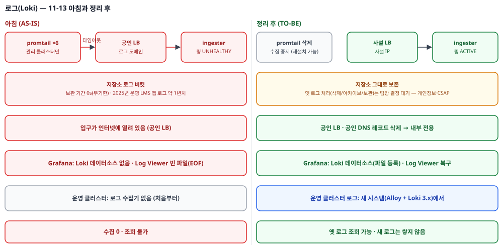
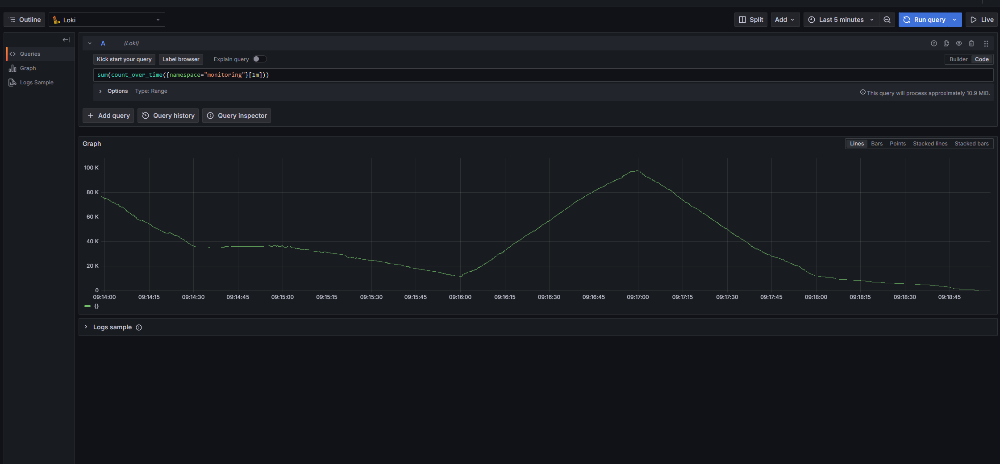
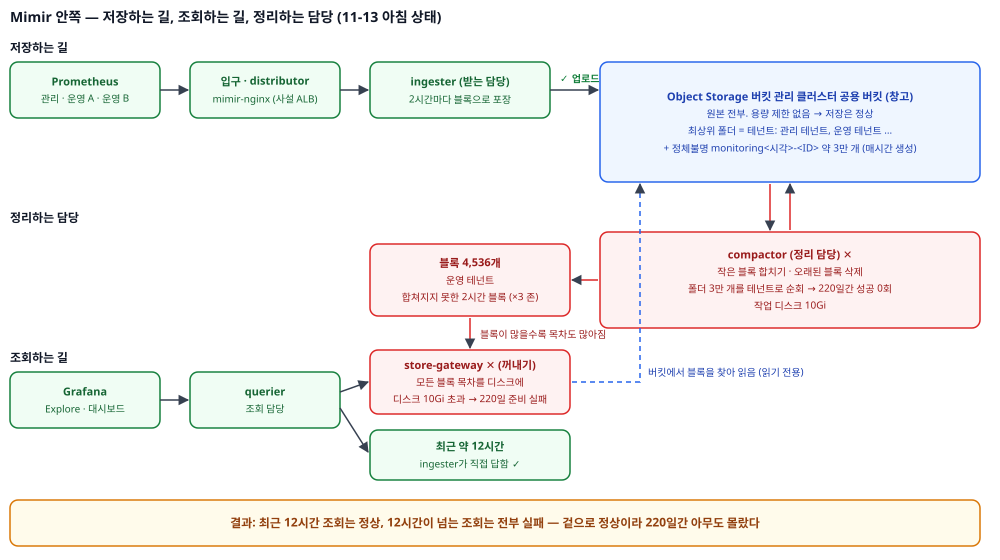
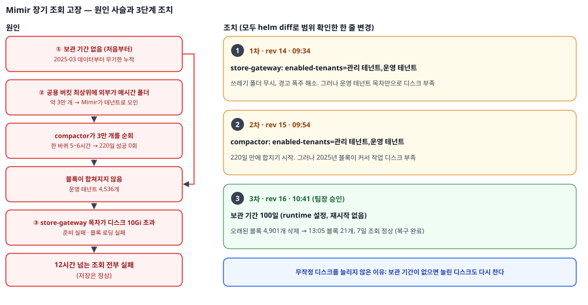
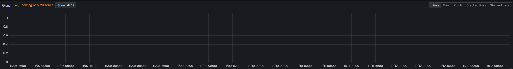

> 「모니터링 시스템 복구기」 2편이다. [1편](/posts/monitoring-recovery-1-revival/)에서 메트릭 수집을 복구했다. 이번 편은 그다음 날의 기록이다. 로그(Loki)를 살렸다가 다시 정리했고, 그 과정에서 메트릭 저장소(Mimir) 안쪽에 숨어 있던 더 큰 고장을 찾았다. 낯선 용어는 [부록: 개념 정리](/posts/monitoring-recovery-appendix-concepts/)에 풀어 두었다.
{: .prompt-tip }

## 들어가며

1편 마지막에 남은 과제로 "로그 파이프라인(Loki) 보완"을 적었다. 메트릭과 같은 유형의 고장일 거라고 예상했고, 실제로 그랬다. 그런데 그날은 예상대로 끝나지 않았다.

결론부터 말하면 이렇다.

1. **로그**: 두 군데 고장(수집 경로, 저장 담당)을 고쳐 로그가 다시 들어오게 했다. 그런데 들어오는 건 관리 클러스터 로그뿐이었다. 저장소에는 1년치 운영 서비스 로그가 보관 기간 없이 쌓여 있었고, 입구는 인터넷에 열려 있었다. 그래서 **입구는 내부 전용으로 닫고, 수집은 다시 멈추고, 옛 로그 처리는 결정권자에게 넘겼다.**
2. **메트릭**: 로그 화면에서 우연히 메트릭 저장소의 경고를 봤다. 따라가 보니 **12시간이 넘는 메트릭 조회가 220일째 전부 실패**하고 있었다. 정리 담당(compactor)은 220일간 한 번도 성공하지 못했다. 원인을 세 겹으로 풀고, 세 번의 한 줄 변경으로 되살렸다.

1편이 "끊긴 길을 잇는" 이야기였다면, 이번 편은 **"살렸다"와 "쓸모 있다"는 다르다**는 것, 그리고 **겉으로 정상이면 아무도 모른다**는 것에 대한 이야기다.

## 1부. 로그 — 살리고, 따지고, 정리했다


_로그 파이프라인 — 그날 아침(왼쪽)과 정리 후(오른쪽)_

### 진단: 메트릭과 같은 모양, 그리고 하나 더

1편과 같은 방식으로, 아무것도 바꾸지 않는 점검 스크립트부터 돌렸다. 구간을 셋으로 나눠 각각 두드렸다.

```text
================ 4. 구간 비교 — 도메인 / 내부 서비스 주소 / LB 주소 직접 ================
wget: download timed out          ← ① 도메인으로: 실패
'/dev/null' saved                 ← ② 내부 서비스 주소로: 성공
wget: download timed out          ← ③ LB 주소 직접: 실패

================ 5. Loki 자체 ================
gateway / -> 200
too many unhealthy instances in the ring
```

①③은 실패하고 ②만 성공이다. Loki에 닿는 길은 있는데, 바깥(공인 LB)을 도는 길이 막혀 있다. 1편의 메트릭과 같은 모양이다. 같은 클러스터의 수집기가 굳이 인터넷을 돌아 들어오는 구조였고, 그 길이 방화벽에서 막혔다.

그런데 하나가 더 있었다. `too many unhealthy instances in the ring`. 입구는 살아 있는데 안쪽이 받지 못한다는 뜻이다. 링 상태를 따로 봤다.

```text
--- 링에 올라가 있는 것 (distributor의 /ring 페이지)
 ingester-0    UNHEALTHY
--- memberlist 구성원 (서로를 알고 있는 Pod)
 compactor-0, distributor-..., querier-0      ← ingester가 명단에 없다
--- ingester 준비 상태
 ready (HTTP 200)
```

ingester 파드는 살아 있고, 자기 자신은 정상이라고 생각한다. 그런데 **서로의 존재를 알리는 명단(memberlist)에서 빠져** 있어서, 다른 컴포넌트는 심장 박동을 받지 못한다. 그래서 링에는 비정상으로 남았다. 파드 나이는 236일. 노드 교체 무렵 다시 뜨면서 명단 합류에 실패한 채 혼자 지낸 것으로 보인다.

### 복구: 두 가지

- **ingester 재시작.** 명단 합류는 시작할 때 다시 시도한다. ingester가 하나뿐이라 잠깐 수신이 멈추지만, 어차피 아무것도 못 받고 있었다. 재시작 뒤 링에 ACTIVE로 돌아왔다.
- **수집기 주소를 내부 주소로.** 같은 클러스터 안이니 인터넷을 돌 이유가 없다. 1편에서 정한 원칙 그대로다. kubectl로 바로 고치지 않고 Helm values로 바꿨다. `helm diff`에 설정 파일과 그 체크섬만 바뀐다고 나오는 것을 보고 적용했다.

5분 만에 34만 줄이 들어왔다. Grafana에는 Loki 데이터소스가 아예 없어서 다시 등록했다. 이 Grafana는 저장 공간이 파드 재시작 때 비워지는 임시 공간이었다. 화면에서 만든 설정이 사라진 이유가 그것이다. 그래서 이번에는 **파일(ConfigMap)로** 등록했다. 로그 대시보드는 엉뚱한 파일 경로를 가리켜 빈 파일을 읽고 있었다(`error=EOF`). 내용을 채워 넣어 살렸다.

### 그런데 쓸모가 없었다

대시보드는 떴다. 그런데 운영 서비스 로그가 하나도 안 보였다. 확인해 보니 **운영 클러스터에는 처음부터 로그 수집기가 없었다.** 들어오는 건 관리 클러스터 로그뿐이었다. 건물은 돌아가는데 사는 사람이 없는 상태였다.

운영 로그를 받으려면 운영 클러스터에 수집기를 새로 깔아야 한다. 그런데 지금 쓰는 수집기(promtail)도, 로그 서버 차트(loki-distributed)도 지원이 끝나는 중이다. 지는 기술을 새로 까는 대신, 운영 로그 수집은 **새 구조(Grafana Alloy + Loki 3.x)** 에서 하기로 미뤘다.

### 저장소 안의 1년치 운영 로그

보관 기간을 정하자는 이야기가 나와서 저장소를 시점별로 조회했다.

| 시점 | 가장 많은 로그 | 의미 |
|---|---|---|
| 1년 전 | 교과별 서비스 앱 네임스페이스들 | 운영 서비스 로그 |
| 1년 전 가을 | 앱 하나가 **1시간에 약 2천만 줄** | 운영 피크 |
| 올해 초 | 관리 도구들만 | 앱 로그가 끊김 |

옛 운영 클러스터의 서비스 로그 약 1년치가 **보관 기간 없이** 남아 있었다. 처음엔 하루만 보고 "옛 로그도 관리 클러스터 것"이라고 판단했다가, 여러 시점을 보고 바로잡았다.

여기서 기술 판단만으로는 정할 수 없는 문제가 생겼다.

| 선택 | 위험 |
|---|---|
| 보관 기간을 켠다 | Loki의 보관 기간은 기간보다 오래된 것을 **일괄 삭제**한다. "옛 것만 남기기"가 안 된다. 1년치 서비스 이력이 영구히 사라진다 |
| 그대로 둔다 | 비용이 계속 나간다. 학생·교사가 쓰는 서비스의 로그라 **개인정보가 들어 있을 수 있다.** 정해진 보유 기간 없이 쌓아 두는 것 자체가 보안 인증 기준에 맞지 않을 수 있다 |

남기면서 정리하려면 다른 저장소에 먼저 복사해야 한다. 어느 쪽이든 **지우는 결정은 내 것이 아니었다.** 보유 기준을 정할 사람에게 넘기고, 결정 전까지는 그대로 두기로 했다. 그대로 두면 잃을 것은 없다.

### 입구를 닫다 — Helm으로 하려다 멈춘 이유

로그 서버의 입구는 **공인 로드밸런서**였다. 어노테이션이 없으면 클라우드가 기본으로 공인 LB를 만든다. 1년치 운영 로그가 든 저장소의 정문이 인터넷에 열려 있었다는 뜻이다.

values에 사설 어노테이션 한 줄을 넣고 `helm diff`를 봤다. 그런데 예상 밖의 차이가 함께 나왔다.

```text
distributor, Service:           -   type: NodePort  +   type: ClusterIP
gateway, Service:               +   service.beta.kubernetes.io/ncloud-load-balancer-internal: "true"   ← 원하는 변경
querier, Service:               -   type: NodePort  +   type: ClusterIP
query-frontend, Service:        -   type: NodePort  +   type: ClusterIP
query-frontend, Deployment:     -  resources: {requests: 100m/512Mi, limits: 512Mi}
```

누군가 kubectl로 Service 세 개를 바꿔 둔 것이다(기록과 실제가 어긋난 **드리프트**). 처음엔 "현재 상태를 담은 values 파일을 하나 더 붙이면 된다"고 생각했다. 그런데 차트 원본을 열어 보니 이 세 Service는 템플릿에 `type: ClusterIP`로 **고정**돼 있었다. values로는 이 드리프트를 표현할 방법이 없다. upgrade하면 누가 쓰는지 모르는 포트가 닫힌다.

게다가 클라우드는 **이미 만든 LB를 공인↔사설로 바꿔 주지 않는다.** 종류와 서브넷은 만들 때 정해진다. 어차피 다시 만들어야 했다. 그래서 **입구 Service 하나만** 다시 만들었다.

```bash
# 자동으로 붙은 값은 지우고, Helm 소유 표시는 남기고, 사설 어노테이션만 더한다
kubectl get svc gateway -o json | jq '
  del(.status, .metadata.uid, .metadata.resourceVersion, .metadata.creationTimestamp,
      .metadata.managedFields, .metadata.finalizers, .spec.clusterIP, .spec.clusterIPs)
  | .spec.ports |= map(del(.nodePort))
  | .metadata.annotations["service.beta.kubernetes.io/ncloud-load-balancer-internal"] = "true"' > gateway.new.json
kubectl delete svc gateway && kubectl create -f gateway.new.json
```

```text
gateway   LoadBalancer   ...   <pending>                  80:31200/TCP   3s
gateway   LoadBalancer   ...   <사설 LB 호스트>.lb.ncloud   80:31200/TCP   43s
$ dig +short <사설 LB 호스트>
10.x.x.x                                  ← 사설 IP
$ curl -s http://<사설 LB 호스트>/loki/api/v1/labels
{"status":"success","data":["app","component","container",...]}
```

Helm 소유 표시(`meta.helm.sh/*`)를 남겼기 때문에, 다시 만든 Service도 Helm이 자기 것으로 인식한다. values 파일에는 어노테이션을 기록으로 남겼다. 나중에 누가 upgrade해도 사설로 유지된다.

### 다시 따져 보고, 수집을 멈췄다

이 무렵 메트릭 쪽 문제(2부)를 보면서 "자원을 계속 쓰고 있는 것"을 따져 봤다. 지금 들어오는 건 쓸모가 적은 관리 클러스터 로그뿐이다. 보관 기간이 없어 들어오는 만큼 영원히 쌓인다. 옛 로그 결정이 나기 전에 새 로그를 계속 쌓을 이유가 없었다.

그래서 수집을 멈췄다. 다만 **"복구 전으로 전부 되돌리기"는 하지 않았다.**

| 바꾼 것 | 되돌림? | 이유 |
|---|---|---|
| 수집기 | **멈춤** | 저장량이 느는 유일한 원인 |
| 링 복구 | 그대로 | 들어오는 게 없으면 비용도 없다. 일부러 다시 고장 낼 이유가 없다 |
| 데이터소스·대시보드 | 그대로 | 옛 로그를 조회하는 통로. 보관 결정의 근거 자료다 |
| 사설 입구 | 그대로 | 되돌리면 저장소 정문이 다시 인터넷에 열린다 |

수집기는 `helm rollback`이 아니라 **삭제(uninstall)** 했다. rollback하면 옛 주소(공인 도메인)로 돌아간다. 지금은 방화벽에 막혀 실패하니 멈춘 것처럼 보이지만, 누가 DNS를 사설로 바꾸는 순간 다시 성공해 쌓이기 시작한다. **우연한 실패에 기대는 정지는 정지가 아니다.**


_"직전 1분간 들어온 줄 수"라서, 멈춘 뒤 1분에 걸쳐 0으로 내려간다_

공인 LB가 쓰던 IP를 가리키던 DNS 레코드도 지웠다. 반납된 IP를 클라우드가 다른 고객에게 주면, **우리 도메인이 남의 서버를 가리키게** 된다. 확률은 낮지만 1분이면 없앨 수 있는 위험이다.

## 2부. 메트릭 — 220일간 아무도 몰랐던 고장

### 로그 화면에 나타난 낯선 경고

로그가 살아난 직후, 모니터링 네임스페이스 로그를 훑다 이런 줄이 쏟아지는 것을 봤다.

```text
level=warn user=monitoring20250327T060000Z-XJEX...
  msg="failed to persist list of lazy-loaded index headers"
  err="write /data/tsdb-sync/monitoring20250327T060000Z-XJEX.../lazy-loaded.json.tmp: no space left on device"
(테넌트 이름만 바뀌며 수십 줄)
```

메트릭 저장소(Mimir)의 **store-gateway**가 내는 경고다. 디스크가 꽉 찼다는 뜻이다. 그런데 `user=` 자리에 테넌트 이름 대신 `monitoring<날짜>-<ID>`가 수십 개 찍혀 있었다.

### Mimir 안쪽 — 저장하는 길과 조회하는 길은 다르다

여기서부터는 Mimir 안쪽 구조를 알아야 이해된다. 핵심은 **저장하는 길과 조회하는 길이 따로 있다**는 것이다.


_Mimir 안쪽 — 저장·조회·정리 담당과 그날 아침의 고장 지점_

| 담당 | 하는 일 | 비유 |
|---|---|---|
| ingester | 받아서 2시간 단위 블록으로 포장해 버킷에 저장 | 받는 직원 |
| compactor | 작은 블록을 합쳐 수를 줄이고, 오래된 블록을 지움 | 정리 직원 |
| store-gateway | 버킷의 블록을 찾아 꺼내 줌. 빨리 찾으려고 **모든 블록의 목차를 자기 디스크에** 복사해 둠 | 꺼내 주는 직원 |

그리고 **창고와 책상을 구분**해야 한다. 버킷(Object Storage)은 창고다. 원본이 전부 있고 용량 제한이 없다. 각 담당의 디스크는 작업 책상이다. 처리용 복사본을 올려 두는 곳이고 크기가 고정이다. 꽉 찬 건 창고가 아니라 책상이었다. 그래서 **저장은 계속 정상**이었다.

### 상태 확인 — 220일간 한 번도 준비되지 않았다

```text
store-gateway-zone-a-0   0/1   Running   500 (8h ago)    220d
store-gateway-zone-b-0   0/1   Running   439 (11h ago)   220d
store-gateway-zone-c-0   0/1   Running   357 (3h ago)    220d

Warning  Unhealthy  (x1986632 over 220d)  Readiness probe failed: HTTP probe failed with statuscode: 503
```

220일 동안 준비 확인을 약 199만 번 실패했다. **만들어진 뒤로 한 번도 준비 완료가 된 적이 없다**는 뜻이다. 몇 시간 돌다 죽고 처음부터 다시, 하루 두 번꼴로 반복했다.

Grafana에서 같은 쿼리를 범위만 바꿔 봤다.

| 범위 | 결과 |
|---|---|
| 최근 6시간 | 정상 그래프 |
| **최근 2일** | `failed to get store-gateway replication set ...: at least 1 healthy replica required, could only find 0` |

**12시간이 넘는 조회는 전부 실패**하고 있었다. "오래된 부분만 빈칸"이 아니라 조회 자체가 오류다. 최근 약 12시간은 받는 직원(ingester)이 직접 답하기 때문에, 대시보드 기본 범위는 멀쩡해 보였다. 그래서 220일간 아무도 몰랐다.

### 테넌트가 7,949개?

store-gateway가 테넌트로 보고 있는 이름을 셌다.

```text
$ ... | grep -o 'user=[^ ]*' | sort -u | wc -l
7949
$ ... | grep -v 'user=monitoring20'
user=alertmanager
user=anonymous
user=blocks
user=comm-...
```

설정을 보니 이 저장소는 **관리 클러스터 공용 버킷**을 쓰고 있었다. 알림 설정은 `alertmanager/`, 규칙은 `ruler/` 접두어 아래에 두는데, 메트릭 블록은 접두어 없이 버킷 최상위에 둔다. 이건 Mimir의 기본 동작이다. 문제는 **다른 무언가가 같은 버킷 최상위에 `monitoring<시각>-<ID>` 폴더를 쌓고 있었다**는 것이다. Mimir는 최상위 폴더 하나하나를 테넌트로 받아들인다.

> 설정을 보다 하나 더 발견했다. 저장소 접근 키(access key, secret key)가 설정 파일에 **평문**으로 들어 있었다. 키 교체와 비밀 저장소 분리를 남은 과제 맨 위에 올렸다.
{: .prompt-warning }

### 이력 — 전임자도 같은 문제를 봤다

배포 이력을 보니 반년 전 어느 하루에 업그레이드와 롤백이 다섯 번 있었다. 그날의 설정을 비교했다.

| 시도 | 넣은 값 | 결과 |
|---|---|---|
| 첫 번째 | 블록 접두어 `blocks`, 보관 기간 100일 | values의 **엉뚱한 칸**에 넣어 실제 설정에 전달되지 않음 → 롤백 |
| 두 번째 | 같은 두 값을 **올바른 위치**에 | 접두어를 바꾸자 Mimir가 **새로 만든 빈 `blocks/` 폴더만** 보게 되어 기존 데이터가 사라져 보임 → 2시간 뒤 롤백 |

전임자가 노린 것은 블록을 `blocks/` 아래로 옮겨 쓰레기 폴더와 **분리**하고, **100일 보관**을 거는 것이었다. 방향은 맞았다. 실패한 이유는 **두 가지를 한꺼번에** 바꿨기 때문이다. 데이터를 옮기지 않고 접두어만 바꾸니 기존 데이터가 사라져 보였고, 그 바람에 보관 기간까지 같이 원복됐다. 그래서 **보관 기간은 처음부터 지금까지 한 번도 동작한 적이 없다.**

### 1차 조치 — 진짜 테넌트만 보게

선택지는 둘이었다.

| 방식 | 장점 | 단점 |
|---|---|---|
| 접두어 변경(전임자 방식) | 버킷이 깔끔해진다 | 기존 데이터를 옮겨야 한다. 안 옮기면 반년 전처럼 데이터가 사라져 보인다 |
| **처리할 테넌트 지정** | 데이터 이동이 없다. 한 컴포넌트만 바뀐다 | 쓰레기 폴더는 버킷에 그대로 남는다 |

Mimir에는 store-gateway가 처리할 테넌트를 지정하는 인자(`-store-gateway.enabled-tenants`)가 있다. 실제로 데이터를 보내는 테넌트 둘만 지정했다.

설정을 넣는 위치도 골랐다. 공용 설정(`structuredConfig`)을 바꾸면 설정 파일 체크섬이 바뀌어 **모든 컴포넌트가 재시작**된다. 컴포넌트별 인자(`extraArgs`)는 그 컴포넌트만 바뀐다. 기존 values는 그대로 두고, **바뀌는 것만 별도 파일**로 덧씌웠다.

```text
$ helm diff upgrade ... -f values.current.yaml -f values.override.yaml
store-gateway-zone-a, StatefulSet:
    updateStrategy:
      type: OnDelete                     ← 자동 재시작 안 됨. 파드를 직접 지워야 한다
          args:
+           - "-store-gateway.enabled-tenants=<관리 테넌트>,<운영 테넌트>"
(zone-b, zone-c 같은 한 줄)
```

적용하고 파드를 지웠다. 경고 폭주는 멈췄다. 그런데 디스크는 여전히 꽉 찼다. 이번엔 **진짜 테넌트**가 블록을 못 올리고 있었다.

```text
893 user=<운영 테넌트>  msg="loading block failed" ... no space left on device
```

### 열어 보니 내 추정이 틀렸다

이미지에 셸이 없어서(distroless) 안을 볼 수 없었다. 한 존만 잠시 멈추고, **같은 디스크를 붙인 임시 파드**로 열어 봤다.

```text
Filesystem   Size   Used   Avail   Use%
/dev/vdc     9.7G   8.0G   1.2G    87%
8206    /data/tsdb-sync/<운영 테넌트>
5       /data/tsdb-sync/<관리 테넌트>
0       (monitoring20… 폴더 합계)
```

나는 "쓰레기 폴더가 디스크를 채웠다"고 생각했다. **틀렸다.** 쓰레기 폴더는 0MB였다. 디스크를 채운 건 진짜 테넌트 하나의 목차, 8GB였다.

여기서 디스크를 늘리는 건 바로 할 수 있었다(확장 지원 확인). 하지만 하지 않았다. 보관 기간 없이 늘리면 언젠가 다시 찬다. 미루는 것뿐이다. 그리고 아직 **"왜 블록이 이렇게 많은가"** 를 몰랐다.

### 진짜 원인 — 정리 담당은 220일간 성공 0회

정리 담당(compactor)의 지표를 직접 읽었다. Grafana에서 보는 테넌트에는 Mimir 자기 지표가 없어서, API 서버를 거쳐 compactor의 `/metrics`를 불렀다.

```text
cortex_bucket_blocks_count{user="<운영 테넌트>"} 4536
cortex_compactor_last_successful_run_timestamp_seconds  → 1970-01-01  (기록 없음)
cortex_compactor_runs_completed_total 0
cortex_compactor_runs_failed_total{reason="error"} 10793
```

**성공 0번, 실패 1만 번.** 30분마다 220일이면 약 1만 회로 숫자가 맞는다. 정상이면 2시간 블록 12개가 하루 1개로 합쳐지는데, 한 번도 합쳐지지 않아 블록이 4,536개로 불어났다. 그 목차가 store-gateway 책상을 넘친 것이다.

로그에서 실패 이유를 찾으려 했지만 에러가 없었다. 남은 로그가 **8분치**뿐이었기 때문이다. 정리 작업이 테넌트마다 몇 줄씩 남겨 8분에 2만 8천 줄이 찍혔고, 30분에 한 번 나는 실패 메시지는 금방 밀려 사라졌다. 그래서 다음 회차를 실시간으로 잡았다.

```bash
kubectl logs -f compactor-0 | grep --line-buffered -v 'component=cleaner' \
  | grep --line-buffered -iE 'level=(error|warn)|compact|discovered users'
```
```text
msg="discovered users from bucket" users=29797               ← 테넌트를 3만 개로 봄
msg="starting compaction of user blocks" user=monitoring20251224T010000Z-...
msg="successfully synchronized block metadata" duration=516ms returned=0
msg="successfully compacted user blocks" user=monitoring20251224T010000Z-...
(빈 폴더를 하나씩, 약 0.7초씩)
```

빈 폴더 하나에 0.7초 × 3만 개 = **한 바퀴 5~6시간.** 그 사이 매시간 새 폴더가 생겼다. 진짜 테넌트의 차례는 끝내 제대로 오지 않았다.

> 파이프로 grep을 두 번 이으면 앞쪽 grep이 출력을 모아 두었다가 넘겨서, 실시간 로그가 화면에 안 나온다. `--line-buffered`를 붙여야 한 줄씩 바로 나온다.
{: .prompt-info }

쓰레기 폴더는 반년 전에 멈춘 게 아니라 **지금도 매시간** 생기고 있었다. 클러스터 안에는 이 버킷에 쓰는 것이 Mimir 말고는 없었다(예약 작업, 백업 도구 모두 없음). 바깥의 무언가다. 출처는 남은 과제로 넘겼다. Mimir가 무시하게 만들었으니 급하지는 않다.

### 2차 조치 — 정리 담당도 진짜 테넌트만

compactor에도 같은 한 줄(`-compactor.enabled-tenants`)을 넣었다. 새로 뜬 compactor의 로그다.

```text
msg="discovered users from bucket" users=29797                     ← 목록만 읽고 건너뜀 (17초)
msg="starting compaction of user blocks" user=<운영 테넌트>          ← 바로 진짜 테넌트
msg="successfully synchronized block metadata" returned=4530 partial=0
... minTime="(1년 8개월 전)" ... msg="compaction ..."                ← 가장 오래된 구간부터
msg="Found overlapping blocks during compaction"                    ← 3개 존 복제본을 1벌로 합치는 정상 동작
```

**220일 만에 처음으로 합치기를 시작했다.** 그리고 2분 뒤 실패했다.

```text
msg="compaction job failed" ... write /data/compact/.../index: no space left on device  block_count=4
```

가장 오래된 8시간치 블록 4개를 합치는 데도 정리 담당의 작업 디스크(10Gi)가 모자랐다. 1년 전 운영 규모가 컸던 시절의 블록이라 크다. 이대로면 가장 오래된 구간에서 계속 실패하고, 최근 데이터까지 차례가 오지 않는다.

이 시점의 Grafana도 달라졌다. 오류가 "정상 복제본 0개"에서 `failed to fetch some blocks`로 바뀌었다. 직원은 출근했는데 책상이 꽉 차서 **어제 블록**조차 못 올렸다. 오래된 블록의 목차가 자리를 먼저 차지한 것이다. 한 단계 나아갔지만, 아직 막혀 있었다.

### 3차 조치 — 보관 기간 100일

| | 디스크 늘리기 | **보관 기간 설정** |
|---|---|---|
| 하는 일 | 10Gi → 50Gi 등 | 100일 지난 블록을 Mimir가 지움 |
| 결과 | 1년 8개월치를 전부 합쳐야 한다. 며칠 걸리고, 또 모자랄 수 있다 | 오래된 블록은 **합치지 않고 지운다.** 남는 건 최근 100일치 |
| 비용 | 디스크 비용 증가 | 없음 |
| 잃는 것 | 없음 | 1년 전 메트릭(대부분 이미 없어진 옛 운영 클러스터 것). **복구 불가** |

보관 기간을 골랐다. 지워지는 건 없어진 클러스터의 1년 전 메트릭이다. 220일간 조회조차 안 됐는데 찾는 사람이 없었다. 전임자도 100일을 넣으려 했다. 메트릭에는 로그와 달리 개인정보가 없어 판단 부담이 작다. 그래도 삭제는 되돌릴 수 없어서 **결정권자의 승인을 받고** 적용했다.

넣는 곳도 중요했다. 클라우드 콘솔의 버킷 자동 삭제(수명 주기)를 쓰면 안 된다. Mimir 모르게 파일이 사라지면 Mimir의 블록 목록과 실제가 어긋나 조회 오류가 난다. 공용 버킷이라 엉뚱한 데이터가 지워질 위험도 있다. Mimir의 **테넌트별 runtime 설정**에 넣었다. runtime 설정은 Mimir가 주기적으로 다시 읽기 때문에 **재시작이 없다.**

```yaml
runtimeConfig:
  overrides:
    <운영 테넌트>:
      compactor_blocks_retention_period: 100d
    <관리 테넌트>:
      compactor_blocks_retention_period: 100d
```

```text
(적용 직후)  cortex_compactor_blocks_marked_for_deletion_total{reason="retention"} 0
(+14분)                                                                       261
(+14분, 몇 초 뒤)                                                              2334
```

처음 몇 분은 0이었다. 정리 작업이 마지막으로 돈 시각이 설정 **2분 전**이었기 때문이다. 다음 회차부터 100일이 지난 블록에 삭제 표시가 붙기 시작했다. Mimir는 표시 → 무시(약 1시간 뒤) → 실제 삭제(약 2시간 뒤) 순서로 지운다.


_원인은 세 겹, 조치는 세 번의 한 줄 변경_

### 결과 — 220일 만에 장기 조회가 돌아왔다

보관 기간을 건 지 두 시간쯤 지나 점검 스크립트를 다시 돌렸다.

```text
store-gateway-zone-a-0   1/1   Running        ← 220일 만에 처음으로 준비 완료
store-gateway-zone-b-0   1/1   Running
store-gateway-zone-c-0   1/1   Running
cortex_compactor_runs_completed_total 4        ← 정리 담당 첫 성공
cortex_bucket_blocks_count{user="<운영 테넌트>"} 21     ← 4,542에서
cortex_bucket_blocks_count{user="<관리 테넌트>"} 7      ← 403에서
cortex_compactor_blocks_marked_for_deletion_total{reason="retention"} 4901
store-gateway 블록 로딩 실패 (최근 10분): 0 / 0 / 0
디스크: 0.1Gi 미만 / 9.7Gi
```

| 항목 | 그날 아침 | 조치 후 |
|---|---|---|
| 저장 | 정상 | 정상 |
| 정리 담당 | 220일간 성공 0회 | **성공** |
| 꺼내기 담당 | 220일간 준비 0회 | **셋 다 준비 완료, 로딩 실패 0** |
| 블록 수 | 4,500여 개 | **21개** (오래된 블록 4,901개 삭제) |
| 디스크 | 꽉 참 | **거의 비어 있음** |
| 장기 조회 | 12시간 넘으면 전부 실패 | **최근 7일 조회 정상** |


_최근 7일 조회가 오류 없이 나온다. 그래프가 복구 시점(전날 오전)부터 그려지는 건, 그 전 8개월은 수집 자체가 끊겨 데이터가 없었기 때문이다_

디스크를 늘리지 않고도 10Gi가 남아돌게 됐다. 블록이 21개로 줄어든 건 보관 기간 100일 안에 들어오는 데이터가 전날 수집 복구 이후 것뿐이어서다. 앞으로 하루하루 쌓이며 최대 100일까지 늘어난다. 정리 담당이 제대로 일하니, 그때도 블록은 하루 한 개 수준으로 합쳐진다.

## 이번에 부딪힌 제약들

| 제약 | 어떻게 했나 |
|---|---|
| 로그 서버의 보관 기간은 일괄 삭제 | 옛 로그는 결정 전까지 보존. 남기려면 아카이브 복사가 먼저 |
| 로드밸런서 종류는 만들 때 고정 | Service 재생성 |
| 차트 템플릿의 고정값 때문에 드리프트를 values로 보존할 수 없음 | helm upgrade 대신 해당 Service만 재생성 |
| Grafana 저장소가 임시 공간 | 데이터소스는 파일로 등록 |
| rollback은 옛 주소로 돌아감 | 수집기는 삭제로 확실히 정지 |
| 셸 없는 이미지 | 같은 디스크를 붙인 임시 파드, 노드 통계 API |
| `OnDelete` 업데이트 전략 | 파드 직접 삭제 |
| 설정 위치마다 재시작 범위가 다름 | 컴포넌트 인자(그 컴포넌트만), runtime 설정(재시작 없음) |
| 로그가 몇 분 만에 넘침 | 지표(`/metrics`)로 판단, 실시간 grep은 `--line-buffered` |
| 콘솔 목록이 잘림(최상위 폴더 수만 개) | 업로드 로그로 저장 여부 확인 |
| 디스크를 다시 만들면 차트 기본값(2Gi) | 늘려야 하면 지우지 말고 크기만 변경 |

## 배운 것

**"살렸다"와 "쓸모 있다"는 다르다.**
로그는 고쳐서 살렸다. 그런데 들어오는 게 쓸모없었다. 살린 뒤 "무엇이 들어오고, 누가 쓰고, 얼마가 드나"를 물었고, 그 답에 따라 입구는 닫고 수집은 멈췄다. 되돌릴 이유가 없는 것까지 되돌리지는 않았다.

**겉으로 정상이면 아무도 모른다.**
최근 12시간 조회는 정상이라 장기 조회가 220일간 고장인 걸 아무도 몰랐다. 1편의 교훈("감시 시스템도 감시가 필요하다")이 저장소 안쪽에서 똑같이 나왔다. 정리 담당의 마지막 성공 시각, 꺼내기 담당의 준비 상태, 블록 수는 알림 대상이다.

**로그가 아니라 숫자를 볼 때가 있다.**
로그는 8분치뿐이었고 실패 메시지는 사라졌다. `runs_completed_total 0` 한 줄이 220일을 설명했다.

**추정은 열어 보기 전까지 추정이다.**
"쓰레기 폴더가 디스크를 채웠다"는 그럴듯했지만 `du` 한 번에 틀렸다. 그 덕에 진짜 원인으로 갈 수 있었다.

**공용 자원은 남이 어지른다.**
Mimir 설정은 틀리지 않았다. 같은 버킷을 다른 무언가가 쓰면서 마비됐다. 공용 버킷을 쓸 때는 접두어로 영역을 나누거나, 최소한 볼 테넌트를 지정해 둔다.

**바꿀 때는 가장 좁게, 한 번에 하나씩.**
전임자의 시도는 방향이 맞았지만 두 가지를 한꺼번에 바꿨다가 둘 다 잃었다. 이번엔 테넌트 지정 → 정리 담당 → 보관 기간을 따로 적용했다. 매번 `helm diff`로 범위를 확인했고, 전부 한 줄짜리 변경이었다. 그래서 각 단계의 효과를 따로 확인할 수 있었다.

**지우는 결정은 내 것이 아닐 수 있다.**
기술적으로 쉬운 일일수록, 되돌릴 수 없다면 승인부터 받는다. 메트릭 보관 기간은 승인 후 걸었고, 로그는 개인정보와 보안 인증 기준이 걸려 결정을 넘겼다.

## 남은 과제

| 과제 | 이유 |
|---|---|
| **저장소 접근 키 교체·비밀 저장소 분리** | 설정 파일에 평문. 가장 먼저 |
| 며칠 뒤 다시 보기 | 블록이 하루 한 개 수준으로 합쳐지며 안정적인지, 꺼내기 담당 재시작이 없는지 |
| 버킷 쓰레기 폴더의 출처 | 매시간 생긴다. 쓰는 쪽을 다른 버킷·접두어로 |
| 옛 운영 로그 1년치 처리 방침 | 삭제 / 아카이브 / 보관 — 결정권자 |
| 운영 클러스터 로그 수집 | 새 구조(Alloy + Loki 3.x)로 |
| 로그 서버 드리프트(NodePort 3개) 정리 | 다음 upgrade 전에 |
| exporter 재구성 | Kafka는 대상 클러스터 자체가 없어졌다 |
| 수집 중단·정리 실패 알림 | "220일간 아무도 몰랐다"를 반복하지 않기 위해 |

## 마치며

1편을 쓰며 "이번 작업을 복구 완료라고 부르지 않겠다"고 했다. 그 말이 하루 만에 맞았다. 메트릭이 "흐른다"는 것과 "쓸 수 있다"는 것 사이에 220일짜리 고장이 숨어 있었다.

이번에도 특별한 기술은 없었다. 차이를 만든 건 질문이었다. "살렸는데, 그래서 쓸모가 있나?" "디스크가 꽉 찼는데, 왜 이렇게 많아졌나?" "로그에 없으면, 숫자에는 있나?" 그리고 틀린 추정을 붙잡지 않고 열어 봤다.

---

**이 시리즈 — 모니터링 시스템 복구기**
[1편 8개월간 멈춰 있던 스택을 되살리다 — 세 겹의 장애와 내부 경로 전환](/posts/monitoring-recovery-1-revival/)
2편 살린 로그는 닫고, 숨은 고장은 찾았다 — Loki 정리와 220일간 아무도 몰랐던 장기 조회 장애 (본 편)
[부록 — 개념 정리: 메트릭이 화면에 뜨기까지](/posts/monitoring-recovery-appendix-concepts/)

**이전 시리즈 — 모니터링 시스템 역추적기** (이 시스템이 어떻게 만들어졌는지 되짚은 기록)
[0편 프롤로그 — 문서 없는 모니터링 시스템을 물려받았다](/posts/monitoring-reverse-engineering-0-prologue/)
[2편 Mimir — 멀티테넌시는 왜 세 번 바뀌었나](/posts/monitoring-reverse-engineering-2-mimir/)
[7편 Loki & Promtail — 로그 파이프라인: 폐기된 Kafka 완충로와 헬스체크 방랑기](/posts/monitoring-reverse-engineering-7-loki-promtail/)
[8편 에필로그 — 역추적이 남긴 것](/posts/monitoring-reverse-engineering-8-epilogue/)

---

*이 시리즈의 모든 내용은 특정 조직·시스템을 식별할 수 없도록 도메인, 명칭, 일부 수치를 일반화/변경했습니다.*
